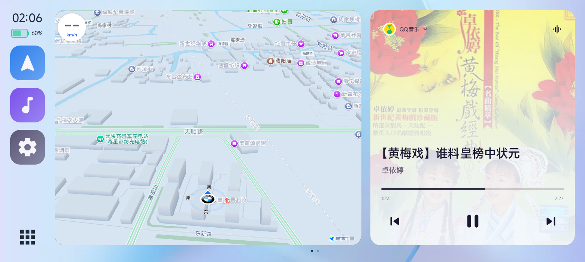

# HyperCar

当前自绘车机 UI 方案：Android 手机通过 CarPlay / AirPlay 向车机投送高德地图和音乐卡片，支持设置、主题壁纸、更多音乐应用及保持连接返回车机系统。

> **开发分支：[feat/carplay-only-ui](https://github.com/fw867/hypercar/tree/feat/carplay-only-ui)**。
> 下方截图和新版功能对应此分支；`main` 仍保留较早的 CarLife 网关代码。
> 编译、安装和当前功能说明请阅读 [开发分支 README](https://github.com/fw867/hypercar/blob/feat/carplay-only-ui/README.md)。

## 界面预览

以下为 2026-10-29 从手机本地构建 0.1.0.377 的车机虚拟屏直接采集的截图，使用 WinPlay 联调。
截图展示白天主题；实际布局会随接收端显示区域调整，地图和音乐内容为截图时的状态。

### 车机首页

高德地图预览与音乐双卡片，左侧 Dock 提供地图、音乐和设置入口，左下角切换更多应用。



### 车机设置

支持导航自动巡航、默认音乐 App、连接自动播放，以及白天／暗夜／自动主题和三套壁纸。
设置页可上下滚动，下方两张截图分别展示其上半部分和主题／壁纸区域。


### 更多应用

自动显示手机已安装且受支持的音乐 App，点击图标切换播放器；“返回车机”固定放在最后，
请求接收端切回原生系统界面并保持 CarPlay 连接。


## 当前 UI 文档

- [功能、环境要求与本地构建](https://github.com/fw867/hypercar/blob/feat/carplay-only-ui/README.md)
- [界面、设置、持续导航与音频投送](https://github.com/fw867/hypercar/blob/feat/carplay-only-ui/docs/CARUI-REDESIGN.md)
- [分辨率兜底、帧率与推流检查](https://github.com/fw867/hypercar/blob/feat/carplay-only-ui/docs/VIDEO-STREAM-REVIEW.md)

## 早期 CarLife 网关实现记录

以下为 `main` 分支早期实现的说明，其 CarLife 依赖和部署方式不适用于上方的自绘 UI 开发分支。

**CarLife → AirPlay 零转码网关**：把手机上 CarLife 系应用（百度 CarLife、小米 CarWith、
荣耀车联等）产出的 H.264 与 PCM，经 **Rust 核心层**零转码直推任意 AirPlay 接收端
（宝马车机、Audi MIB3、WinPlay、其它 AirPlay 1/2 接收端）。


- **手机侧**只要求它跑的是 CarLife 协议栈（iAP2 + 那 6 个标准端口）。**当前版本必须用公版
  百度 CarLife+**（`com.baidu.carlife`）：只有它的 `isCarLifeApp()==true`，会走
  `ScreenCarlifeImpl` **自己渲染车机界面**（地图/音乐/Dock + 触摸全部由 CarLife 负责），
  我们这边零 UI 代码。小米定制版（`com.baidu.carlife.xiaomi`）永远把编码面交给宿主，拿不到原生界面。
- **车机侧**只要求它是 AirPlay 接收端；不同车机的行为差异（是否校验 deviceID、
  发不发 `0x4301`、端口怎么找、触摸报告几字节/指……）全部收敛在
  [车机档案](#车机档案按型号适配)里，加型号不改主流程。

## 必需环境（缺一不可，App 启动连接前会自动检测）

| 条件 | 为什么必须 | 缺失时 |
|---|---|---|
| **Shizuku 已启动并授权**（**仅当装了小米定制版 CarLife 时必需**：它只管冻结小米版；没装小米版时会自动跳过，用普通 startActivity 拉起公版） | 只有 shell 身份能做三件事：① `pm disable-user com.baidu.carlife.xiaomi` 冻结小米定制版（否则 CarWith 会不停把它拉起来、抢走 7240，公版永远拿不到会话 → 母帧/闪屏）；② `am start` 拉起公版 CarLife 的 Activity（它的 `Presentation` 必须挂在 Activity 上）；③ 静默入网 / 读取真实蓝牙 MAC | 日志 `ENV: ✗ 环境未就绪：Shizuku 未启用…`，连接直接不开始 |
| **已安装公版「百度 CarLife+」**（`com.baidu.carlife`，应用宝可下） | 只有公版会自己渲染车机界面（见上）；小米定制版没有原生界面 | 日志 `ENV: ✗ 环境未就绪：未安装公版 CarLife…`，连接直接不开始 |

- 小米定制版可以存在（系统预装），程序在会话开始时**自动冻结它**、断开时**自动恢复**
  （`pm enable --user 0 com.baidu.carlife.xiaomi`），不影响你之后用 CarWith 连盒子。
- 没有 Shizuku 的降级模式（`WifiNetworkSpecifier` + 伪 MAC）只能连上 AirPlay，
  **出不了 CarLife 车机界面**，所以本版本把它判定为"环境未就绪"。
- 细节与反编译证据见 [docs/NEGOTIATION-GAPS.md](docs/NEGOTIATION-GAPS.md) §0 / §27。


## 两种部署形态（协议逻辑同一份）

```
① 本机 HU（真车 / 手机自己当车机）——当前主线
   公版 CarLife（自渲染界面）──127.0.0.1──▶ hypercar_core(Rust, 在手机里) ──车机热点──▶ 车机 AirPlay
        触摸 ◀── 车机 HID ──────────────────────┘        同一套协议栈        （BMW / Audi / …）

② 盒子角色（PC 联调 / 没有真车时）
   CarLife ◀──Wi-Fi── hypercar-hub(PC，当车机) ──127.0.0.1──▶ WinPlay
                        同一套协议栈                    （任意 AirPlay 接收端）
```

> 连接方向不是写死的：**同机**时 HU 监听 `127.0.0.1:7240…`、MD 连入；
> **盒子角色**（小米 CarWith「车辆热点 → 开始连接」实测）反过来是 **MD 监听**、
> HU 逐个端口拨过去。两条路径分别对应 `CarLifeHub::start` / `CarLifeHub::connect`，
> 见 [docs/CARLIFE-PROTOCOL.md](docs/CARLIFE-PROTOCOL.md)。

## 首次使用（手机上要做的三件事）

1. **装 Shizuku 并启动**（设置 → Shizuku 状态 → 启动/授权）。本 App 靠它冻结小米定制版、
   拉起公版 CarLife、静默入网。
2. **装公版「百度 CarLife+」**（`com.baidu.carlife`，应用宝搜 CarLife）。
3. **车机端开始接收**（iDrive 里把本机选成 CarPlay 手机 / PC 联调先开 WinPlay）→
   手机点「启动连接」。首次成功后同一台车会自动回连。

App 在每次「启动连接」最前方会做环境检测（`ENV: ✓ / ✗`），缺 Shizuku 或公版 CarLife 时
直接失败并给出补齐方式，不会带着错误前提去握手。

## 车机档案（按型号适配）

车机侧的差异用「档案」表达，设置页可切换，内置四种：

| 档案 | 状态 | 关键差异 |
|---|---|---|
| **BMW iD8.5**（MGU-86 / MGU-55） | 真车实测 | 车机从不发 `0x4301`、从不回 `0xEA03`；端点靠 ctrl 邀请 + mDNS；失败要保活 iAP2 |
| **通用（0.27）**（任意车机 / 未知车型） | 0.27 宝马实测 + cardeck 通用序列 | `0x4300`/`0xEA00`/`0x4E0E` 全发、出站前断 HFP/A2DP、不主动拆链；端点 mDNS 优先、拿不到退 7000；`0xAE00` 回 3 条 `0xAE01`。不知道选哪个就先选它 |
| **WinPlay**（PC AirPlay 接收端） | 实测 | 校验 `deviceID`（SETUP 必须带真实蓝牙 MAC）；控制面固定 7000；同时进入「只保 iAP2」模式 |
| **Audi MIB3**（3315） | **未实测** | 会发 `0x4301`（可能晚到 2 分钟以上）；控制会话 id=1；触摸为 5 字节单指 |

加新品牌有两条路：

1. **改配置（推荐，不用发版）**：仓库 [`profiles/headunits.json`](profiles/headunits.json) 是车型下发文件，
   补一条 JSON + push，用户在手机上点「车机型号 → 从 GitHub 更新车型列表」就能拿到新车型。
   远程同 id 会覆盖内置档案，所以内置档案配错了也能这样修。
2. **改代码**：加一个 `HeadUnitProfile` 常量 + 注册表一行（改协议行为时才需要）。

字段含义、实测校准步骤、症状→字段对照、远程下发格式见
[docs/HEADUNIT-PROFILES.md](docs/HEADUNIT-PROFILES.md)（§2 加档案 · §5 远程下发）。

## 特性

- **不自绘车机界面**：画面完全由 **CarLife 自己渲染**（公版 `ScreenCarlifeImpl` →
  `CarlifePresentation` → 它自己的编码器），我们只做「8240 取帧 → AirPlay 推流」；
  触摸也是「车机 HID → CarLife 的 CTRL 通道(9340) → 它自己点自己的界面」。
  砍掉了 VirtualDisplay / EGL 双屏合成 / 自绘桌面，手机不额外发热。
- **协商整体下沉 Rust**（/info → pair-verify → RTSP SETUP → RECORD → 三条心跳），
  Kotlin 只交「绑定车机网络的 socket FD」——协商状态机一份实现，见
  [docs/NEGOTIATION-GAPS.md](docs/NEGOTIATION-GAPS.md)。
- **上车秒连**：车机蓝牙 ACL 连上 → 清单静态接收器冷启动进程 → FGS(connectedDevice)
  → iAP2 协商 → 静默加入车机热点（Shizuku 可用时零弹窗）→ Rust 自动协商。
- **零转码数据面**：H.264 Annex B 拆 NAL → avcC/VideoConfig → ChaCha20-Poly1305 封帧；
  PCM 重采样 48k + TTS 闪避混音 → RTP（352 SPF / SSRC=0 / 大端 PCM）。
- **双向控制**：车机触摸 → `CarlifeTouchAction` **protobuf**（0x68001）、
  旋钮/方向盘键 → 硬按键（0x68008）、宝马 HUD 导航报文（iAP2 0x5200）。
  触摸报告两种布局（每指 6 字节 / 奥迪 5 字节）按长度自适应。
- **语音助手麦克风**：CarLife 的语音识别要求「车机」供麦，本机 HU 用手机麦克风
  采集经 VR 通道（`VR_MIC_DATA 0x58001`）推给 MD；也可在车机端设置里切到
  「手机麦克风录音」由 CarLife 自己录。
- **可调编码分辨率**：设置页直接填宽/高（默认 2560×744），手机回报实际尺寸后自动跟随。
- **按车机型号配置**：设置页切换档案，切换时自动把「目标车机」重置为自动发现，
  避免带着上一台车机的名字连不上。
- **协议对齐真机**：用真 iPhone 的 HCI 抓包逐条对照（iAP2 报文清单、`/info` 方法、
  链路存活），差异都在文档里可追溯。
- **现代 UI**：Compose 深空黑 + 电光青 + 玻璃拟态，状态大卡 + 2×2 状态芯片 +
  实时步骤 + 免 adb 诊断日志，内置「首次连接」引导。

## 目录

```
app/           Android 应用（Kotlin + Compose）：薄壳、iAP2 协商、WiFi/秒连、UI
rust-core/     Rust 核心层（cdylib）：AirPlay 协商 + CarLife 网关 + 零转码推流
rust-core/hub/ PC 侧可执行 HU（独立 crate，复用同一套协议源码，不含 JNI）
               双击即开原生 Win32 参数面板（GUI）；带参数启动仍是命令行
tools/         本地构建脚本 + 预编译的联调工具（hypercar-hub.exe）
profiles/      车型下发配置（headunits.json）：新增车机改这里，不用发版
docs/          架构、CarLife 协议、协商对比、编译指南、车机档案、**iPhone 抓包手册**
```

## 文档

| 文档 | 讲什么 |
|---|---|
| [docs/ARCHITECTURE.md](docs/ARCHITECTURE.md) | 整体架构、数据面/控制面分工 |
| [docs/CARLIFE-PROTOCOL.md](docs/CARLIFE-PROTOCOL.md) | CarLife 六个端口、握手阶段、消息 ID |
| [docs/NEGOTIATION-GAPS.md](docs/NEGOTIATION-GAPS.md) | AirPlay 协商差异、真车实测、真 iPhone 对照 |
| [docs/CARDECK-ALIGNMENT.md](docs/CARDECK-ALIGNMENT.md) | 与 cardeck 参考实现的差异对照（身份模型/配对/蓝牙/iAP2/AirPlay） |
| [docs/HEADUNIT-PROFILES.md](docs/HEADUNIT-PROFILES.md) | 车机档案字段、**新增品牌四步走**、**远程下发（改 JSON 不发版）** |
| [docs/IPHONE-HCI-CAPTURE.md](docs/IPHONE-HCI-CAPTURE.md) | **iPhone HCI 抓包手册**（描述文件 → sysdiagnose → .pklg） |
| [docs/BUILD.md](docs/BUILD.md) | 编译环境、本地出包、CI 标记 |
| [docs/ARCHIVE-CARWITH-XIAMI.md](docs/ARCHIVE-CARWITH-XIAMI.md) | **存档**：小米 CarWith / 小米定制版 CarLife 路线（已放弃）的反编译结论与四道门 |

## 快速开始

见 [docs/BUILD.md](docs/BUILD.md)。本机已装好工具链时：

```powershell
# 一次出两样：手机 APK + PC 侧 hypercar-hub.exe（自动覆盖 tools\）
pwsh -File tools\build-local.ps1 -Release -BuildNumber <N>
# 只改 Kotlin（跳过所有 Rust 构建）
pwsh -File tools\build-local.ps1 -Release -SkipRust
```

PC 侧联调工具：

```
双击 tools\hypercar-hub.exe
  → 原生窗口：自动经 adb 填 device-id / 手机 IP，可改参数、看实时日志
  → 点「启动」跑 headless 子进程（无控制台窗口），日志流回窗口
```

也可以纯命令行（参数全部可省略，会自动检测/用上次缓存）：

```powershell
# WinPlay 需先点「开始接收」，它才监听 17000
.\tools\hypercar-hub.exe --airplay 127.0.0.1:17000 --touch-display 2732x794 --voice 0
```

> - `--device-id` 省略时按 adb → 缓存取值；**必须等于接收端「目标蓝牙设备」的 MAC**
>   （WinPlay 逐字符比对，不一致直接 403）。
> - `--touch-display` 是接收端的 HID 像素空间（它 `/info` 报 `0x0` 时用）。
> - `--voice 0` = HU 不提供麦克风（PC 上没有麦克风来源）。
> - 配置/身份缓存在 `%LOCALAPPDATA%\hypercar-hub\`，**不会写进仓库**。

## 已知限制

- **必须装公版 CarLife、必须开 Shizuku**（见 [必需环境](#必需环境缺一不可app-启动连接前会自动检测)）。
  小米定制版即使存在也会被自动冻结（断开即恢复），所以不会影响你之后用 CarWith 连盒子。
- **连接时公版 CarLife 的界面会短暂出现在手机上**：CarLife 自渲染的 `Presentation` 必须挂在它自己的
  Activity 上，所以我们得先 `am start` 它的 Activity；画面起来后它退到后台继续编码，车机画面不受影响。
- **部分 ROM 会把后台录音静音**：小米 HyperOS 把 CarWith 的 `RECORD_AUDIO` 锁在
  `foreground` 模式，语音助手在后台录音时拿到全静音数据（不报错但不响应）。
  真车请用「车机麦克风」让本 App 供麦（它跑前台服务）。
- **接收端与 HU 连接强绑定**（WinPlay 这类 PC 接收端）：控制连接一断它就结束接收，
  所以顺序是「先开始接收 → 再起 hub」，hub 重启需要重新点一次接收。
- **Audi MIB3 档案未实车验证**：只按历史记录配了已知差异，首次上车需按
  [docs/HEADUNIT-PROFILES.md](docs/HEADUNIT-PROFILES.md) 的症状表逐项校准。

## 合规

- 基于 [shaonialife/cardeck](https://github.com/shaonialife/cardeck) 的协议研究成果重构
  （其协议笔记与坑位记录来自真车实测）。
- 「CarLife」为百度商标，本项目仅个人研究用途；CarLife 接收端协议参考了
  apollo-DuerOS（Apache 2.0）与 CarLifeWirelessBox（MIT）的公开资料。


