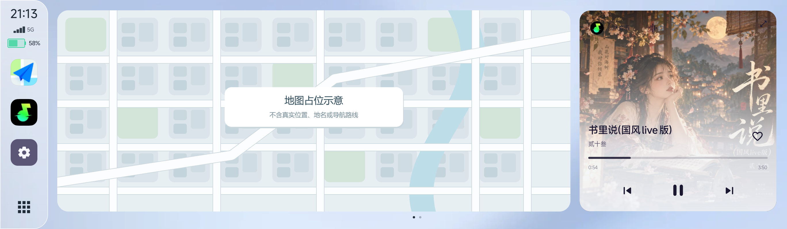
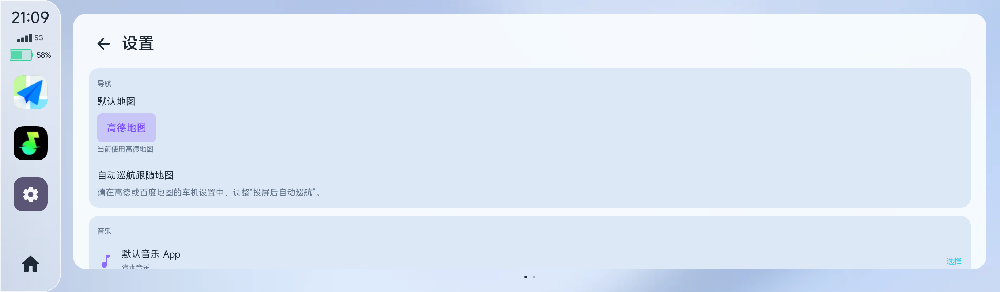
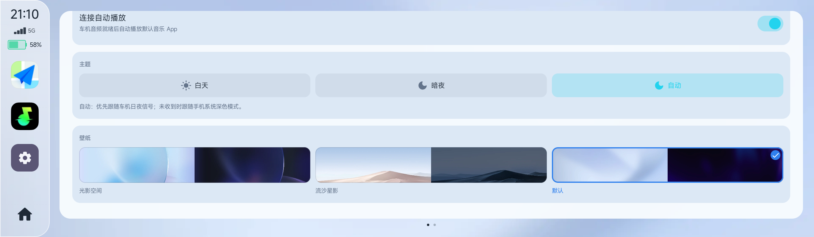
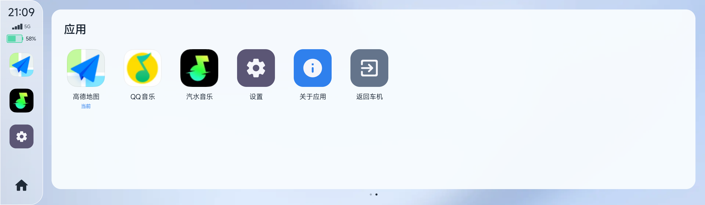

# HyperCar

让 Android 手机连接无线 CarPlay 车机，将地图、音乐和应用画面送到车机屏幕，并转发声音与触摸操作。支持 **自绘车机 UI** 和 **小米 CarWith** 两种画面来源，无需 root。

[下载 APK](https://github.com/fw867/hypercar/releases/latest) · [使用与开发文档](docs/README.md) · [验证范围](docs/VALIDATION.md) · [反馈问题](https://github.com/fw867/hypercar/issues)

目前以 BMW MGU / iD8.5 为实车开发基准，并提供大众、奥迪、奔驰、BMW ID9 等车机档案。**提供档案不等于所有车型和功能均已实测**，具体状态见下方兼容表。

## 主要功能

- **两种画面来源**：自绘 UI 提供地图、音乐卡片与 Dock；CarWith 模式转发系统 CarWith 的界面与音频。
- **地图与导航**：自绘 UI 支持已安装的高德、百度地图；首页卡片可触摸拖动，通过 Dock 地图图标进入全屏。卡片与全屏复用地图任务，短时断开保留地图进程；高德结构化数据可用于卡片导航提示。
- **音乐控制**：显示播放器提供的专辑封面、播放状态，支持播放/暂停、切歌及播放器允许的收藏操作，也可打开播放器界面。可选择默认音乐 App 和连接自动播放。
- **声音转发**：提供「自动」「PCM」「AAC 优先」，CarWith 与自绘 UI 共用输出链路。AAC 需接收端声明支持，已有 DiPlay 出声测试。
- **自动连接与唤醒**：支持目标车机、增强发现、待机通知、首页自动连接快捷开关及有界断线恢复。
- **外观与诊断**：手机 App 支持深色、HyperOS 风格浅色和跟随系统；连接阶段、推流参数与日志导出用于排查问题。

方向盘媒体键与语音转发已实现，具体按键取决于车机报告及当前来源；车机麦克风与 HUD 属于实验功能，见下方说明。

## 车机档案与兼容状态

在「设置 → 我的车机」选择档案及目标设备。内置档案离线可用，也可在 App 中更新远程档案；远程更新可调整兼容策略，新增原生功能仍需更新 App。

| 设置中的档案 | 适配对象 | 当前状态 |
|---|---|---|
| **BMW** | MGU-86 / MGU-55，以 iD8.5 为实车基准 | 有 CarWith、自绘音画成功记录；回连后无法进入桌面的问题仍在排查 |
| **BMW ID9** | IDC23 / ID9 | 独立实验档案，尚未完成实车音画验证 |
| **大众 Volkswagen** | VW4131 / VW4211，参考 ID.7、帕萨特 2025 | 有用户连接成功反馈；无声恢复、方向盘按键与语音仍需实车验证 |
| **Audi MIB3** | MMI 6318 / 9310 / 3315 参考配置 | 已实现握手适配，尚未完成本项目实车验证 |
| **奔驰 Mercedes-Benz MBUX** | MBUX 参考配置 | 实验适配；存在屏幕 SETUP 拒绝记录，音画待验证 |
| **通用配置（0.27 基线）** | 未单独适配的接收端 | 供未知车型尝试，不代表全部车机可用 |
| **WinPlay** | PC 接收端 | 用于媒体、触摸和会话联调；DiPlay 也已有联调记录，但无独立内置档案 |

BMW 的不同硬件平台不能只按 iDrive 名称判断；IDC23 使用独立的 BMW ID9 档案。PC 接收端测试结果不能代替实车兼容性验证。

## 手机要求与画面来源

- **Android 12 及以上、arm64-v8a** 手机。
- 车机支持无线 Apple CarPlay，手机蓝牙与 Wi-Fi 保持开启。
- 按首页引导完成必需权限；后台运行、静默入网及系统音频采集能力受 ROM 和应用限制。

| 画面来源 | 必需条件 | 画面与设置 |
|---|---|---|
| **自绘车机 UI** | 安装、启动 Shizuku，并成功授权 HyperCar；安装所需地图和音乐 App | HyperCar 渲染首页；车机内可设置默认地图、音乐、自动播放、日夜主题与壁纸 |
| **CarWith** | 系统已安装并启用小米 CarWith（`com.miui.carlink`） | 使用 CarWith 自身界面；不强制要求 Shizuku，画面尺寸在系统 CarWith 中设置 |

CarWith 是否可用取决于系统是否提供该组件，不仅取决于手机品牌。部分静默入网、蓝牙回连辅助仍依赖 Shizuku 或系统授权。

## 首次使用

1. 从 [Releases](https://github.com/fw867/hypercar/releases/latest) 下载 APK 安装，打开 HyperCar，按首页引导授予附近设备、通知等必需权限。Android 12 / 12L 还需定位权限与定位服务。
2. **明确选择画面来源**。自绘 UI 必须先完成 Shizuku 授权；未安装时，App 提供下载入口。CarWith 需检测到可用系统组件。条件满足后才允许开始连接。
3. 在「我的车机」选择合适档案和目标车机，完成系统蓝牙配对，并在车机侧选择该手机、确认 Apple CarPlay 授权。部分车机首次需要手动加入车机 Wi-Fi。
4. 自绘 UI 使用前，先在手机地图、音乐 App 中完成初始化。音乐封面和控制需授予系统「通知使用权」。
5. 需要自动上车时，授予悬浮窗权限并开启「上车自动连接」（新安装默认关闭）；按系统要求设置自启动和电池优化。Android 13+ 可为目标车机授权增强发现。
6. 连接后分别确认车机桌面、声音和触摸。诊断中的「控制已连接」或视频写帧增长，不等于车机已进入 CarPlay 桌面。

无互联网的车机热点按局域网方式连接时，HyperCar 绑定车机网络，其他 App 使用系统默认网络；实际入网授权与移动数据可用性仍取决于系统设置。

## 设置入口

| 分类 | 主要内容 |
|---|---|
| **我的车机** | 车机档案、远程档案更新、目标设备与增强发现 |
| **连接与唤醒** | 上车自动连接、待机通知、蓝牙回连唤醒、CarPlay 蓝牙身份广播、中断恢复与画面资源联动 |
| **画面与声音** | 画面来源、CarWith 设置快捷入口、分辨率与帧率、音频转发、音频格式及麦克风实验开关 |
| **主题与外观** | 手机 App 深色、浅色、跟随系统；仅改变手机 App，车机界面主题在车机内设置 |
| **权限与后台** | 系统权限、通知使用权、后台运行与 Shizuku 授权 |
| **高级设置** | 手动蓝牙地址及配对身份清理 |

诊断页提供会话信息与日志导出。自绘 UI 内的地图、音乐、日夜主题和壁纸通过车机界面的设置入口调整。

### 显示与声音

- **分辨率**：优先采用车机上报尺寸；未上报时使用设置中的兜底值，默认 **1920×1080**。CarWith 的源分辨率需通过「打开 CarWith 设置」调整。
- **帧率**：可在「画面与声音」选择；实际输出取决于画面更新、编码器和接收端能力，静止地图不一定持续满帧率。
- **拉伸铺满**：当前设置项暂时停用，视频按实际编码尺寸发送。
- **音频格式**：自动模式保留已有 PCM 兼容策略，ID9 按能力选择；AAC 优先在车机支持时使用。音频格式与画面来源分别设置。

### 自动连接与实验功能

- **首次连接**：BMW 等要求本轮激活的档案等待车机邀请或本轮 iAP2 端点；已配对、连上热点或端口可达，均不能代替授权。
- **车机 Wi-Fi 中断恢复**：默认关闭。由车机发起的本次会话已有视频发送和 TCP 确认，意外断开后才开放 **2 分钟、最多 5 次**恢复窗口。首次在网络可用后立即尝试，失败后退避；超时重新等待邀请，失败不能自行补次数。
- **主动停止**：开启自动连接时，主动停止会暂停自动连接 10 分钟，手动启动可解除暂停；手动重新开始不会继承主动恢复资格。
- **画面资源联动**：按车机屏幕资源变化建立或释放视频通道，保留音频和控制；部分档案会强制启用。
- **车机麦克风**：两个实验开关默认关闭。自绘模式只测试收音、不保存录音、不接入助手；CarWith 模式对接内置语音取音。真实收音、识别和长期稳定性仍待实车验证。
- **HUD / 仪表导航**：已有导航数据接入与订阅转发，需要车机实际订阅和支持；尚不能承诺 HUD 显示正常。详见[导航说明](docs/NAVIGATION.md)。

## 界面示例

以下截图来自当前自绘 UI。首页地图区域已用代码替换为不含真实位置、地名和导航路线的占位图，其余 UI 保留实际截图；占位图不代表地图的实际渲染样式。



<details>
<summary>更多界面示例</summary>







</details>

## 构建与开发

Kotlin / Compose 管理界面、蓝牙、网络与会话；Shizuku 为自绘模式提供虚拟屏、触摸注入和系统播放采集；Rust 负责 AirPlay 控制、H.264、PCM / AAC 和实验麦克风链路。

需要 JDK 17、Android SDK 35、NDK r27c、Rust 和 cargo-ndk。Windows 可使用仓库脚本构建调试包：

```powershell
pwsh -File tools\build-local.ps1

# 仅修改 Kotlin / 资源，且已有对应原生库时
pwsh -File tools\build-local.ps1 -SkipRust
```

正式签名、版本号、测试和安装见[构建说明](docs/BUILD.md)。CarWith 的 CarLife 通道、认证及加密流程见[画面来源说明](docs/CARWITH-SOURCE.md)。

| 目录 | 内容 |
|---|---|
| `app/` | Android 界面、会话、蓝牙、网络及自绘 UI |
| `rust-core/` | AirPlay 控制与媒体核心 |
| `profiles/` | 远程车机档案 |
| `tools/` | 构建和诊断工具 |
| `docs/` | 使用、协议、适配与验证说明 |

## 文档与反馈

从[文档索引](docs/README.md)进入完整说明；排查连接看[连接诊断](docs/HANDSHAKE-DIAGNOSTICS.md)，实际通过范围看[验证记录](docs/VALIDATION.md)，参考项目见[参考资料](docs/REFERENCE-REVIEW.md)。

反馈问题时请提供 App 版本、车机型号与档案、画面来源、是否首次/重连，以及操作现象和对应日志。分享前请移除日志中的设备标识、Wi-Fi 信息、路线和认证内容。

项目用于协议研究与互操作实验，按 [GPL-3.0](LICENSE) 开源，与 Apple 及各车厂、地图和音乐服务商无隶属关系。CarPlay、AirPlay 等商标归各自权利人所有。
