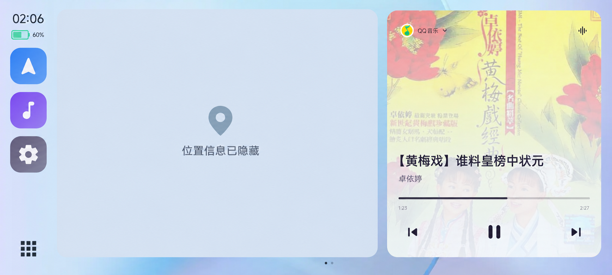
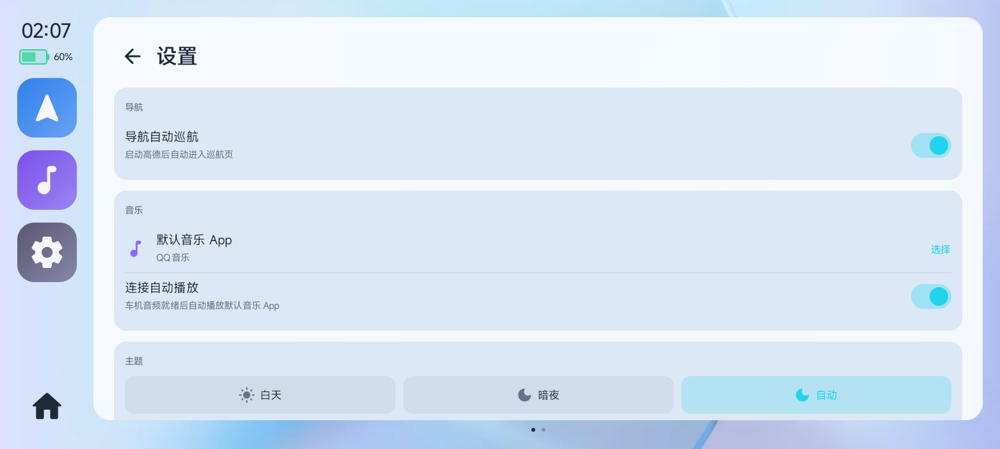
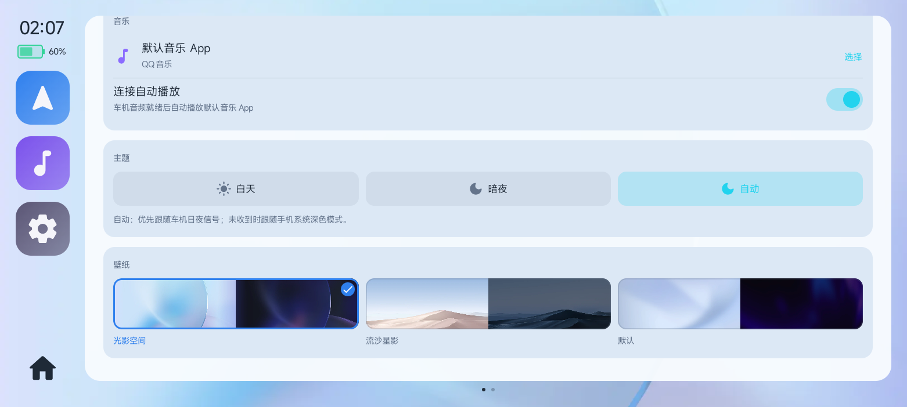
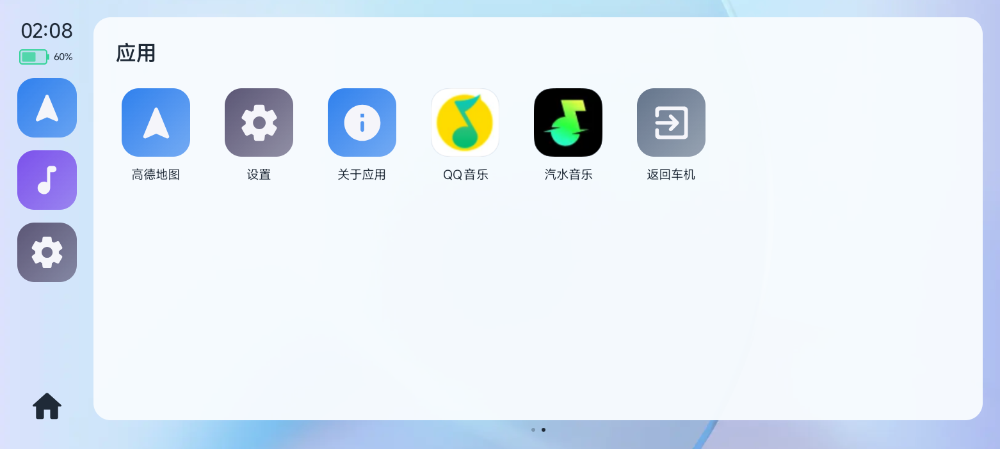

# HyperCar

让 Android 手机通过 **CarPlay 协议**（蓝牙 iAP2 协商 + Wi-Fi AirPlay 投屏）变成宝马车机等
AirPlay 接收端的内容源：手机自己绘制车机界面、自己编码画面和音频，不依赖 CarLife、CarWith
或 PC 侧 hub，也不需要 root。

> 当前主线只保留 **CarPlay / AirPlay** 一条链路，面向宝马 MGU-55 / iD8.5 实测开发，
> 同时保留 WinPlay、Audi MIB3 等接收端的车机档案。

## 界面预览

以下为 2026-10-29 从手机本地构建 0.1.0.377 的车机虚拟屏直接采集的截图，使用 WinPlay 联调。
截图展示白天主题；实际布局会随接收端显示区域调整。首页地图区域已替换为隐私占位图，隐藏真实道路、地标和定位信息；音乐内容为截图时的状态。

### 车机首页

高德／百度地图预览与音乐双卡片，左侧 Dock 提供默认地图、音乐和设置入口，左下角切换更多应用。



### 车机设置

支持默认地图选择（高德／百度）、导航自动巡航、默认音乐 App、连接自动播放，以及白天／暗夜／自动主题和三套壁纸。
设置页可上下滚动，下方两张截图分别展示其上半部分和主题／壁纸区域。





### 更多应用

自动显示手机已安装且受支持的音乐 App，点击图标切换播放器；“返回车机”固定放在最后，
请求接收端切回原生系统界面并保持 CarPlay 连接。



## 形态

```
手机（Android / HyperOS）
 ├─ D1 自绘车机首页（Shizuku 创建虚拟屏）
 │    ├─ 地图卡片：高德巡航预览
 │    ├─ 音乐卡片：封面 / 歌名 / 进度 / 播放控制 / 切换音乐 App
 │    ├─ 左侧竖向 Dock + 设置 / 更多应用页
 │    └─ 实时触摸、左下角应用 / 首页切换
 ├─ D2 高德全屏（同一高德任务，卡片 ↔ 全屏切换不打断导航）
 ├─ Rust 核心：AirPlay 协商 + H.264 / PCM 推流、触摸回传
 └─ 音频：系统播放采集 48kHz 双声道 → AirPlay，不占麦克风
```

车机侧只需要支持 **无线 Apple CarPlay**；首次在车机屏幕确认一次，之后同一台车自动回连。

## 功能

- **自绘车机首页**：白天／暗夜／自动主题、三套日夜壁纸、地图卡片、音乐卡片和大触摸区域 Dock；
  超宽屏适当收窄音乐卡片，为地图留出更多空间。地图卡片和全屏共用同一个所选地图任务，支持高德与百度的 UCAR 车联入口。
- **车机设置与更多应用**：设置默认地图（高德／百度）、导航自动巡航、默认音乐 App、连接自动播放、主题和壁纸；
  更多应用只列出已安装的受支持音乐 App，自动换行并支持滚动。
- **返回车机系统**：更多应用最后的“返回车机”通过 AirPlay `requestUI` 请求切回原生系统页面，
  保持 CarPlay 会话和音频通道；接收端需支持该命令。
- **高德全屏**：D2 独立虚拟屏，高德按车机横屏布局；顶部下滑或右侧中间的悬浮主页按钮退出，
  退出后首页和高德任务都保留。
- **音频直通**：Shizuku 下的 `AudioRecord` / REMOTE_SUBMIX 采集系统播放的 PCM，
  经 Rust 重采样/混音后通过 AirPlay 推送；支持 QQ 音乐、汽水音乐、网易云、酷狗、酷我、
  Spotify、Apple Music、咪咕音乐等标准 MediaSession 播放器。
- **音乐卡片**：真实封面、歌名、进度和上一首/播放/下一首；左上角图标可切换已安装的音乐 App，
  切换时自动暂停并关闭上一个播放器。
- **实时触摸**：车机 HID → Rust → D1/D2，地图拖动为异步流式注入，跟手不积压。
- **锁屏不冻结**：虚拟屏使用独立显示组 + 常亮/解锁标志，会话期持有 CPU partial wake lock；
  保持车机 UI 在锁屏／熄屏期间运行，实际帧率取决于设置、设备和接收端。
- **断连暂停与续播**：真正断连时先暂停正在播放的音乐；重连且音频采集就绪后再恢复。
  车机设置开启“连接自动播放”后，可在音频就绪时播放默认音乐 App。
- **分辨率与帧率**：优先读取车机 `/info` 的 `widthPixels/heightPixels`，兼容旧 `width/height`；
  未上报或尺寸无效时，使用手机设置页的宽高兜底。当前编码会等比缩小到最大宽 1920、高 1080、
  约 110 万像素；默认 30 fps，可手动选 60 fps，修改后下次连接生效。显示区域尺寸与实际编码尺寸不同。
- **自动连接**：车机蓝牙 ACL 连上手机后冷启动前台服务，完成 iAP2 协商、入热点、AirPlay 建链。

## 环境要求

- Android 12+（HyperOS / MIUI 实测；其他 ROM 未验证）。
- **Shizuku**：创建 D1/D2 虚拟屏、注入触摸、拉起高德/音乐 App 需要 shell 权限。
- **通知使用权**：音乐卡片读取 MediaSession 需要。
- 车机支持无线 CarPlay（BMW MGU-55 / iD8.5 为当前实车基准）。

没有 Shizuku 时应用仍可启动和连接，但自绘车机界面无法创建，属于降级模式。

## 构建

```powershell
# 完整构建（Rust + APK）
powershell -File tools\build-local.ps1 -Release -BuildNumber <N>

# 只改 Kotlin，跳过 Rust
powershell -File tools\build-local.ps1 -Release -SkipRust -BuildNumber <N>
```

产物：`app/build/outputs/apk/release/app-release.apk`。

本仓库不再包含 PC 侧 hub / 抓包工具；联调直接用手机 + 任意 AirPlay 接收端。

## 目录

```
app/             Android 应用（Kotlin + Compose）：会话、蓝牙 iAP2、WiFi、自绘 UI
  carui/         D1 首页、D2 高德、音乐卡片、音频采集、悬浮主页按钮
  spike/         Shizuku 建屏 / 编码器 / 触摸注入的底层封装
rust-core/       Rust 核心（cdylib）：AirPlay 协商、H.264/PCM 推流、触摸通道
tools/           本地构建脚本（build-local）
profiles/        车机档案远程下发配置
docs/            架构、编译、车机档案、P1/P2 说明
```

## 文档

| 文档 | 内容 |
|---|---|
| [docs/BUILD.md](docs/BUILD.md) | 编译环境、出包、安装 |
| [docs/ARCHITECTURE.md](docs/ARCHITECTURE.md) | 当前自绘 UI、地图、音频和 Rust 协议层架构 |
| [docs/P1-CARUI.md](docs/P1-CARUI.md) | D1 自绘首页、触摸、编码器 |
| [docs/P2-MAP.md](docs/P2-MAP.md) | D2 高德、卡片/全屏切换、触摸注入 |
| [docs/CARUI-REDESIGN.md](docs/CARUI-REDESIGN.md) | 当前界面、截图、设置、导航与音频投送 |
| [docs/VIDEO-STREAM-REVIEW.md](docs/VIDEO-STREAM-REVIEW.md) | 分辨率协商、等比缩放、帧率与码流修复记录 |
| [docs/HEADUNIT-PROFILES.md](docs/HEADUNIT-PROFILES.md) | 车机档案字段与新增车型 |

## 已知限制

- 实车验证以 BMW MGU-55 为主；Audi MIB3 等档案仍属未实测。
- 接收端未提供有效像素尺寸时，触摸空间由车机档案或设置宽高兜底；应与接收端实际配置一致。
  WinPlay 已按 `widthPixels/heightPixels` 正确读取，不能把历史联调的 2732×794 当作宝马固定规格。
- 偶发红绿斑块已修复一处明确风险：不再随机丢弃编码后的 H.264 预测帧，切源后等待关键帧；
  仍需在具体车机上长期复测，尚不能据此认定所有花屏原因均已排除。
- 音频采集依赖系统 REMOTE_SUBMIX 路由，部分 ROM 对后台录音有限制。
- 高德为安装版车机模式，升级高德后窗口配置/入口可能需要复验。

## 合规

仅个人研究用途，与宝马、百度、高德无隶属关系。CarPlay、AirPlay 为 Apple 商标。
