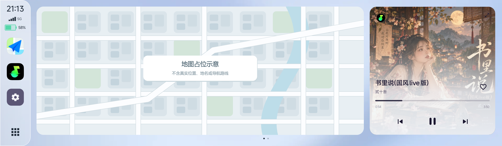
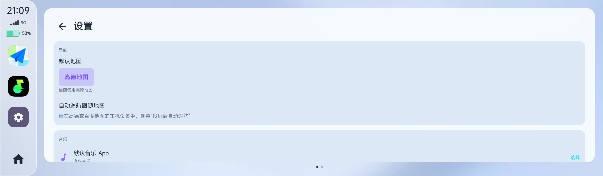
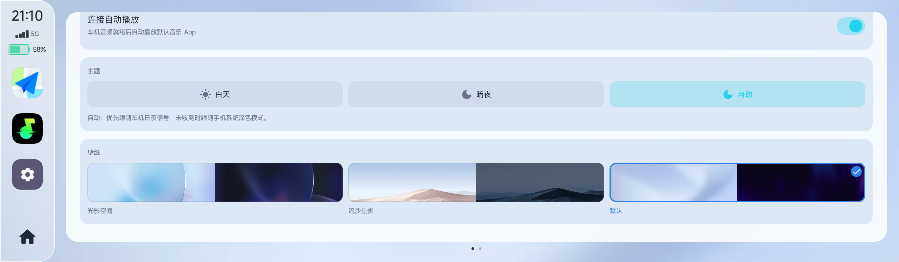
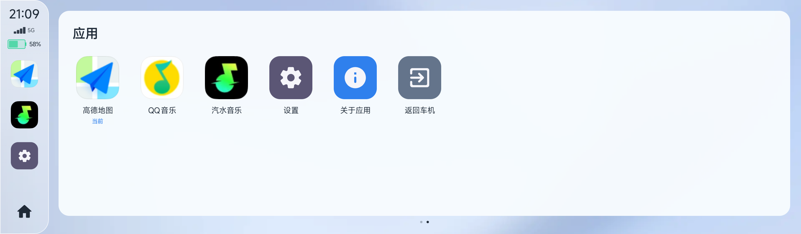

# HyperCar

让 Android 手机连接无线 CarPlay 车机或雅迪仪表，将地图、音乐和应用画面送到车机屏幕，并转发声音与触摸操作。无线 CarPlay 支持 **自绘车机 UI**、**小米 CarWith** 和 **系统 CarLife+** 三种画面来源。雅迪仪表支持 CarWith 和 CarLife+ 导航投屏，可在手机预览上操作。

[下载 APK](https://github.com/fw867/hypercar/releases/latest) · [使用与开发文档](docs/README.md) · [验证范围](docs/VALIDATION.md) · [反馈问题](https://github.com/fw867/hypercar/issues)

## 注意事项

1. **反馈问题请附上故障现场日志。** 在 [GitHub Issues](https://github.com/fw867/hypercar/issues) 提交反馈时，请完整描述故障现象，包括 App 版本、车机型号与档案、画面来源、复现步骤和具体报错。故障发生后，请立即从 HyperCar 的「诊断」页导出txt日志，并附在 Issue 中。无完整日志的Issues无法定位故障会直接关闭。
2. **宝马二次上车提示连接失败时，可保留配对重连。** 在车机的「移动设备」设置中点击「连接新设备」，等列表出现手机名称后，点选该手机。这一步可触发车机重新发送 CarPlay 邀请，车机和手机都无需删除原有配对记录。

## 主要功能

- **三种画面来源**：自绘 UI 提供地图、音乐卡片与 Dock；CarWith 模式转发小米 CarWith；CarLife+ 模式接入手机系统提供的 CarLife+ 无线连接界面，详见[使用说明与验证边界](docs/SYSTEM-CARLIFE-SOURCE.md)。
- **雅迪仪表投屏**支持通过 Wi-Fi Direct 扫描仪表或输入仪表 IP 进行连接，操作入口见[雅迪仪表投屏](#雅迪仪表投屏)。
- **地图与导航**：自绘 UI 支持已安装的高德、百度地图；首页卡片可触摸拖动，通过 Dock 地图图标进入全屏。卡片与全屏复用地图任务，短时断开保留地图进程；高德结构化数据可用于卡片导航提示。
- **音乐控制**：显示播放器提供的专辑封面、播放状态，支持播放/暂停、切歌及播放器允许的收藏操作，也可打开播放器界面。可选择默认音乐 App 和连接自动播放。
- **声音转发**：提供「自动」「PCM」「AAC 优先」，CarWith 与自绘 UI 共用输出链路。AAC和缓冲音频需接收端声明支持。
- **自动连接与唤醒**：支持目标车机、增强发现、待机通知、首页自动连接快捷开关及有界断线恢复。
- **外观与诊断**：手机 App 支持深色、HyperOS 风格浅色和跟随系统；连接阶段、推流参数与日志导出用于排查问题。

方向盘媒体键与语音转发已实现，具体按键取决于车机报告及当前来源；车机麦克风与 HUD 属于实验功能，见下方说明。

## 车机档案

在「设置 → 我的车机」选择档案及目标设备。内置档案离线可用，也可在 App 中更新远程档案；远程更新可调整兼容策略，新增原生功能仍需更新 App。

| 设置中的档案 | 适配对象 | 连接特点 |
|---|---|---|
| **BMW** | ID7-ID8.5（MGU-86 / MGU-55） | 由车机发起无线 CarPlay，按 MGU 流程从蓝牙交接到 Wi-Fi |
| **BMW ID9** | IDC23 / ID9 | 支持 IPv6，主屏与 HID 就绪后激活会话 |
| **BMW ID6** | NBT Evo | 按车机声明协商音频，音频与主屏就绪后激活会话 |
| **大众 Volkswagen** | VW4131 / VW4211，参考 ID.7、帕萨特 2025 | 保持蓝牙与车机 Wi-Fi，等待本轮 CarPlay 邀请 |
| **Audi MIB3** | MMI 6318 / 9310 / 3315 | 支持 mDNS 发现和晚到的 `0x4301` 端点 |
| **奔驰 Mercedes-Benz** | MBUX（MB_D-PP / MB_E-P） | 保留蓝牙，画面和音频按车机声明协商 |
| **通用（0.27）** | 未单独适配的接收端 | 优先通过 mDNS 找端点，找不到时尝试 7000 端口 |
| **通用摩托车** | 突破者 M2PRO | 沿用 BMW 连接流程，保留蓝牙并跳过车机蓝牙交接命令 |
| **WinPlay** | PC 接收端 | 控制端口优先采用 mDNS 公告，校验手机真实蓝牙 MAC |

按车机硬件平台选择档案，IDC23 使用 BMW ID9，NBT Evo 使用 BMW ID6。未知车型可从「通用（0.27）」开始。

## 手机要求与画面来源

- **Android 12 及以上、arm64-v8a** 手机。
- 车机支持无线 Apple CarPlay，手机蓝牙与 Wi-Fi 保持开启。
- 按首页引导完成必需权限；后台运行、静默入网及系统音频采集能力受 ROM 和应用限制。

| 画面来源 | 必需条件 | 画面与设置 |
|---|---|---|
| **自绘车机 UI** | 安装、启动 Shizuku，并成功授权 HyperCar；安装所需地图和音乐 App | HyperCar 渲染首页；车机内可设置默认地图、音乐、自动播放、日夜主题与壁纸 |
| **CarWith** | 系统已安装并启用小米 CarWith（`com.miui.carlink`） | 使用 CarWith 自身界面，HyperCar 自动适配车机屏幕，无需手动设置分辨率。无需 Shizuku；未授权时，首次加入车机 Wi-Fi 或手动连接请求开启蓝牙可发现，可能需要按系统提示确认 |
| **CarLife+** | 手机系统提供可用的 CarLife+ 无线连接功能 | 在手机手动进入 CarLife+ 无线连接并保持等待，再由 HyperCar 连接车机；无需 Shizuku，默认使用手机麦克风。部分 ROM 尚需实机验证 |

CarWith 是否可用取决于系统是否提供该组件，不仅取决于手机品牌。部分静默入网、蓝牙回连辅助仍依赖 Shizuku 或系统授权。

## 首次连接 CarPlay

1. 从 [Releases](https://github.com/fw867/hypercar/releases/latest) 下载 APK 安装，打开 HyperCar，按首页引导授予附近设备、通知等必需权限。Android 12 / 12L 还需定位权限与定位服务。
2. **明确选择画面来源**。自绘 UI 必须先完成 Shizuku 授权；未安装时，App 提供下载入口。CarWith 需检测到可用系统组件。条件满足后才允许开始连接。
3. 在「我的车机」选择合适档案和目标车机，完成系统蓝牙配对，并在车机侧选择该手机、确认 Apple CarPlay 授权。部分车机首次需要手动加入车机 Wi-Fi。
4. 自绘 UI 使用前，先在手机地图、音乐 App 中完成初始化。音乐封面和控制需授予系统「通知使用权」。
5. 「上车自动连接」新安装默认开启，授予悬浮窗权限并完成启动条件后开始监听；按系统要求设置自启动和电池优化。Android 13+ 可为目标车机授权增强发现。
6. 连接后分别确认车机桌面、声音和触摸。诊断中的「控制已连接」或视频写帧增长，不等于车机已进入 CarPlay 桌面。

无互联网的车机热点按局域网方式连接时，HyperCar 绑定车机网络，其他 App 使用系统默认网络；实际入网授权与移动数据可用性仍取决于系统设置。

## 雅迪仪表投屏

1. 在「设置 → 我的车机 → 车机档案 → 电动车」打开「雅迪仪表」，选择「使用雅迪仪表」，再选择「P2P 扫描」或「手动 IP」。手动 IP 模式下，先让手机接入仪表网络，再填写仪表 IP。
2. 在「雅迪仪表」选择 CarWith 或 CarLife+，回主页点「启动连接」。P2P 模式下，请先在仪表上开启投屏 Wi-Fi Direct，再从扫描结果中选择仪表。
3. 使用 CarLife+ 时，按主页提示点「打开手机车联」，进入 CarLife+ 无线连接页开始连接，再返回 HyperCar。出画后，直接在主页的「手机导航预览」上点按或拖动。结束时可在主页或前台通知中停止投屏。

手动 IP 模式下，可在「雅迪仪表」点「Ping 仪表」。如果仪表未回应 Ping 或手机系统不允许应用发出 Ping，HyperCar 会继续尝试连接投屏端口 `TCP 8888`，并分别显示结果。

车辆蓝牙音频需要先在 Android 蓝牙设置中连接车辆并启用媒体音频，再到「雅迪仪表」的「媒体音频」选择输出设备。仪表分辨率和帧率在连接时自动协商，主页会分别显示仪表参数、导航来源请求尺寸和来源实际尺寸。结束雅迪会话后，可在车机档案中选择「使用 CarPlay 车机」，继续使用原来的画面来源、车机档案和自动连接设置。

P2P 组网、手机预览触控、车辆蓝牙音频和息屏续连仍需按仪表和手机型号实测。排查时可从「诊断」页导出日志，或通过 ADB 查看 `YadeaP2p`、`YadeaNetwork` 和 `YadeaTouch` 日志。参见[构建与实机验证说明](docs/BUILD.md#雅迪仪表投屏)。

## 设置入口

| 分类 | 主要内容 |
|---|---|
| **我的车机** | CarPlay 自动连接、车机档案和目标设备。车机档案中的「电动车」分类包含雅迪仪表 |
| **画面与声音** | CarPlay 画面来源、CarWith 设置快捷入口、显示参数、音频格式和画面资源联动 |
| **主题与外观** | 手机 App 深色、浅色、跟随系统；仅改变手机 App，车机界面主题在车机内设置 |
| **权限与后台** | 系统权限、通知使用权、后台运行与 Shizuku 授权 |
| **高级设置** | 手动蓝牙地址及配对身份清理 |

诊断页提供会话信息与日志导出。自绘 UI 内的地图、音乐、日夜主题和壁纸通过车机界面的设置入口调整。

### 显示与声音

- **分辨率**：自绘 UI 优先使用车机上报尺寸，未上报时使用设置中的兜底值，默认 **1920×1080**。CarWith 模式按车机屏幕分辨率自动换算源画面尺寸（上限 **2560×2560**），再按需拉伸适配车机屏幕，无需在系统 CarWith 中手动设置分辨率。
- **帧率**：可在「画面与声音」选择；实际输出取决于画面更新、编码器和接收端能力，静止地图不一定持续满帧率。
- **音频**：自绘和 CarWith 均默认转发声音。音频格式可选自动、PCM 或 AAC 优先。缓冲音频在车机声音支持且使用AAC时尝试协商开启，CarWith 默认启用车机麦克风，在请求语音输入且车机支持时收音。

### 自动连接与车机联动

- **首次连接**：BMW 等要求本轮激活的档案等待车机邀请或本轮 iAP2 端点；已配对、连上热点或端口可达，均不能代替授权。
- **主动停止**：开启自动连接时，主动停止会暂停自动连接 10 分钟，手动启动可解除暂停。
- **画面资源联动**：按车机屏幕资源变化建立或释放视频通道，保留音频和控制；部分档案会强制启用。
- **HUD / 仪表导航**：已有导航数据接入与订阅转发，需要车机实际订阅和支持；尚不能承诺 HUD 显示正常。详见[导航说明](docs/NAVIGATION.md)。

## 界面示例

以下截图来自当前自绘 UI。首页地图区域已用代码替换为不含真实位置、地名和导航路线的占位图，其余 UI 保留实际截图；占位图不代表地图的实际渲染样式。



<details>
<summary>更多界面示例</summary>







</details>

## 构建与开发

Kotlin / Compose 管理界面、蓝牙、网络与会话；Shizuku 为自绘模式提供虚拟屏、触摸注入和系统播放采集；Rust 负责 AirPlay 控制、H.264、PCM / AAC 和实验麦克风链路。

需要 JDK 17、Android SDK 35、NDK r27c、Rust 和 cargo-ndk。Windows 可使用仓库脚本构建调试包：

```powershell
pwsh -File tools\build-local.ps1

# 仅修改 Kotlin / 资源，且已有对应原生库时
pwsh -File tools\build-local.ps1 -SkipRust
```

正式签名、版本号、测试和安装见[构建说明](docs/BUILD.md)。CarWith 的 CarLife 通道、认证及加密流程见[画面来源说明](docs/CARWITH-SOURCE.md)。

| 目录 | 内容 |
|---|---|
| `app/` | Android 界面、会话、蓝牙、网络及自绘 UI |
| `rust-core/` | AirPlay 控制与媒体核心 |
| `profiles/` | 远程车机档案 |
| `tools/` | 构建和诊断工具 |
| `docs/` | 使用、协议、适配与验证说明 |

## 文档与反馈

从[文档索引](docs/README.md)进入完整说明；排查连接看[连接诊断](docs/HANDSHAKE-DIAGNOSTICS.md)，实际通过范围看[验证记录](docs/VALIDATION.md)，参考项目见[参考资料](docs/REFERENCE-REVIEW.md)。

反馈问题时请提供 App 版本、车机型号与档案、画面来源、是否首次/重连，以及操作现象和对应日志。分享前请移除日志中的设备标识、Wi-Fi 信息、路线和认证内容。

项目用于协议研究与互操作实验，按 [GPL-3.0](LICENSE) 开源，与 Apple 及各车厂、地图和音乐服务商无隶属关系。CarPlay、AirPlay 等商标归各自权利人所有。
