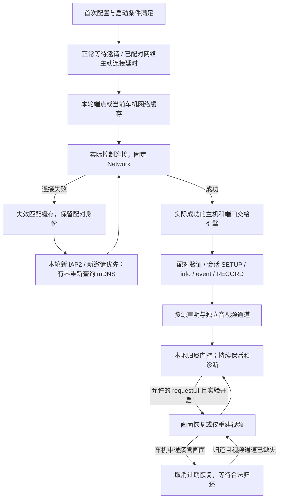

# 2026-11-04 新增功能审计（542）

审计基线：工作区 536–541 的未提交改动及调用上下文，HEAD `f2de7e9`。
范围包括端点选择/重试/清理、Wi-Fi iAP2、资源仲裁、实验恢复、视频尺寸与报文、
音频路由恢复、计时/TCP 诊断、JNI 快照及对应设置。未覆盖整个仓库所有历史实现。

## 确认并修复的问题

| 优先级 | 问题与触发条件 | 542 处理 |
| --- | --- | --- |
| P2 | 开启实验重建后，暂停旧 sender 时车机借屏，恢复中止为 PAUSED；第一次 requestUI 归还画面时没有“原先已持有”标记，原实现只反馈归属，视频通道仍为空 | 已初始化但 FAILED/PAUSED 的通道，在第一次合法归还画面时也重建；这一分支不额外执行释放/取回 |
| P2 | 音频或应用 changeModes 也推进画面 revision，并清除尚未消费的 requestUI 意图，误取消画面重建 | 只在画面 Resource 实际变化时推进画面 revision；音频仲裁和反馈继续独立执行 |
| P2 | 事件持有、事件分发、画面恢复任务仅依赖 Notify；协商失败或任务尚未注册等待时的停止广播可能遗漏，保留旧控制连接引用 | 事件持有/分发任务归入会话 KeepaliveTasks；反馈 worker 持有 JoinHandle 并在 Drop abort，不再只靠 Notify |
| P2 | 本轮明确的 iAP2/SRV 端口为 17000 等非默认值，同 IP 后来的 ctrl 邀请只给出主机，却又将端口推回 7000 | 本轮保存明确端口；同 IP 新邀请保留它，换 IP 后没有新端口证据才使用 7000 兜底 |
| P2 | 8 秒连接窗口只在外层循环检查，单轮多个兜底端口可继续消耗时间 | 每个候选连接前检查窗口；最后一个已发起连接仍受它自己的连接超时约束，非硬性 8 秒总时限 |
| P2 | fail() 路径未像主动断开一样标记诊断 generation 已结束，上次会话快照可能继续显示“当前活动” | fail() 立即关闭已观测的 generation，快照标记 inactive；旧 generation 后续更新被拒绝 |

同时补充 PAUSED 中文状态，并去掉把“图标存在但无法进入桌面”写成“黑屏”的设置说明。

## 梳理后的流程与约束

- 主动 Wi-Fi 开关关闭时仍遵守正常邀请路径；缓存或开放端口不当作车机授权。
- 端点恢复只处理控制连接失败。车机明确关闭控制通道时仍清掉旧端点，回到既有待机/下一轮会话策略。
  不通过重新发现去绕过配对拒绝、资源约束或伪造新的车机身份。
- 发现与所有媒体 socket 使用本轮固定 Network；连接/发现结果受本轮标识及 socket lease 保护。
  同一 IP 的邀请不覆盖刚收到的明确端口；切换后控制 FD 与引擎 car_ip/airplay_port 保持一致。
- 正常 requestUI 先完成应答再安排反馈。默认两个实验均关闭；首次正常资源 claim 保持原行为。
- 视频重建先释放旧 socket，再进行 screen-only TEARDOWN/SETUP/RECORD、新密钥与 nonce，等待 SPS/PPS/IDR。
  只检查画面 revision；车机新的画面变化优先。相同 revision 的重复恢复保留 10 秒节流，
  通道已缺失且发生新资源交接时不被上一轮节流挡住首次归还。
- 音频资源、音频通道与屏幕恢复分离。自绘音频路由恢复只在持续全零且音乐活动/输出路由满足条件时尝试一次；
  退出仅在偏好仍与本次设置一致时恢复。未将该路由操作应用到 CarWith。
- 视频配置取 SPS/实际来源尺寸，不以更改头部尺寸冒充真正缩放；源重置保持同一流 nonce 连续，
  新建流才重置密钥/nonce。CarWith 与自绘来源不混用数据路径。
- Wi-Fi iAP2 等待首包是独立阶段，不因尚无首包拆媒体。READY 表示本地传输屏障完成，
  不当作对端密码学接受或显示成功。
- 写出、TCP 内核确认、非零 PCM、计时交互是不同观测；均不确认物理屏幕/喇叭输出。
  TCP 采样在写入阻塞时继续，socket 关闭前撤销描述符借用，重建流以连接 ID 隔离。

## 验证及边界

- 163 项 Kotlin 测试通过，包含端点拒连后重发现、旧连接取消、端口提示优先级、窗口内多候选限制与 DNS 解析。
- Android arm64 手机上 64 项 Rust 测试通过；1 项实际 CarWith 会话测试忽略。
  新增实际 pending feedback worker 释放测试、画面归还首次恢复测试，以及音频变化保留画面意图测试。
- 原有屏幕重建、车机中途借屏取消、仅屏幕 TEARDOWN、新密钥 nonce、Showcase 独立报文向量、
  TCP 堵塞采样及计时 UDP 测试保持通过。
- 这些结果不能证明宝马实车“点击 CarPlay 图标无法进入桌面”的原因已消除。
  恢复实验的兼容效果、物理显示和出声仍需新实车日志；本轮没有开启用户的实验开关。

542 签名 release 已覆盖安装到手机，versionName=0.1.0.542、versionCode=10542。
APK 内原生库与本地新构建逐字节一致，SHA256：
`8e932ccb7aeb61545ba4b3e03abf94ba801eb4d963a69080e9e27b9b6d2d1e89`。

## 543：实连发现的审计遗漏及修复

用户反馈“已连接但没有发起 CarPlay 请求”后，读取 542 当前手机日志并确认：

- 22:12:38.320 RECORD 已发出，22:12:38.325 获得 200；随后资源声明、屏幕与音频 SETUP 成功。
- 22:12:38.394 视频 sender 立即释放，source_units=0、tcp_written_frames=0。
- 至 22:13:19，仍为视频来源/写出 0，音频只有 5 包；屏幕 TCP acked_bytes=1、队列为 0。
  手机编码器却已产生两千余帧，PCM 采集有明显非零信号。计时/控制保活独立继续。

根因是 539 引入可重建的 mpsc 控制通道后，把控制生产者结束当作视频媒体结束：
默认关闭恢复实验时，协商返回会释放局部 ScreenSession，commands sender 随之释放。
视频泵 `recv() == None` 直接退出；随后源分发器向 video 队列写入失败，连带停止音频事件分发。
因此控制会话存在但没有视频配置/帧送达，音频只剩开始时几包。
这是本项目回归；542 审计与已有分层测试没有覆盖默认开关关闭后协商返回的媒体泵生命周期。

543 将视频泵提取为同一份可直接测试的生产函数。恢复控制通道关闭时禁用该 select 分支，
继续保留当前 sender、视频来源与保活；实际源结束或会话停止才退出。禁用分支也避免闭合通道忙轮询。
没有添加伪造 UI 请求、打开实验开关或更改媒体协议来掩盖该生命周期错误。

新增生产视频泵回归用例：安装 sender 后释放协商侧所有 commands sender，再投喂配置/IDR/P 帧，
验证真实 TCP 报文可解密、帧统计增长、保活继续、停止后 socket 关闭；覆盖恢复开关关闭/开启两种配置。
Android arm64 上 65 项原生测试通过，1 项需真实 CarWith 会话的测试忽略。
原始现场日志保存于 `D:\devtools\hypercar-diagnostics\20261104-audio\542-current-connection-logcat.txt`。

543 已签名覆盖安装，并在用户重新发起接收端连接后复测：

- 22:21:38.514 恢复命令通道关闭，视频泵明确继续运行。
- 22:21:39.419 写出 2736x800 VideoConfig 与首个 IDR，SPS 与来源尺寸一致。
- 22:21:49：视频来源/写出 582/582 帧，音频 1482 包，其中非零 PCM 1342 包。
- 22:21:59：视频来源/写出 1183/1183 帧，音频 2849 包，其中非零 PCM 2709 包。
  音频持续约 136 包/秒，计时请求/回包均为 21，TCP 确认约 14MB，未发送队列为 0。
- 22:22 截图时视频来源/写出继续增至 2419/2419，音频 5717 包；未见提前释放 sender。
  requestUI 计数仍为 0，不能把缺少该入向命令等同于没有完成媒体会话。

诊断页同步按用户要求调整：会话卡填满可用宽度，显式收紧字号与行高，同一行合并多个事实；
删除版本信息卡，日志区继续以 weight 占用剩余高度，缩小外部间隔及日志内边距。
手机 UI 层级与截图确认摘要文本高度由约 656px 减至 339px，版本卡不存在，日志区明显增加。
截图保存于 `D:\devtools\hypercar-diagnostics\20261104-audio\543-diagnostics.png`。

163 项 Kotlin 测试通过；APK 内原生库与本地构建一致，SHA256：
`bacb4dfb33404064cf968164f9e74a548d0e8902ad1aac296facc517fa6280db`。
媒体复测日志：`D:\devtools\hypercar-diagnostics\20261104-audio\543-after-connection-logcat.txt`。
上述验证确认持续发送与对端内核确认，不替代用户对接收端实际画面/声音的确认。
