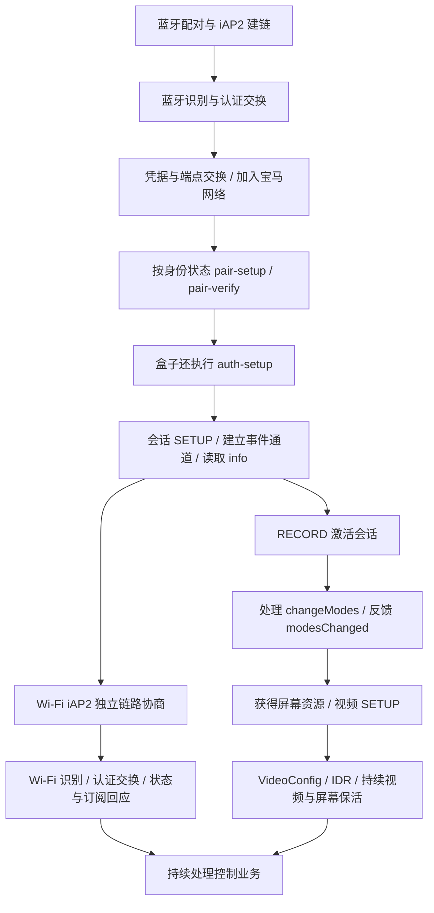

# 以宝马专用盒子为参照的 CarPlay 状态机

## 目标与范围

按用户 2026-10-30 的确认，只复现「盒子 → 宝马」的 CarPlay 行为。盒子内置 UI 在没有手机 CarLife 接入时也能稳定输出，因此 CarLife、Zlink 的手机侧会话不是 HyperCar 的依赖。

目标是用 HyperCar 自绘 UI 和手机编码器代替盒子的 UI/编码器，复现可观察的 CarPlay 状态机、资源协议和媒体传输，而不是在手机运行盒子的 ARM32 程序。现有蓝牙首次配对保护和数字钥匙兼容约束继续保留。

证据基于 [晚间排查报告](BMW-CONNECTION-2026-10-30-EVENING.md) 中的固件哈希、两组同车日志和源码版本。没有把「在成功日志中出现」直接等同于「协议中必需」。

## 已还原的成功主干



此图描述两组样本的成功路径，不是把所有箭头定义为强制互斥等待。Wi-Fi iAP2 与资源、视频并行：`090040` 的首个视频数据约 39.605 秒，Wi-Fi AA03 直到 39.853 秒才到。**不得人为等待 Wi-Fi 认证全部结束才处理屏幕请求。**

媒体面不依赖手机到盒子的 CarLife 会话；业务资源状态也不应由手机 CarLife 连接与否决定。

## 已确认的运输方向

来自固件实际调用关系，而不只是参考项目注释：

1. 来向 `POST /command` → `eventCommand` `0x45df4`。
2. 类型为 `iAPSendMessage` 时，`0x45fa8` 比较类型，取 `params`（字符串对象 `0xb4338`）、`data`（`0xb4348`），`0x46074` 调用 `pushWirelessData` `0x6ba44`。
3. Wi-Fi 链路发送回调调用 `AirPlaySendiAPMessage` `0x49274`，组 `{type:iAPSendMessage,params:{data:...}}`，不是裸 CSM 直接进 RTSP。
4. `0x49350` 调度的回调地址由 literal pool `0x49374` 和 PC-relative 地址算得 **`0x42b40`**，即 `_AirplayClientSendCmd`。
5. 此函数构造 **`POST /command RTSP/1.0`**，序列化二进制 plist，经 `0x42d08` 取出的 HTTPClient 和 `0x42d20 HTTPClientSendMessage` 发出。

因此本固件的 Wi-Fi iAP2 是：**事件通道入站，客户端命令队列出站**。入站 bytes 必须经过独立链路引擎；接收一个 RTSP 命令后返回 200 不等于完成内部 iAP2 ACK/CSM。

仍需把该 HTTPClient 的创建/连接路径与实际车机控制连接进一步对齐，不能仅靠成员偏移 `0xc8` 命名套接字；也不应把历史其他接收端的事件通道出站兜底默认套用到本车。

## 两组 Wi-Fi iAP2 序列

新增 [语义提取工具](../tools/summarize-box-iap2.py)，对两组文件运行，得到每组 45 条可识别 WLAN 包；排除空 ACK 后，**40 条方向、类型和消息 ID 的顺序完全相同**。

工具只输出时间、方向、序号、会话号、消息 ID 和截断标记，不导出 TLV 正文、凭据、证书或签名。很多 WLAN 原始 dump 只有前 16 字节，所以这不是完整逐包抓包，也不能据此声称已恢复所有参数。

关键顺序（`C`=宝马，`B`=盒子）：

```text
C → B  DETECT             B → C  DETECT
C → B  SYN                B → C  SYN|ACK
C → B  ACK
B → C  1D00               C → B  1D01
B → C  1D02
B → C  AA00               C → B  AA06
B → C  AA00               C → B  AA01
B → C  AA02               C → B  AA03
B → C  AA05
B → C  4E0C, A100, 4E0A, 4E09, 4E0B
C → B  AE00               B → C  AE01 × 3
C → B  4154               B → C  4155
C → B  4157               B → C  4158
C → B  4170               B → C  4171
C → B  5200, 10DA
C → B  AD00               B → C  AD01
C → B  6800
C → B  5000               B → C  5001
C → B  A101 × 4
```

消息之间还有链路 ACK，不能按这个简表省略。SYN 实际协商结果在日志中为控制 ID=1/version=2、EA ID=2/version=2、其他 ID=3/version=1；零重传和 ACK 超时适用于本次可靠 Wi-Fi 通路，不能覆盖蓝牙传输的不同参数。

不要只回 DETECT/SYN 后便停住，也不要直接重用蓝牙那条链接的序号、缓存、会话 ID 或认证阶段。`5001` 等 ID 的含义必须核对实际协议；本项目历史常量将其命名为 STOP_NOW_PLAYING_UPDATES，不能仅凭该名字拒绝按成功样本处理响应。

## 资源状态与视频启动

固件已确认：`eventCommand` → `makeModeChangesFromDictionary` → `ResourceManager_AccessoryChangeModes` → `AirplayClientSendCmdModesChanged`。视频启停是资源状态变化的结果，不只是连接成功后无条件推流。

样本成功状态为主屏 controller、主音频 accessory；随后根据业务请求改变音频。不能用「每次 changeModes 都抢占全部资源」替代状态机。借用、归还、永久所有权与临时所有权需要分别跟踪。

盒子当前观察顺序是 **会话 SETUP → info → RECORD → 屏幕资源请求/状态反馈 → 视频 SETUP → 推流**。HyperCar .406 是 **会话 SETUP → info → 固定 modesChanged → 视频 SETUP → RECORD**，并丢弃后续 changeModes。这是需要对齐的另一项明确顺序差异；还不能单凭差异证明调整顺序就能修复全部故障。

盒子在 RECORD 后约 38.480 秒已请求 disableBluetooth，但实际蓝牙阶段到约 39.968 秒才退场；期间 Wi-Fi iAP2 正在推进。此处既有请求时机，也有异步完成条件，不能把它简化成 RECORD 一获 200 就由 Android 断开整个宝马蓝牙设备。数字钥匙和系统配置文件不在此链路的释放范围。

## 可复现的部分与尚未闭合的参数

可以据此实现：阶段转换、各阶段独立的发送队列、双运输链路隔离、来向消息分派、状态回应、资源仲裁驱动的视频启动，以及持续心跳和恢复。

仍需从固件构造函数/调用链恢复或通过新日志确认：

- 会话 SETUP 的完整键值、auth-setup 的要求及其与身份路径的关系。
- Wi-Fi AA00 参数、AA06 处理条件、设备状态和各订阅回应的完整 TLV；日志大部分正文被截断。
- 屏幕和主音频 take/borrow/return 的状态表、失败反馈与重试条件。
- 各路保活的数据格式、时间原点和错误后的收尾顺序。
- 原生画布、viewArea、安全区在 VideoConfig 与媒体数据中的区别。

身份、公钥、每轮随机数、挑战、签名、会话密钥、连接 ID、端口、链路序号与时间戳是动态字段。要在 HyperCar 内生成并维护，不能把盒子报文逐字节重放，不能复制硬件或车辆身份来替代状态机。

复刻应针对协议行为，并保留手机端已有网络绑定、编码器和自绘 UI。主干已经有双样本及固件调用链相互支持；尚未观察到的错误分支不能标记为完整恢复。当前未修改手机运行版本。
