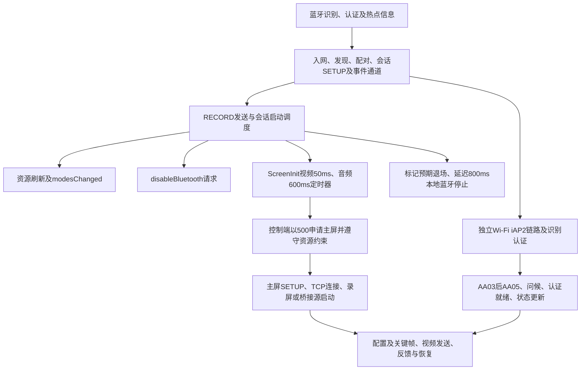

# 宝马盒子流程证据

## 已配对 ID8.5 在热点已连接时等待邀请（2026-11-17）

盒子二次上车摘要的蓝牙 CSM 为识别、认证、4E0C/4E0D/4E0A/4E09/4E0B、三条 AE01、5702/5703。AA05 到 5702 约 100 ms。两轮成功摘要在提供凭据的蓝牙链路上也是这一顺序，邀请前未记录 EA00。另有早期蓝牙链路只交换普通业务。摘要未显示车机内部的邀请判定。

M154FF / MGU-55 的 581 导出中，10:54:28 的普通 BMW Apps 识别后另来了带 CarPlay 能力的连接，10:54:41 收到邀请。10:56:31 复用热点并恢复 ctrl，10:56:38 的 1D01 只列出七项 de.bmw.a4a 协议；手机主动打开七条 EA 会话，车机断开 RFCOMM，直到用户停止仍无邀请。另在 10:44:24 主 iAP2 服务启动时，CarPlay 标记线程先报告主服务未就绪，五秒后才注册。10:56 时标记已经存在，两个现象应分别验证。

583 同批改动按当前 RFCOMM 对端的本机身份和配对凭据识别重入。ID8.5 档案下，已识别的 BMW MGU 若只声明普通 Apps 能力，保留链路服务订阅，等待更新的 1D01、主动到达的凭据或新入站连接。声明旧式 5702/5703 的 MGU 跳过主动 EA 打开，可选 HID 等待上限 100 ms。同链路更新识别时先回 1D02，再按新清单探询。主 SDP socket 发布后立即启动已启用的 CarPlay 标记注册。实车复测按时间对照 `BT-MARKER`、`MGU-REENTRY`、接收 5703 和 `CTRL: ✓ 车机 ctrl 邀请`。

### 控制会话 v1 的固件与 HCI 对照（2026-11-17）

盒子蓝牙回调 `iAP2BtLinkConnected`（xiap2 0x4d9d4）按 service 0 查控制描述符，读取其 version 字节。0x4db24 处分支的两个六字节固定 CSM 已从 ELF 常量核对：v1 对应无参数 AA00，v2 对应 1D00。085004 样本的 v1 链在 17.821 s 请求证书，18.292 s 连续发 AA05、1D00，18.319 s 发 1D02，随后回 AE00、4C00、4C03。这段没有 5702/5703。329.356 s 才观察到下一组 Detect，不能据此推断车机规定了两轮之间的等待时间。

11 月 12 日 iPhone/IDC23 的 7435 条 PacketLogger 记录中，两轮车机 SYN 和手机 SYN|ACK 的会话表都是 `(175, kind=0, v2)` 和 `(234, kind=2, v1)`。两次 iPhone 的首条控制消息都是 1D00。第二项是 EA 描述符，两轮均无控制 v1。第一条 ACL 在 06:47:06.546 结束，第二条在 06:47:40.315 建立，06:47:44.150 收到 4301。

11 月 3 日小米/MGU-55 的原始 HCI（103519.log，SHA-256 `e18e81991cd9c894a3465fad99310c1e690e83e0174501e4a691480e9ec9e0f4`）有两轮普通 BMW Apps 控制 v1。用 583 Release 的校验实现离线重放两轮完整的 AA01、AA02、AA03：两条证书链均通过内置 Apple Accessories CA 00000002，两条 64 B 签名均验证了该轮 32 B 挑战，修改挑战后均被拒绝。

| 普通 v1 握手开始 | v1 的 AA02 → AA03 | 旧 ACL 断开 | 下条 ACL 建立 | 新 CarPlay v2 的 SYN |
|---|---|---|---|---|
| 10:37:33.030 | 10:37:33.113 → 33.570 | 10:37:52.166 | 10:38:02.951 | 10:38:03.288 |
| 10:39:38.427 | 10:39:38.576 → 39.052 | 10:39:43.583 | 10:39:50.501 | 10:39:50.851 |

这两轮旧 App 都先发 1D00、接受识别后才发 AA00，普通 v1 未声明 com.bmw.carplay，后续新 v2 声明了该协议并收到 5703。历史记录可核对证书、签名和蓝牙退场；当前基线是否收到新的 Wi-Fi ctrl 邀请仍以本轮实车日志为准。

## 会话结束、收屏与重新邀请（2026-11-17，MGU-55）

以下实车记录对应 581。随后在 582 的本地构建中，App 手动暂停会立即禁止新的蓝牙握手，保留旧 RFCOMM 和事件连接供本轮退出。已建立的会话先停媒体，按音频、屏幕分别发单流 TEARDOWN，然后在同一控制 URI 上发空体的整场 TEARDOWN，等待应答或超时后关闭。日志中的 `stream` 和 `session` 分别标识两种应答。若暂停发生在协商中，本地已收到会话 SETUP 200 才发送整场结束请求。主屏单独归还走原有屏幕路径。

这次进一步确认了盒子的主动停止入口 `CarplayStop`（0x2a5e8）。它先设置停止标志，停心跳、配置及重启定时器；无线标志有效时还会调用 `wlan_disconnect`（0x746b0）执行接口 disconnect，再排队运行 0x294b8。该路径与车主要求的“暂停时保留已连接热点”有一处平台行为差异。App 保留同车热点，通过活动通道显式通知车机结束。逐流报文格式可对照盒子，空体整场请求参照下文 CarPToCarL。宝马是否据此立即退出 CarPlay 仍需实车复测。

| 场景 | 宝马实车记录，取 11:09 导出的累计日志 | 在 HyperCar 中的含义 |
|---|---|---|
| 手机仍持有主屏，车机再次请求 UI | 10:47:12.584，旧版收到 `requestUI` 时主屏为 1/1，却在 .594 发送仅屏幕的 TEARDOWN。.601 得到 200，.639 收到 `changeUIContext`。10:47:22.842 又在同一事件通道收到 `requestUI` | 属于同一会话。相同归属应复用屏幕，切换界面无需清理音频、订阅或热点 |
| 手机主动停止 | 10:48:38.511、10:52:29.795、10:53:51.145 都收到停止请求的 RTSP 200。最后一次 CSeq 68，131 字节，耗时 39 ms，随后记录保留热点请求 | 581 停媒体工作任务，合并待释放的流到一个 `streams` 请求，收到响应或超时再关控制通道。`graceful completed` 记录本地清理完成，远端响应需另看 CSeq 和状态 |
| 车机收回主屏，随后关闭连接 | 10:56:27.001 申请主屏，.004 屏幕变为 2/2、音频保持 1/1；.007 手机写出业务答复，随后回报 `modesChanged`。.018 发仅屏幕的 TEARDOWN，.057 得到 200，.709 收到 `changeUIContext(mobilephone)`。10:56:28.969 控制 EOF，.971 事件 EOF | 第一阶段释放已协商的 type 110 和对应 UUID，保留音频及控制。第二阶段由 EOF 触发本地整场清理，已关闭的控制通道跳过发送 |

**盒子固件。** `xiap2` 的 `_EventStop`（0x28e2c）入口检查活动状态，把偏移 +2、+3 两个字节分别置为 0、1。随后切换焦点，停止心跳、无线配置及重启定时器、iAP2 状态更新，清除 ready 状态并进入 `CarplaySimSessionStop`（0x48bec）。该函数先停音频、再停视频，清除连接和封面状态。外层再释放资源管理器，按状态停 Wi-Fi iAP2，回收事件、时钟和 HTTP 客户端。整体停止的外层入口 0x294b8 还调用 `HidSim_DestroyAll`。0x2da90 的一条错误分支先关 fd、置 +3，再投递 `_EventStop`。

固件在活动会话内另有单流发送函数。屏幕（0x38c08）构造 `streams=[{type:110, uuid}]`，音频（0x41ed8）构造 `streams=[{type}]`，均使用本场 URI。两个函数都要求 +2 非零且 +3 为零。因此从上述 `_EventStop` 进入时，后续停音视频会跳过这两个发包分支。两个盒子成功摘要仅覆盖 iAP2 交接和业务报文，不能给出用户主动停止前的最后一组 RTSP 包，也无法确认是否有其他入口先发整场结束请求。固件内的 `XB_CONNECT=0,0,0,0` 交给 `h_send_to_fmt`，上述路径没有将它封装为发给车机的 iAP2 CSM。

**公开发送端。** CarPToCarL 对登记过活动流的客户端调用 `closeGracefully()`。它按条发送 TEARDOWN，每条带 type、streamConnectionID，屏幕还有可用的 UUID；然后对会话发一次零字节正文的 TEARDOWN，最后关闭 TCP，并用 3 秒总时限兜底。HyperCar 581 的主动停止发送一份带流列表的 plist，随后关闭。即使列表为空，带 `streams=[]` 的 plist 与零字节正文在报文上仍可区分。通用 RTSP 文档定义 TEARDOWN 对请求 URI 所指资源生效；CarPlay 的 plist 字段和宝马是否需要第二次请求，仍需对应实现或实测确认。[CarPToCarL 退役入口](https://github.com/jjuugk/CarPToCarL/blob/d1c1fd4498053bf942cdf72ec07f44725d8deea0/app/src/main/java/io/github/shaonialife/carptocar/SessionController.kt#L2654-L2667) · [逐流、整场及关闭实现](https://github.com/jjuugk/CarPToCarL/blob/d1c1fd4498053bf942cdf72ec07f44725d8deea0/app/src/main/java/io/github/shaonialife/carptocar/airplay/AirPlayClient.kt#L851-L938) · [RFC 2326 §10.7](https://datatracker.ietf.org/doc/html/rfc2326#section-10.7)

**重新邀请与订阅。** 10:54:38.061 HS#7 收到 0xAE02，当前处理器把它对应到 0xAE00 电源更新订阅；10:54:41.162 才记录新的 HTTP 邀请。车屏点击时刻未知。10:47 的零首包发生在 10:46:55 对端 EOF 之后，且早于 10:48 的手动停止。主动停止是否少发整场 TEARDOWN 可在手停后立即重新邀请的场景单独比较，不能据此解释所有零首包。有效比较应分别记录新邀请、Wi-Fi iAP2 Detect/回应、0x5000/5001 和 0x6800/6802；固定蓝牙交接时序并保留同车热点。

## 再次邀请与 Wi-Fi iAP2 首包（2026-11-17，MGU-55）

### 蓝牙会话归属与交接次序

取 11:09 导出的累计日志，每个 RTSP 会话只计一次。下表的时间差为本轮蓝牙收到 5703 的时刻减去对应事件的时刻。负数表示车机先给了凭据。手机已连在同车热点时，App 收到新 ctrl 邀请就可使用其地址启动 AirPlay；当前实现没有把本轮 5703 设为受邀连接的必要条件。

| 实车邀请 | 邀请对应蓝牙会话 | 5703 相对邀请 | 5703 相对 disableBluetooth 200 | Wi-Fi iAP2 实收 |
|---|---|---:|---:|---|
| 10:46:54.111 | HS#1 | −6000 ms | −6742 ms | 200 后 100 ms 收到 Detect，随后写出 5001 |
| 10:47:06.235 | HS#2 | +2282 ms | +978 ms | 0 帧 |
| 10:49:23.851 | HS#4 | +2213 ms | +921 ms | 0 帧 |
| 10:53:19.372 | HS#6 | +2210 ms | +743 ms | 0 帧 |
| 10:54:41.162 | HS#8 | +2277 ms | +1064 ms | 0 帧 |

10:47 的 HS#1 在 HS#2 开始前 9.426 s 已读到对端 EOF；HS#2 入站时记录 active=false。200 后仍保持约 90.9 s 的是新会话 HS#2，直到 App 手停才本地取消。10:49、10:53、10:54 才是上一次 App 手停后的重邀。车机先后开 HS#3/#5/#7，每次 1D01 都为 559 B，未声明发送 5703，三条均以 local_cancel=false 结束，期间未记录 ctrl 邀请。分别相隔 677、691、2372 ms，手机接受 HS#4/#6/#8，均为 active=false。新链的 1D01 为 644 B，声明可收 5702、会发 5703，随后才出现新邀请。这个顺序与车主描述的两次点击相容，日志无法给每次点击定时。可复核累计日志行 15427、15599、16673、17212、17226、19188、19201、20813、20830。

**200 与首包。** 10:46 和 10:47 的命令都是对应控制通道的 CSeq 11、RTSP 200、42 B 正文，均未解析出业务 status。10:47 事件通道正常收到 forceKeyFrame、requestUI、requestSiri 和 21 个 hidSendReport；有限的 HID 明细样本为设备 1 的 5 B 触摸报告。设备 0 的描述符列出选择、返回、X/Y、滚轮，未见 B5/B6。Wi-Fi iAP2 到结束时 rx_frames、tx_frames、input_pending 均为 0，HS#2 的蓝牙 RX 记录里也没有 5000、6800 或 6802。触摸事件说明事件通道可用；它不能替代 iAP2 媒体订阅和方向盘报告。可复核累计日志行 15211、15848、15900、16535、16687。

**盒子参照。** 两轮成功摘要中，5703 到车机发 Detect 分别间隔 3.106 s 和 5.348 s；随后分别在 334.664/39.947 s 收 6800、334.669/39.952 s 收 5000，再于 334.674/39.959 s 发 5001。两份摘要未记录 6802 按键动作。另存的 52 秒片段显示首包早于蓝牙断开 548 ms。固件 0x47a48 分开排队远端命令和本地退场，0x50598 只在对应蓝牙活动条件满足时启动 800 ms 动作。Android 的 retireForWifi 则由 ACL 断开、Wi-Fi iAP2 已就绪及控制保活条件触发。若在这些 581 样本里机械地从 200 起算 800 ms 强关 RFCOMM，四个零首包样本有三个在那一刻还没收到当前 5703。

**实车验证点。** 581 的五轮都在发出蓝牙 AA05 后约 2.3 s 才发 5702。582 已对匹配此识别清单的 MGU-55 将可选 EA/HID 等待限制在约 100 ms；目前没有这版的同车重邀日志。下一次应首先核对同一条新蓝牙会话的 5703 是否已经早于交接、随后是否收到 Detect。若时序已经翻转仍为零，再单独对照“本轮凭据齐备后仅退当前 RFCOMM”。车机内部决定发首包的条件尚未观测到。

### 两轮盒子与 10:47 的包序

车主在 App 停止以更改设置后，会先在车机关闭 CarPlay，再次点击才会发起连接。以下用新的 `GET /ctrl-int/1/connect` 标识一轮。车屏点击没有时间戳。10:47:22 的 `requestUI` 仍在已有 RTSP 会话内。

| 观察点 | 盒子 085004 | 盒子 090040 | App 581，10:47 |
|---|---|---|---|
| 本轮蓝牙链路 | 329.356 s 车机从 Detect 开新链，此前 17.785 s 还有一段独立握手 | 32.489 s 车机从 Detect 开链 | 旧 HS#1 已于 10:46:55.815 读到对端 EOF；10:47:05.241 车机新建 HS#2，06.235 发 Wi-Fi 邀请 |
| 蓝牙凭据与后续业务 | 330.039 s 收 5703，随后记录到蓝牙 ACK | 33.196 s 收 5703，随后记录到蓝牙 ACK | 07.489 RECORD 200，07.500 写 disableBluetooth，07.539 收 200；08.517 收 5703，08.518 发 4300，08.519 发 4E0E |
| Wi-Fi 首包 | 333.145 s 车机发 6 B Detect，盒子同毫秒回应 | 38.544 s 车机发 Detect，盒子 38.545 s 回应 | 07.483 建好事件通道；07.783 收到的首个事件请求为 forceKeyFrame。直到 10:48:38 App 手停，Wi-Fi iAP2 收发均为 0 |

两个盒子时间轴分别取自 `iap2-flow-summary.json`，只含 iAP2。两段都未记录 5703 后的 4300/4E0E，摘要也没有 RTSP 命令的上网时间或车主点击。另存的二次上车样本 `iap2-flow-second-entry-20261031.json` 使用自己的时钟：51.598 s 新邀请，52.231 s 完成 RECORD，52.351 s 收到 WLAN Detect，52.897 s 发 5001，52.899 s 蓝牙才记录断开。前文对应原始日志行号可供复核。

固件在无线会话启动时（0x2993c → 0x47a48）先调度远端 disableBluetooth，再调度 ScreenInit 和本地 DisableBT。0x434a0 取设备身份填入 params.deviceID，随后再异步排队发送，两个成功摘要没有给出这一命令的精确写出或回复时间。0x42dc8 在无线标志有效时调用 0x50598，标记预期蓝牙退场，取消旧计时器；本地蓝牙处于相应活动状态时安排 800 ms 后执行动作 3。远端命令与本地计时各有自己的触发条件。

10:47 轮的 HS#2 持续到 10:48:38.438 的本地取消，交接命令写出后还可见 80 条蓝牙纯 ACK 发送日志。相比之下，10:46 首轮同样发过 4300/4E0E，但都早于邀请；10:46:54.953 的 Wi-Fi 首包又早于 HS#1 退场 862 ms。除 5702 早晚外，蓝牙后续报文相对交接的顺序和本地蓝牙退场方式确有差异。单独出现 4300/4E0E 或 RFCOMM 尚未关闭都不足以解释零首包。现有样本没有显示车机依据哪个状态决定发送 Detect。

两轮实车还可以逐包核对 4E0E 的链路确认。10:46:48.113 的 4E0E 用本轮 seq 125，48.227 收到车机 ACK 125；10:47:08.519 同样用新链路的 seq 125，08.612 收到车机 ACK 125。每轮累计确认也覆盖前一条 4300（seq 124）。两轮各只收到一次蓝牙 5703，均在 4E0E 之前，均未收到 4301。10:47 的 1D01 可收清单含 4E0D、5702，未列 4E0E、4300，仍完成识别并收到新邀请。两轮日志中的 4300、4E0E 与引擎 device_id 使用相同手机标识；SETUP.macAddress 单独取本轮 Wi-Fi 站点地址。日志没有车机内部身份比对结果。公开解析器把 4E0E 列为 Device 发出的 DeviceTransportIdentifierNotification；CarDeck 记录的部分接收端会在通知后重发 5703。此次 MGU-55 记录未观察到这种重发。[Wireshark 解析器](https://gist.github.com/JJTech0130/78527c600f7b4d0a7aeb294eab06d8ba) · [CarDeck 两个凭据发送时机](https://github.com/shaonialife/cardeck/blob/main/docs/PROTOCOL-NOTES.md#L113-L124)

## 自绘音乐卡与 5001 的 QQ 音乐联测（2026-11-16，580）

手机运行真实 QQ 音乐。测试接收端向 Wi-Fi iAP2 处理器订阅一次 5000，连续输入 6802 上下曲报告。独立记录 QQ MediaSession 回调、手机虚拟显示窗口画面、5001 解出的曲名与字段 26，以及文件通道实际重组出的 JPEG。拨测使用同源测试构建和本机接收端，未经过 BMW 的 RTSP 或车机显示链路。曲名与封面在记录中用编号和摘要代替。

旧实现每 1.5 秒检查一次订阅快照；实测一次新歌名发出后约 4.7 秒才传完对应封面。将检查间隔单独缩短后，发现 QQ 在同一曲目反复给出不同 Bitmap 对象，同一 JPEG 因而被多次重新分配文件 ID。修正后每 100 ms 检查变化，纯进度仍按 5 秒节流；同曲替换图片在后台比较编码结果，内容一致沿用原文件引用。更换曲目时立即丢弃旧引用，图片稍后就绪再公布新 ID。

最终一轮，Android 对发往 QQ MediaSession 的 8 对 DOWN/UP 都返回受理成功（含约 0.3 秒间隔的五次连按），播放器回调 6 次曲目变化，涉及 3 首不同的歌。以 QQ 回调为起点，新歌名进入 5001 用时 66–129 ms，匹配封面重组完成用时 205–324 ms。10 条含封面 ID 的 5001 引用 7 次文件传输，逐一吻合对应曲目的 QQ 封面 JPEG 摘要。222 次窗口采样在同一幅画面上提取标题区域和封面区域，全部匹配该轮 3 首歌之一的成对样本。

### 方向盘连续切歌逐键复测

在同一台手机、QQ 音乐 20.9.8.8 上重放。下表均为距本轮探针启动的毫秒数。6802 列为本机测试接收端送入协议栈的按下、松开；MediaSession 列为 Android 系统服务向 QQ 会话派发的 DOWN、UP。每次 HID 按下产生一次上下曲操作，HyperCar 随即派发一对 Android 键事件，随后到达的 HID 松开供解码器识别下次按下。QQ 列取独立 MediaController 观察到新歌名的首次回调，5001 列取订阅端首次收到同名报文，初始曲目为 T1。

| 次序 | 操作 | 6802 按下 / 松开 | MediaSession DOWN / UP | QQ 新曲目 | 5001 新曲目 |
|---|---|---:|---:|---|---|
| 1 | 下 | 6493 / 6529 | 6502 / 6503 | 6540 T2 | 6563 T2 |
| 2 | 下 | 7894 / 7930 | 7898 / 7899 | 7939 T3 | 8053 T3 |
| 3 | 上 | 9293 / 9331 | 9295 / 9296 | 9332 T2 | 9414 T2 |
| 4 | 下 | 10693 / 10734 | 10698 / 10699 | 10738 T3 | 10791 T3 |
| 5 | 下 | 11018 / 11053 | 11019 / 11020 | 无，保持 T3 | 无新曲目 |
| 6 | 上 | 11344 / 11379 | 11349 / 11350 | 11385 T2 | 11421 T2 |
| 7 | 下 | 11669 / 11704 | 11669 / 11670 | 无，保持 T2 | 无新曲目 |
| 8 | 下 | 11997 / 12032 | 11999 / 12001 | 12043 T3 | 12148 T3 |

绕过 HID 和 HyperCar，按 325 ms 间隔向同一 QQ 会话发送“下、下、上、下、下”。直接派发 Android 媒体键测了两轮，直接调用 `skipToNext()/skipToPrevious()` 也测了两轮；四轮均只有第 1、3、5 下出现新曲目。把完整 6802 路径的间隔改为 750 ms，同样五下全部换歌，5001 逐次跟上。可复现的边界在 QQ 会话受理操作到发布新曲目之间，本次未测定 QQ 内部限频阈值。方向盘沿用播放器原生节奏，按下一次立即派发一次。

## 4158、4171 的字段、首次累计确认与 580 首帧回放

**同一台 MGU 有确认过同样的 4171。** 在 18:10、18:11 两轮，手机实际写出的 4171 都获 RTSP 200，最后一次收到的链路 ACK 都是 113，只覆盖到 4158。手机每次从固定链路序号 99 开始，这两轮又走了相同的业务包顺序，所以两次的 113 对应同一条消息。单看这个数不能判断车机在哪一帧决定关闭。

| 订阅 | 18:10 和 18:11 的请求与回复 | 用同一请求走盒子固件 | 成功日志的交叉验证 |
|---|---|---|---|
| 4157 → 4158 | 请求 0、1、9、17；App 仅回字段 17，u8 值 0。TLV 正文 5 字节 | 0x621c0–0x62428 按请求逐项添加，四个 u8 为 **0=5、1=4、9=0、17=0**。正文 20 字节，比 App 多 15 字节 | 两轮均为请求整帧 32 字节、回复 36 字节。按固件重建的 20 字节正文正好得到 36 字节整帧，App 的对应整帧为 21 字节 |
| 4170 → 4171 | 请求 1、3、4；App 回字段 0，u8 值 0。TLV 正文为 `00 05 00 00 00` | 0x61824–0x61868 检查请求字段 1、6：有 1 写字段 0=0，有 6 写字段 5=0。此处只命中前者 | 两轮均为请求整帧 71 字节、回复 21 字节，与这条单 TLV 回复吻合 |

两轮盒子的摘要各帧最多留前 16 字节。表中盒子的**字段值**是将实车请求代入固件得出的结果，实际可从两轮摘要独立验证的是消息号、整帧长度、序号和 ACK。

580 后续改动在蓝牙和 Wi-Fi 的共用订阅处理器中按车机身份启用 MGU 的 4158。厂商为 BMW Group、型号为 MGU 或以 MGU- 开头时，按固件顺序从支持的字段 0–2、4–17 中选取本次 4157 请求的项目。表中的实车请求现回 20 字节正文，重复字段只回一次。以上两轮 EOF 仍是 578 的观察结果。

| 会话 | 首次覆盖 4158 的车机 ACK | 首次覆盖 4171 的车机 ACK | 此后观察 |
|---|---|---|---|
| 盒子 085004 | 发 seq 155 后 44 ms，入站 6800 携 ACK 157 | 发 seq 156 后 41 ms，同一个 6800 | 中间 5200、10DA、AD00 的 ACK 分别为 153、153、154 |
| 盒子 090040 | 发 seq 16 后 9 ms，入站 5200 携 ACK 17 | 发 seq 17 后 7 ms，同一个 5200 | 后续 AD01 尚未被确认时，车机已经发出 5000 |
| 实车 18:10 | 发 seq 113 后 25 ms，入站 10DA 携 ACK 113 | 未观察到 | 发 4171 后 25 ms 收到最后的 AD00，79 ms 时控制 EOF；最后 2 帧未确认 |
| 实车 18:11 | 发 seq 113 后 47 ms，入站 5200 携 ACK 113 | 未观察到 | 发 4171 后 57 ms 收到最后的 5000，66 ms 时控制 EOF；最后 3 帧未确认 |

上午的反例来自同一份滚动日志，车辆识别也是 MGU-55-BMW。筛选上午同时记录上述两组请求/应答字段、4171 发送序号和 Wi-Fi 结束摘要的 12 轮，6 轮的最终累计 ACK 达到或超过 4171。以 10:47 的 WIFI-IAP#18 为例，33.298 写出 4158 (113)，33.300 写出 4171 (114)，33.310 收到 6800 携 ACK 115，33.410 仍发生控制 EOF。该轮 5200 后还发了 5201，不能当作 578 的单变量试验。它足以说明相同字段组合可以通过链路确认，且确认之后仍可能关连接。两轮晚间挂起数量均低于对端窗口 5，日志没有对 4171 的显式拒绝或接收端关闭理由。

### 最后五个入站 ACK 与 578 的首帧窗口

**以 4171 实际写出为零点。** 下表列出车机随后五个入站帧携带的累计 ACK。每格为“相对毫秒 / ACK”，各行序号仅在本会话内比较。实车按 LINK RX 记时；盒子按 WLAN 报文记录记时。

| 会话（4158 / 4171 发送序号） | 5200 | 10DA | AD00 | 6800 | 5000 |
|---|---:|---:|---:|---:|---:|
| 盒子 085004 摘要（155 / 156） | +4 / 153 | +6 / 153 | +9 / 154 | +41 / 157 | +46 / 157 |
| 盒子 090040 摘要（16 / 17） | +7 / 17 | +9 / 17 | +11 / 17 | +19 / 17 | +24 / 17 |
| 另存 085004 原始段（141 / 142） | +5 / 141 | +10 / 142 | +13 / 142 | +29 / 143 | +32 / 143 |
| 实车 18:11（113 / 114） | +1 / 113 | +5 / 113 | +8 / 113 | +13 / 113 | +57 / 113 |

在 18:11 会话内，事件通道收到承载 5200 的请求，与控制通道写完 4171 同为 05.991，单看 5200 的旧 ACK 区分不了成败。4171 的外层 200 在 +3 ms 到达，此后仍能看到四个 ACK=113 的新帧，直至 +66 ms 控制 EOF。接收侧最后一次 5000 从事件通道入站到 LINK RX 用了 3 ms，结束时 input_pending=0；发送侧 21 帧均已写出，output_pending=0。原始盒子段与实车均报告 peerWindow=5、重传及累计 ACK 定时参数为 0。收尾时手机两侧队列均已排空，车机是否处理了 114 的业务载荷仍未知。

同日滚动日志中，上述 12 个上午 MGU 对照会话在 4171 写出后均出现控制 EOF。6 个已确认 4171 的会话距 EOF 为 85–217 ms，另外 6 个为 66–121 ms。逐会话对齐视频，11 个明确记录无主屏使用权，1 个建立视频 TCP 但释放时 source_units=0；12 个都没有首个 IDR 的 TCP 写出记录。另一个独立会话 18:13:37.307 视频 TCP 就绪，.535 首个 IDR 写完（228 ms），其 WIFI-IAP#5 却以 rx_frames=0 结束。这些会话均不能充当“完整 Wi-Fi iAP2 交接期间，IDR 已写出”的宝马对照。

**578 的补帧窗口。** 18:11:05.265 已向 CarWith 写出一次 0x1800B；.331 安装视频发送器，.383 等待同步帧。578 的 CarWith 命令线程对同一连接的关键帧请求间隔设为至少 1 秒，间隔内收到的请求直接消费。因此最早允许再次写 RESET 的时间是 06.265，晚于控制 EOF（06.057）208 ms；实际仅记录一次 RESET。原始盒子段在视频 socket 建立后 80 ms 写成功首个 IDR，随后 395 ms 发 AA05、455 ms 发 4171。手机 578 在对应两点均无视频负载写出。这里能解释为何该轮没能靠再次请求及时补帧，仍缺少 MGU 发起关闭的内部原因。

### 从缓存回放到视频 TCP 写出

580 在普通安装视频发送器和按屏幕所有权安装成功的两个分支都触发同一源的回放。缓存按重置、编码格式、参数集和分辨率变化失效，GOP 上限为 2 秒、180 个单元和 4 MiB。发送器在配置生效且收到 IDR 后写视频，完成 socket 的 `write_all` 才记录 `IDR TCP written`。仅有 `screen ready; replay current bounded GOP` 不能证明当时有可用 IDR。

579 的 DiPlay 日志提供了快慢两种实际发送路径。21:12:28.735 视频 TCP 就绪，.736 回放并写出 H.264 配置，.737 写出 IDR（2 ms）。21:16:07.277 TCP 就绪，.278 触发回放，1 秒后发送器仍为 source_units=0；08.745 才记录 H.264 源 IDR，08.811 写出 HEVC 配置与 IDR（距 TCP 就绪 1,534 ms）。后者大部分时间发生在记录到源 IDR 之前。

手机上的 580 源码回环测试复现 18:11 的正例条件：一个 14,686 字节、带 SPS/PPS/IDR 的合成 H.264 单元在 TCP 建立前 125 ms 到达，提前送出的副本被消费，之后不再输入新帧。测试驱动同一缓存和屏幕发送器，接收端按顺序读出配置和加密视频，解密核对为缓存中的原 IDR。该测试覆盖 H.264 直通和本机 TCP，真实车机上的调度、链路和解码仍需在 580 BMW 会话验证。

在当前手机上独立重复 10 次，全部收到相同的缓存 IDR；从两端 TCP 已建立、发送器已创建，到对端读出并验证完 IDR，用时 **1.440–2.009 ms**。这是发送路径的回环测量，不含真实车机建连、无线传输或 HEVC 硬件转码耗时。

### 580 下次上车如何核对同一轮

导出手机日志后，在仓库根目录运行以下命令。默认列出有 MGU 标记的每个控制会话。第二条命令只看控制连接在 18:11:04 开始的会话。每行给出原日志时间、相对控制连接起点的毫秒数和原文件行号。

```powershell
python tools/mgu-handoff-timeline.py "<导出的日志路径>"
python tools/mgu-handoff-timeline.py "F:/Downloads/hypercar-log-20261116-181708.txt" --start 18:11:04
```

看同一段里的“视频 TCP 就绪 → 触发 GOP 回放 → IDR 写完”，再比较 4171 的 POST、同一控制通道和 CSeq 的应答、控制 EOF 前最后记录的车机 ACK。事件通道 EOF 和 Wi-Fi worker 的 END 快照另外标出。若先发生控制 EOF，再发生 IDR 写完，该帧不计入 EOF 前已经写出的首帧。屏幕重建时继续列出新 TCP、回放和发送器的首帧。遇到日志截断、逐帧日志达到上限、没有控制 EOF 或没有 4171，应保留对应的未知项。

580 的两条视频发送器安装路径都会在安装成功后触发 CarWith 回放；按屏幕所有权安装的路径先检查最新授权和修订号。回放请求可以遇到空缓存，现场日志也没有在每个 IDR 上标记“缓存”或“新到”。实际写出以 `IDR TCP written` 为准，只有当前发送器完整写入视频 socket 后才记录。若 EOF 前缺少这行，结合发送器释放时的 `written_idrs` 判断是否确为零。

581 在同一条 `IDR TCP written` 日志上增加 `origin`。时间线将 `cached` 显示为“缓存回放”，将 `live` 显示为“新到源帧”。CarWith 在向发送器交付单元时记录来源，实时输入即使同时被存入 GOP，其直接交付的副本仍标为 live。经 HEVC 硬件转码时，用同一编码器实例的输入和输出 PTS 匹配；匹配不到或同一 PTS 有两种来源时显示“来源未确认”。580 及更早的日志显示“来源未记录”。

手机 TCP 回环使用主屏所有权校验后的发送器，两种场景均核对了接收端的配置包及解密后的 H.264 IDR。IDR 提前 125 ms 到达且随后没有新帧时，首个成功写入记录为 `origin=cached`。回放仅有参数、随后才到达实时 IDR 时，记录为 `origin=live`。两条实际写入日志均经时间线工具核对，对应 14,816 字节的首帧写入。回环未连接宝马车机。

## 18:11 交接后控制 EOF 的逐包对照（2026-11-16）

实车样本为 578/10674 的 `hypercar-log-20261116-181708.txt`，以下取 BMW ID8.5 的 ATTEMPT#3、HS#2、WIFI-IAP#2 和控制 RTSP#3。盒子两轮取 `iap2-flow-summary.json` 的 085004、090040。另存的同名 085004 原始日志有一段能同时观察视频、蓝牙及 WLAN 的成功交接；其时间和序号均与摘要所选段不同，单独列出。

### 实车从认证到 EOF

时间列省略 18:11。收包的 seq/ACK 来自车机，ACK 表示车机已累计确认到的手机链路序号。发包列只计实际写入的 POST；最后一列是同一 CSeq 的外层回复。

| 车机入站时间及消息 | 车机 seq/ACK | 手机出站 CSeq、消息及链路 seq | 写入时间 | RTSP 200 时间 |
|---|---|---|---|---|
| 05.882 认证签名 | 229/105 | 23 AA05 (106)、24 4E0C (107)、25 4E0A (108)、26 4E09 (109)、27 4E0B (110) | 05.884–.885 | 05.926–.927 |
| 05.928 AE00 | 230/110 | 28 AE01 (111) | 05.929 | 05.931 |
| 05.932 4154 | 231/110 | 29 4155 (112) | 05.945 | 05.945 |
| 05.942 4157 | 232/110 | 30 4158 (113) | 05.945 | 05.987 |
| 05.987 4170 | 233/111 | 31 4171 (114) | 05.991 | 05.994 |
| 05.992 5200 | 234/113 | 32 纯 ACK，确认 234 | 05.996 | 05.998 |
| 05.996 10DA | 235/113 | 33 纯 ACK，确认 235 | 05.998 | 06.003 |
| 05.999 AD00 | 236/113 | 34 AD01 (115) | 06.000 | 06.006 |
| 06.004 6800 | 237/113 | 35 纯 ACK，确认 237 | 06.006 | 06.046 |
| 06.048 5000 | 238/113 | 36 5001 (116)，捎带 ACK 238 | 06.053 | 06.054 |

06.057 控制通道读到对端 EOF，未完成 RTSP 事务为 0。车机此前通过事件通道送入 5000（该通道第 17 个请求）；直到 06.107 事件通道也读到 EOF，计数仍为 17。06.106 才出现首条音频 RTP 写入被拒，06.109 结束时仍记录到 wlan0 有地址。纯 ACK 使用 session 0，复用上一发送序号。末包的 ACK 238 是手机对 5000 的确认；车机最后给出的 ACK 113 仅覆盖到 4158。4171、AD01、5001 都已写出、各有 RTSP 200，三条的 iAP2 链路确认均未观察到。结束状态为 pending=0、outstanding=3，低于本轮 peerWindow=5。5001 的 200 正文 42 字节，日志未解出业务 status。

同一文件的 18:10:50.974 也出现控制 EOF。那一轮最后一次收发是 AD00/AD01，尚未进入 5000/5001；视频发送器同样写出 0 字节，但当时收到的源帧数也是 0。两轮共同的 ACK 边界都是 4158 (113)，第一条未确认的业务帧都是 4171 (114)，其 POST 都得到了 200。两轮从 4171 写出到控制 EOF 分别为 79 ms、66 ms。这个重复位置值得在新版跟踪，现有数据没有记录车机拒绝 4171。

### 两轮盒子如何确认 5001

下表序号均取各自会话。在这段交换中，两轮摘要的 5200、10DA、6800 后面都没有实车 578 所发的那三条独立 session 0 ACK；可见的盒子应答使用后续数据包捎带确认。摘要记录的粒度和最后的累计确认只足以比较行为，不能据此判定独立 ACK 会触发关闭。

| 观察点 | 085004 成功段 | 090040 成功段 |
|---|---|---|
| 4154、4157、4170 进来时的车机 ACK；盒子对应回复 seq | 均为 153；回复 154、155、156 | 均为 14；回复 15、16、17 |
| 5200、10DA、AD00、6800、5000 各自捎带的车机 ACK | 153、153、154、157、157；盒子的 AD01 为 157 | 17、17、17、17、17；此时 AD01 (18) 仍待确认 |
| 5000 → 5001 → 封面文件通道建立包 | 334.669 收到 5000，.674 发 5001 (158)，.676 发 session 2 (159) | 39.952 收到 5000，.959 发 5001 (19)，.962 发 session 2 (20) |
| 首个覆盖 5001 的车机 ACK | .680 收到 A101 时仍为 157；.688 文件通道回 ACK 159，距 5001 **14 ms** | .972 文件通道回 ACK 20，距 5001 **13 ms** |
| 随后的链路进展 | .695 收到 ACK 160，之后还有 A101 | .981 收到 ACK 21，之后还有 A101 |

578 实车从 5001 实际写出到 EOF 仅 4 ms；这个窗口短于上述两次确认用时。两轮盒子的 5001 都是 224 字节并紧跟文件通道；实车是 161 字节且媒体源当时报告 artwork=false。字段和值会影响长度，长度差无法单独定位关闭原因。更早还存在问候缺 A100、合并 AE01、4158 仅回应字段 17（整帧 21 字节，盒子为 36）等差异；其中实车的 AE01 和 4158 均已获链路确认。字段能力与应用层处理仍须单独验证。

### 蓝牙退场和首个可解码视频帧

| 同一会话内的事件 | 18:11 实车 578 | 另存的 085004 盒子原始成功段 |
|---|---|---|
| 视频 TCP 与首帧 | 05.205 产生 14,686 字节 H.264 AU，含 SPS、PPS、IDR；.206 因发送器未就绪丢弃。05.330 视频 TCP 就绪，源首帧早了 125 ms | 52.329 建立视频 socket，.402 出现 SPS，.404 送入首个 IDR 写路径（NAL 0x65），距建连约 75 ms |
| 首帧写结果 | .264 收到 forceKeyFrame，.265 已向 CarWith 发 VIDEO_ENCODER_RESET；.331 装好发送器后请求同步帧。.383 到达发送器的是非 IDR。直到控制 EOF 的 727 ms 内视频 TCP 写出 0 字节；释放时 source_units=12、skipped_sync=12、skipped_owner=0、written_idrs=0 | 52.405 写返回 errno 11，.409 重试成功；Wi-Fi AA05 在 .804 才发出。发送端写成功可核实，接收端解码时刻未知 |
| 蓝牙与 5001 的先后 | 05.216 发起 disableBluetooth，.221 收到该请求的 200；.974 RFCOMM 读 -1，local_cancel=false。其后 Wi-Fi 仍收到车机 seq 233–238 六帧，再写出 5001；控制 EOF 比 RFCOMM 关闭晚 83 ms | 52.897 发 5001，.898 建立封面文件通道，.899 记录 BT Disconnected，.904 在 Wi-Fi 收到覆盖 5001 的 ACK，.910 再确认文件数据，随后继续收到 A101 |

这轮已定位到手机丢弃可用 IDR 后一直等新同步帧，视频发送器没有写入负载，因此此处没有一次视频 socket 写超时可供归因。RFCOMM 结束后仍有双向 Wi-Fi 数据，本轮日志也未给出车机关闭控制通道的内部原因。现有证据优先指向首帧缺失这一可复测的差异，无法把它直接定为车机 EOF 的触发条件。

当前 580 已包含 579 引入的同源 GOP 缓存回放。复测时应把同一次 BMW 会话的 `screen ready; replay current bounded GOP`、首个实际写出的 IDR、AA05、RFCOMM 结束、对端累计 ACK 与控制 EOF 放在同一时间线上。若 IDR 在认证前已写出却仍发生 EOF，即可在有视频的条件下继续判断 ACK 或交接差异。

## 580 同批后续实现：中控 HID 与车辆订阅

**自绘 UI 手机副屏验证。** 在同源 580 测试构建上，通过中控键派发入口发送正转、反转、确认和返回；每步刷新副屏无障碍节点缓存再读取焦点。可依次选中上一首、播放/暂停、下一首，确认后测试 MediaSession 收到相应操作。旋钮选中高德后确认，进入独立全屏地图，返回后首页音乐卡恢复。音乐应用选择层此前未接管焦点和返回；修正后焦点在 QQ 音乐和汽水音乐间双向移动，返回关闭列表并回到入口。另以 iAP2 的 6800 注册测试媒体描述符，注入 6802 上下曲报告：音乐卡的曲名按 TEST-1 → TEST-2 → TEST-1 更新，读取实际窗口像素验证封面蓝 → 红 → 蓝。本轮覆盖按键解码后的播放器与 UI 链路，未采集实车物理按键或第三方播放器的回调时延。

盒子 `xiap2` 的 0xb1a68 表将 Consumer 0224、Button 01 和方向轴分别映射为返回、确认与方向输入。HyperCar 根据 AirPlay 公布的设备 UUID、应用集合、报告 ID 和字段位偏移解码；媒体组件声明的 B5/B6 继续派发给播放器。对照 MGU-81 的四字节多轴控制器描述符回放 15:59 的历史样本，末字节 02/FF 分别产生两次正向和一次反向转动，首字节 01 产生确认。该回放使用参考描述符，当天 App 现场摘要只记下了返回键占首字节 bit 2，未保存完整描述符，也没有采到该位按下。

CarWith 源通过已建立的 CarLife CTRL 连接发送 0x68008；返回、确认、四方向使用键值 14、20、21–24，反向与正向旋转使用选择器 7/6。相同方向的连续格数按手机接收端的去抖窗口间隔发送。自绘源使用当前投屏虚拟显示上的方向键、确认和焦点前后移动，全屏地图的返回键回到自绘首页。旋转不会产生媒体下一曲或上一曲。

盒子 `xiap2` 的 0x600bc–0x601cc 读取车辆组件能力，0x5bfcc–0x5c2bc 按能力添加 A100 标志。App 在 Wi-Fi 认证成功后的 4E0C 和语言问候之间，仅订阅车机同时声明可交换且组件支持的字段（3、4、6、9–16）。A101 的有效分帧更新合并为本次会话的续航、车外温度、低续航告警及分能源数据；相同声明不会重复订阅，重连会清空缓存。两轮盒子摘要的 A100 整帧均为 36 字节，载荷截断，无法由摘要直接读出全部字段编号。

该批正式 APK 校验通过，已保留数据覆盖安装 580/10676。597 项 JVM 测试通过；手机 ARM64 原生套件 334 项通过、3 项忽略。回归覆盖 BMW 描述符、无 UUID 歧义、CarWith 加密控制帧和同向旋转间隔、A100 发送顺序、A101 分帧与会话清理。实车物理键到焦点/切歌以及重新订阅后的稳定性仍待复测。

## 580 同批后续实现：媒体库和 Now Playing 回复

以下“源码复核”表记录改动前的状态。此后在同批 580 中接入蓝牙和 Wi-Fi 共用的媒体库请求处理。认证后的 4C00 触发 4C01（设备显示名、本安装持久库标识、本地库类型）。固件 0x64158–0x6417c 先比较库标识；App 同样只处理自己已公布的库。4C03 中请求字段 5、6、4 分别触发 4C04 的字段 8=false、9=false、以及字段 6 重置/字段 1 修订号“1”/字段 7 进度 100。固定修订号对应 App 提供的空目录。4C02/4C05 可撤销本通道尚未发出的相应应答。

显式 5000 订阅可取得额外的曲目标识、曲号、曲数、碟号、流派、作曲者、收藏状态、队列位置/数量及百分倍率；回复依据所选 Android MediaSession 的缓存快照筛选。曲目标识由播放器包名和播放器提供的 media ID 派生；没有源 ID 时省略。没有队列数量或倍率时使用协议的 0 值。收藏/屏蔽的远程写入能力均回 false。第三组及缺少可靠来源的可选字段仍省略。蓝牙保活收发回归覆盖查询及三条更新，593 项 JVM 测试通过；真车 4C03 回访、界面显示与控制 EOF 待复测。

## HID、媒体库与 Now Playing 的功能差异（2026-11-16，580 源码复核）

以下比较盒子 `iap2-flow-summary.json` 中 085004、090040 两轮，另用留存的 085004 原始记录核实 HID 和车辆状态。App 现场时间来自 `hypercar-log-20261116-181708.txt`。各轮独立计时。

| 路径 | 盒子与车机的证据 | HyperCar 当前行为 |
|---|---|---|
| 蓝牙媒体库查询和更新 | 085004 的早期蓝牙会话在 18.525 s 收到空体 4C00，回 91 字节 4C01；18.608 s 收到 4C03，回三条 4C04（71、71、81 字节）。固件 0x624e0 建立库信息，0x65174–0x652e8 分别检查请求字段 5、6、4 后发送更新。090040 的无线交接成功记录中未见这段交换。 | 18:12:31.672、18:16:48.018 都收到 4C00，进入 keep-alive 记录，源码无 4C01/4C04 响应。代码日志将整个 4Cxx 指向疑似热点凭据；对这四个已核实的消息，该提示有误。盒子的这些回复仅证明存在库服务，不能由三个更新包推出它实际导出了可浏览的歌曲目录。 |
| Wi-Fi iAP2 媒体 HID | 两轮都有 67 字节 6800，留存原始记录解出 Consumer B0/B5/B6（播放、下一首、上一首）；两轮摘要均无实际 6802。 | 18:11:06.004 已成功注册组件 1 的 29 字节描述符。支持 6802 描述符解码和 Android 媒体键派发。该时刻只验证注册。 |
| AirPlay HID 返回及方向输入 | 固件的 Usage 映射、虚拟输入和按源转发路径处理返回及部分方向/轴输入。 | BMW 设备 0 声明 Consumer 0224（返回），offset=2，占一位。Rust 已把它归入 Consumer 设备，但支持列表不含 0224；已识别设备即使零个可派发边沿也在 event 入口结束处理。15:59:47–15:59:50 的 21 条记录中，首字节 bit 2 全为 0，19 条变化集中在末字节（01/FF/02/FE）。这些样本无法验证一次返回按下，也无法从数值确定轴的 Usage 或实际操作的物理键。 |
| WLAN 车辆状态 | 两轮都由盒子发 A100，随后各有四条 A101；留存原始记录明确打印 rangeWarning、outsideTemperature、range。 | 当前主流程缺少对应的主动订阅和解析消费。属于车辆数据能力，媒体订阅已在 A101 之前完成。 |

直接读取 ELF 的 0xb1a68 映射表，每项为四个小端 16 位数。盒子还映射了 Consumer 0223/0225（Linux 0xAC/0x9F，主页/前进）、Button 01（0x1C，确认）。另有一个媒体键语义差异：固件 B9 和 B0 均映射到 Linux 0xCF（播放），App 的 CarMediaKeys 将 B9 和 B7 均派发为 MEDIA_STOP。两轮 BMW 成功摘要均无 B9 报告，留存的 BMW 媒体组件也只声明 B0/B5/B6。

### 5001 的字段差异

两轮盒子在 WLAN 收到的 5000 均为 196 字节，回出的 5001 均为 224 字节（均为链路整帧）。现存摘要只留前 16 字节。下表用 18:11 BMW 的完整请求字段日志，对照固件首次回复函数中的 getSubPara 和 addSubPara。字段号为十进制。表中“可写”代表该固件存在加入该字段的路径，实际值或是否带封面还取决于当时源状态。

| 请求组 | 固件可写、580 未输出的请求字段 | 依据 |
|---|---|---|
| 0，曲目信息 | 0、7、8、9、10、16、18、21、22、23、24、27 | 0x629c0–0x62c80。字段 0 为 64 位，7–10、27 为 16 位，16、18 为字符串，21–24 为单字节。 |
| 1，播放信息 | 2、3、4、5、6、8、9、10、11、12 | 0x62cf4–0x62e98。部分初始值直接写常数 0；App 当前返回 0、1、7、13、14、16。该车还请求 17，未在盒子该初始响应路径找到写入。 |
| 2 | 未发现该初次回复写入此组 | 0x62f20–0x62f84 检查 0、1、6、12、14、16、18，随后进入共同发送路径，没有创建输出组或加入这些字段。 |

18:11:06.048 App 收到 180 字节订阅正文，06.053 实际写出 161 字节 5001（正文 145 字节，CSeq 36、链路 seq 116），06.054 收到该 CSeq 的 RTSP 200，06.057 控制 EOF。最后记录的对端链路 ACK 为 113。该轮已验证订阅、实际写包及外层回复；车机对 seq 116 的业务处理结果未知。歌曲文本和封面状态也影响帧长，224 与 161 的差额不能直接换算成必填字段数量。

## MGU-55 蓝牙到 Wi-Fi 的两轮成功交接（2026-11-16，580）

下表使用盒子固件目录中 `iap2-flow-summary.json` 的两轮记录。各行时间差均在同一轮内计算。Wi-Fi 摘要截短了多数载荷，能比对消息编号、先后与帧长。电源字段另用完整蓝牙记录和固件交叉核对。

| 盒子事件 | 085004 | 090040 |
|---|---:|---:|
| 蓝牙发出热点信息 5703 → 首次 Wi-Fi 链路探测 | 3.106 s | 5.348 s |
| 首次 Wi-Fi 链路探测 → 车机发出 SYN | 0.935 s | 0.845 s |
| Wi-Fi 车机请求 AE00 → 盒子连续回应 AE01 | 3 帧，21 / 21 / 22 字节 | 3 帧，21 / 21 / 22 字节 |

两轮提供热点信息的蓝牙会话都从链路探测和 SYN 开始，随后进行 1D00 系列识别、AA 系列认证，完成问候和电源回应，再交换 5702/5703。Wi-Fi 独立完成探测、SYN、识别和认证。AA05 后两轮均出现 4E0C、A100、4E0A、4E09、4E0B，再进入 AE00 电源订阅和 4154/4155、4157/4158、4170/4171 配置交换。085004 还有一段更早的控制会话版本 1 蓝牙连接，直接请求证书，未交换热点信息；该段与两轮实际交接的版本 2 蓝牙连接分开看。

完整蓝牙日志显示，AE00 请求字段 0、1、4、5、6 时，盒子分别用三条 AE01 发回字段 4、5、6，值宽度依次为 1、1、2 字节。固件 `xiap2` 的 0x610fc 至 0x61224 对这三个字段逐一检查、创建消息并入队。旧版 App 在 18:11:05.928 的 Wi-Fi 日志中将它们合为一条正文 16 字节的 AE01。580 在蓝牙和 Wi-Fi 识别到 BMW Group 的 MGU-55-BMW 后，改为每个已请求且有值的字段单独回应，三条消息读取同一份手机电源状态。实车是否因此越过此前的控制 EOF 窗口仍待复测。

## 首轮已建视频TCP仍EOF的独立复核（2026-11-16，代码仍为577）

本节只使用早上574的ID8.5首轮及同一去重日志中的对照轮次。没有577实车新日志，不把旧故障直接认定为577仍未修复。未新增协议、定时器或热点行为改动。

| 首轮手机时间 | 已观察事实 | 限定解释 |
|---|---|---|
| 10:35:27.554 | CarWith主动连接七路通道时，7240返回拒绝 | 源端尚未就绪；失败连接后实现等待1s才重拨，日志另按5s节流，不能由一条拒绝记录推定后续失败端口 |
| 28.187→28.193 | RECORD/资源后发disableBluetooth，收到RTSP200、正文无业务status | 请求有回复，不代表Wi-Fi iAP2或蓝牙交接已完成 |
| 28.304 | SCREEN_SETUP成功、视频TCP就绪，screen_phone=true | 主屏优先级缺口不是本轮必要触发；有连接不代表已发送视频 |
| 28.476 | CarWith入口启动请求返回 | 仅为启动请求，晚于视频TCP就绪172ms；七路连接/认证/首帧仍无成功记录 |
| 28.851 | Wi-Fi收到AA03，排队AA05及问候；随后实际POST写出、RTSP200 | 本轮进入交接后的状态初始化，不能解释为仍卡在证书请求 |
| 28.910→29.009 | 对端ACK110、随后ACK111 | 链路已确认问候及电源AE01；不证明应用层认可后续状态 |
| 29.010→29.023 | 4155、4158、4171有实际POST及RTSP200；无导航源仍排队5201；最后入站10DA、ACK仍111 | 后两条出站超过旧日志前16包写出记录范围，未见其RTSP回复或新的链路ACK；不能把QUEUED当成已收到或已拒绝 |
| 29.054 | RFCOMM读取结束，local_cancel=false | 对端退场先于控制EOF81ms；App对应onSessionEnded只记日志，finally只关闭本轮蓝牙channel/socket，未找到直接停止Wi-Fi核心的调用 |
| 29.067→29.068 | changeUIContext(mobilephone:)已回空体200 | 盒子eventCommand同样仅记录该上下文，普通回复也是空体200。不同于requestUI，不据URL假造资源移交或启动电话动作 |
| 29.135→29.145 | 控制EOF、事件EOF、本地清理；视频sender终止统计source_units=0、frames=0、config=false、written_idrs=0 | 本轮从TCP就绪到EOF831ms，期间没有可被车机拒绝的视频配置或压缩帧；不是本轮视频写阻塞超时。早于本地断网清理，也未见先行NET-WATCH lost |

重新按每轮实际AA05、RFCOMM结束和首个控制EOF计算，12轮短断的AA05→EOF为170～313ms，RFCOMM结束→EOF为62～215ms。这个关联不能证明BT回调导致断线：盒子也区分预期BT退场与异常重启；App蓝牙回调及ACL保留逻辑未发现上述时间窗口内主动拆Wi-Fi的证据。不同轮次分别有无视频TCP、有无自绘源帧，都落在交接后的短断窗口，因此不能将全部短断简化为相同的首帧截止时间。

进一步导出盒子screenKeepLiveTimer入口0x3b420并核对安装点0x3939c：视频TCP建立后定时器首次延迟2,000,000,000ns、周期1,000,000,000ns，并受已启用屏幕/有效socket等条件约束；不是一建TCP就必须发保活。0x38114录屏线程在源链路未就绪的相应分支还会进行约100×5ms有界等待，必要时再延迟70ms。App当前首次屏幕keepAlive在1s后，因此没有依据把本轮831ms的EOF归为“比盒子更晚发第一个keepAlive”，也不凭猜测缩短间隔。

现有证据支持两项独立事实：源端晚启动、未完成七路连接解释首轮为何没有视频字节；交接后无导航源主动5201是已确认的盒子差异，575已修正，仍是首轮EOF的候选触发。缺少完整接收端拒绝信息或修正后的同车新轮次，不能在两者之间建立唯一因果。4158字段完整性、A100和电话能力不据此伪造或补发。577已有前128包实际POST的CSeq/CSM及业务status诊断，下一轮可核对去掉5201后是否仍在同一窗口EOF。

手机恢复ADB后，Android arm64 release现场探针确认源准备时机有显著影响：入口晚于源连接约0.9s拉起时，两轮七路连接约2013/2016ms、首个H.264 IDR为2486/2460ms；先启动入口等待1200ms再连接时，七路均4ms、首个IDR为420/366ms。计时起点均为原生探针启动，包含真实挑战认证和加密；不含同时进行的车机协商，不能直接推导接收端首帧期限。577同批据此将入口提前至连接准备阶段并行启动，connected不重复拉起，不改变iAP2应答或蓝牙退场。该实验确认源端迟延，不能单独确认EOF的车机决策原因。

## Ghidra桥接状态机还原与ID8.5主屏启动修正（2026-11-16，577）

本轮按原始ELF零基址导入Ghidra，核对动态符号和关键全局指针，补建间接回调入口。完成xiap2及libAirPlay、libAirPlaySupport、libscreenrecord、zlink_server的首轮分析，导出目标函数伪代码、函数索引和引用关系。自动反编译结果不等同于完整源码恢复；复杂类型、共享尾块和跨进程行为仍须逐项核验。以下地址均使用原始ELF地址，未混用Ghidra默认附加的加载偏移。

盒子与HyperCar都是投屏桥梁：车机侧维护CarPlay会话及资源，手机侧接CarLife/HiCar等来源，再经内部视频生产/消费及编码链路输出。稳定性对照必须同时看源、资源、传输三条生命周期。



图中认证路径与媒体路径并行；I到L表示状态及订阅服务伴随媒体运行，不表示视频必须等待Wi-Fi认证。盒子RECORD路径0x2a9e4在HTTPClientSendMessage返回成功后调度0x2993c，而0x2d8d4另行处理RECORD完成/失败；不能把前者日志直接当作已收到200。HyperCar继续验证RECORD回复，不照搬乐观启动。

| 入口/状态 | 反编译证据 | 对HyperCar的意义 |
|---|---|---|
| 事件与Wi-Fi iAP2启动 | 0x25094按无线标志调用0x6c0dc；后者异步进入0x6b69c创建链路、runloop和线程。0x6b394选择控制/文件会话及其版本，决定先识别或先认证 | 与App提前建worker、被动等待字节不矛盾；worker存在不等于已完成交接 |
| WLAN认证完成 | 0x65e14进入共享CSM处理体；AA03分支发送AA05，设置transport auth标志。WLAN mode=4再设置miAP2SimComm+0x3c并启动状态更新；WirelessCarplayReady(0x2983c)本身为空函数 | 不存在必须等待该空函数或额外确认后才能推视频的证据 |
| 会话与源端协调 | 0x2993c更新无线状态0x95→0x96，调用0x47a48；后者刷新资源、发布连接/显示参数并调度disableBluetooth、ScreenInit和本地蓝牙延迟退场 | 会话启动、源准备和iAP认证是不同条件；不能只比较末次CSM |
| 预期蓝牙退场 | 0x50598设置mBt[7]、清mBt[5]并安排800ms停止。0x507f8收到Disconnected时按这些状态进入仅停止BT链路的分支；异常活动BT另可触发carplay_restart | App已绑定网络时应保留业务/热点，不能因普通BT退场释放Wi-Fi；不照搬盒子的硬件/MCU命令 |
| 主屏启动申请 | 0x42df4启动50ms视频定时器；0x28cb8启用视频并调用0x7d034，构造Take：priority=500、takeConstraint=500、borrowConstraint=100 | 确认App仅以100初次申请会卡在BMW的takeConstraint=500；是本轮有日志和代码共同依据的修正 |
| 资源回调到屏幕TCP | 0x2e93c把0x235a4/0x2359c注册为启停回调；0x79a90按资源结果调用它们。0x235a4进入0x3cc48/0x3a998；SETUP回复0x3939c核对本轮序号后连接视频端口，再启动0x38114录屏线程 | 视频启停受资源、会话代次和传输就绪共同约束，不能用认证标志代替 |
| 源预热与手机桥接 | xiap2 0x3c908做约500ms预热；libscreenrecord的0x3308创建kmssrc/mpph264enc等预热管线。zlink_server 0x34250注册视频/音频/焦点回调，0x30ca0检查来源启用状态及SPS后启动producer；0x332bc处理AirPlay源的启停转换 | 预热、解码/生产和车机发送不是同一动作；不能把盒子的编码硬件初始化直接移植为App协议要求 |
| 反馈和异常恢复 | 0x65e3c建立约30s看门狗，0x43690反馈完成调用heartbeat_reset；0x59a1c在失活时走carplay_restart。0x3939c具有视频SETUP序号及局部恢复分支 | 反馈、视频恢复和Wi-Fi物理关联应分开核对；该30s看门狗解释不了1.5～1.8s的初始短断 |

**本轮修正：** ID8.5真实盒子启动路径在原RECORD/资源声明及disableBluetooth请求之后、启用视频资源协调之前，补一次优先级500的受约束主屏申请；只有状态实际改变才发送modesChanged。初始屏幕revision已改变则跳过，避免覆盖车机的新决定。等待回复时不开放视频gate；成功后读取最新资源状态；RTSP/业务拒绝只回退未被新事件改变的屏幕字段，不回退音频或结束控制会话。Never、不可抢回借用继续等待。ID9、NBT、MBUX和桌面接收端不进入此路径。不增加重复入网或热点清理动作。

**日志定位边界：** 多个失败轮次初始screen=2/2、take=500，App以100申请失败；自绘源帧在EOF前已到达，却被丢弃，屏幕未SETUP。该缺口能解释这些轮次的WAIT_OWNERSHIP及无视频连接。最早短断轮take=100且已有视频TCP、没有源帧，仍然EOF；因此不能认定本项为全部EOF的唯一根因。盒子无源首次5201差异已在575修正；A100、电话状态完整性、分开发电源字段等剩余差异仍缺接收端拒绝证据，不继续叠加猜测性改动。需577/H.264新实车轮次核对startup claim、SCREEN_SETUP、config/IDR、实际iAP POST/业务status/链路ACK与EOF顺序。

## 连接前初始化、蓝牙与mDNS对照（2026-11-16）

574 实施范围：所有档案使用绑定当前 Network/接口的 IPv4 与 IPv6 mDNS，主动补查 PTR→SRV/TXT→A/AAAA，并将同实例地址交给原 TCP 重试器；组播锁只覆盖查询期间。ID8.5 单独采用盒子 4E0C/4E0D/4E0A/4E09/4E0B 问候顺序、手机名称作为控制服务实例名，以及已配对目标/被动监听就绪后的短时可发现准备。按用户追加要求，BMW 的设置控制主动建链、邀请门禁和已保存 Wi-Fi 重连策略保持不变。

可发现准备继续受原开关、Shizuku、当前连接授权限制，5 秒稳定后最多 30 秒，开始会话/停止/取消即清理。此处没有将盒子的 AT-LK 指令宣称为 Android 某个精确扫描模式，也没有新增认证验签或在屏幕资源授权前启动实际视频推流；这些不同平台行为还缺等价实现依据。

本轮仅查证当前源码、同一固件样本和既有MGU成功日志，没有修改连接代码、编译或安装。盒子成功记录不是当前手机黑屏轮次，初始化差异不能直接等同根因；ID8.5仍为主线，旧协议问候顺序不能自动套用ID9/奔驰。

### 启动与已对齐部分

S37CarPlay先启动hct_mdnsd，再后台启动xiap2/zlink_server；S42HCTBluetooth按CarPlay模式设置blueware的pair/serial/iap属性，启动独立模块进程。成功记录显示xiap2先准备Wi-Fi驱动和wpa_supplicant，再由车机发起蓝牙连接；盒子实际作为STA连接车机AP。提取固件脚本使用SDIO aic3581bs、wlan0/ap0，成功日志却是USB aic3581bu、air0，不能把脚本逐条当成成功样本真实执行步骤，也不能因wifi_ap.sh的名字认定盒子给车机开AP。

App复用Android蓝牙/Wi-Fi系统栈，已有CarPlay SDP marker和iAP2来向监听；BMW ID8.5配置保留HFP/A2DP并禁用主动出站，与成功记录的Connected from方向一致。已有0x5703→验证IP/绑定车机Network→ctrl ServerSocket/mDNS→邀请/端点→AirPlay流程，Wi-Fi iAP2 worker也已实现，并非缺少连接前listener。MAC由PhoneIdentitySnapshot共享；真实MAC获取失败仍有稳定伪标识回退，现场要核对它与空口蓝牙身份是否一致。

### 明确差异与边界

| 项目 | 固件/成功样本 | 当前App源码 | 结论 |
|---|---|---|---|
| mDNS完整发现 | xiap2 0x34cfc DNSServiceBrowse；0x256d8 Resolve；0x27dc0协议掩码3、0x27dc4 GetAddrInfo，IPv4/IPv6均查询 | net/AirplayServiceProbe.kt:35、45、63–64只向224.0.0.251做单轮PTR查询；AirplayDnsRecords.kt:55–79处理SRV/A/model TXT，无AAAA | 高确定性的功能差异。仅PTR或SRV、地址分开发送且需后续解析，或只有AAAA的接收端，App可能错过；已有0x4301/ctrl IPv6端点仍可直连，不能说App不支持IPv6 |
| 持续性与接口 | 盒子保留Bonjour connection/dispatch source，用if_nametoindex限定接口，Browse→Resolve→地址回调持续处理 | 每次browse默认3秒，发送一次查询，窗口内累积记录；外层可再次调用，窗口之间无该query状态。NSD发布在SDK33+显式setNetwork | App不是完全没有mDNS重试，而是缺少完整持续DNS-SD会话；应把接收端晚发布、拆分应答、TTL变化分别抓包核对 |
| mDNS发布 | 0x343ec–0x344f4注册_carplay-ctrl._tcp，TXT仅id和srcvers=770.8.1，使用本轮接口/HTTP端口；实例名取设备身份结构+0x44 | CarPlayCtrlAdvertiser.kt:45–46、155–161：实例名固定sender，TXT id/srcvers=770.8.1相同；先建ServerSocket(0)，健康注册复用 | TXT与端口准备已对齐，服务实例名有差异；没有证据证明sender名称导致400/黑屏，不连同srcvers一起盲改 |
| 可发现窗口前置 | 成功记录34.541s发送AT-LK1，48.709s车机连入，均早于Wi-Fi入网；Detect后发送AT-LK0。0x4ed30–0x4ed70存在对应发送路径 | HyperCarRepo.kt:1299–1311要求已绑定Wi-Fi+目标MAC/SSID，并要求SDP监听和ctrl广播就绪；ReconnectDiscoverability.kt:21–41、75–90再等5秒开30秒窗口 | 冷启动/尚未入网阶段不被App自动兜底覆盖。未完整解码LK处理器，不把LK1精确命名为某个inquiry/page scan组合；已配对设备不一定需要可发现状态 |
| iAP2前段消息顺序 | 从原始发送帧独立解码：AA05→4E0C→4E0D→4E0A→4E09→4E0B，约100ms后5702 | Iap2SenderSession.kt:275–284、362–363、974–999：旧Wi-Fi路径先4E0C→4E0A→4E0B→4E09，再5702→4E0D | 是可精确单变量对照的MGU差异，尤其卡5703时；当前代码有先请求再声明的既有设计，不能仅据一个成功盒子记录直接全车型翻转。ID9是AA05→4300独立路径 |
| 保存热点重入 | 0x5d3dc requestWifiConnect及wpa_cli存在主动配置和选择网络路径，但尚未证明待机时一定无蓝牙主动重入保存SSID | HyperCarRepo.kt:1163–1190 monitor在系统已经连入已配对车网后恢复会话；从5703得到凭据时才主动joinAndBind | 若二次上车没有新5703且Android未重入local-only热点，仅监听已连接网络不能完成重新入网。应先区分WIFI_BOUND缺失与已绑定后的AirPlay窗口缺失 |
| 邀请与主动RTSP | 成功记录49.470s收到5703，49.772s IP ready，51.598s收到本轮ctrl connect后连接7000 | HeadUnitActivationPolicy.kt:14–17仅requireFreshCtrlInvite=true强制同网络/20秒；BMW默认未设该项，允许配置下的已知车网主动尝试 | 有Wi-Fi、RTSP200与视频写帧，不等于车机本轮CarPlay窗口已授权显示。不能从该成功盒子推导所有接收端都须禁用主动模式；需要和无画面轮次的新邀请、屏幕归属一起核对 |
| 可见身份与握手门禁 | 成功入口从来向连接继续Detect、识别和认证 | HyperCarRepo.kt:953–973冷却/休眠keepIdentityOnly；Iap2Bluetooth.kt:398–401会以sessions-disabled或wifi-handoff拒绝来向 | App“SDP可见”不一定“允许新iAP2”。这是授权暂停/交接策略，先对照BT-REJECT原因，不直接删门禁 |
| 视频预热 | 成功记录入网前Preheat/Record已启动，实际资源/端口就绪后再启动正式录制 | 自绘/CarWith各有源与资源生命周期，正式自绘编码在连接/票据许可后启动 | 时序不同，但当前已有每轮modes和资源状态及旧代清理，不能笼统认定二次连接沿用了上轮状态，亦不能证明缺预热就是黑屏根因 |

协议常量按[Apple DNS-SD头文件](https://github.com/apple-oss-distributions/mDNSResponder/blob/main/mDNSShared/dns_sd.h)核对，GetAddrInfo协议3为IPv4|IPv6。App未发现显式MulticastLock及对应权限，但Android NSD与手工UDP发现是不同通路，不能据此直接断言mDNS被系统过滤；如做丢包实验，应结合空口/手机抓包和系统状态验证，[Android MulticastLock说明](https://developer.android.com/reference/android/net/wifi/WifiManager.MulticastLock)仅说明一般过滤行为，不是本次丢包证据。

建议优先级：补齐mDNS双栈、分阶段Resolve及持续发现的可重复测试；在BMW旧协议单独比较4E0D/5702顺序；现场同步记录冷启动可发现前置、身份MAC、BT会话门禁和本轮ctrl邀请。已通过RECORD且只有声音的轮次，再查看changeModes/requestUI、screen owned、视频SETUP/config/IDR和接收端统计，不能把发现阶段缺口当作已经推流后的必然解释。App的MFi ready仍是兼容交换结果，未完成证书/签名校验；本轮也未逆向证明盒子的完整验签算法。

2026-11-16最新URI状态：按用户追加要求，已将绝对会话URI扩大到所有车机档案，删除BMW专用门控和配置字段，统一从配对后的公共会话路径安装。下文BMW单变量对照是此前实施阶段记录；最新测试见[验证记录](VALIDATION.md)。

2026-11-16编码策略更新：所有档案现在默认能力门控的HEVC优先，ID9不再无条件禁止声明；保留显式H.264选择，要求手机硬件编码能力与本轮会话确认，详见[视频策略](VIDEO-STREAM-REVIEW.md)。下文的默认关闭和ID9关闭记录反映早期固件对照阶段；随后CarWith硬件转码已实现并经DiPlay验证。

## 屏幕SETUP参数与绝对URI复核（2026-11-16）

后续实现状态：按用户指示，已仅为BMW ID8.5/ID9接入一次生成、按控制通道归属的绝对URI，覆盖会话/屏幕SETUP、RECORD及TEARDOWN，IPv6使用方括号和原始scope编码；音频SETUP地址不改。DiPlay两轮接受新URI，正常停止的TEARDOWN复用原URI但连接关闭未收到200，重连分配新ID并恢复HEVC。以下“当前HyperCar”描述为改动前的静态对照，最新测试边界见[验证记录](VALIDATION.md)。

依据同一固件xiap2，屏幕构造入口0x3a998。0x3ab70–0x3abd4创建单元素streams数组，每个stream仅四项：type=110（Int64）、streamConnectionID（UUIDGet新随机值前8字节组成的64位整数）、uuid（当前选中显示器的字符串）、latencyMs=75（Int64，0x3abac固定立即数）。uuid从/info的display字典读取（0x2f2d4）并复制到屏幕状态+34（0x2f4b8–0x2f4f8），不与随机连接ID混淆。该构造区间没有HEVC/H.264分支或width/height、fps、bitrate、codec、VPS/SPS/PPS等额外字段。

请求头0x3aa68–0x3aac4：SETUP、RTSP/1.0、User-Agent AirPlay/770.8.1、动态CSeq。0x3abe4通过CFBinaryPlistV0Create序列化，Content-Type为application/x-apple-binary-plist。屏幕成功样本52.310发起、52.327完成，随后读取main screen data port并连接视频TCP；日志不是完整请求抓包，字典与URI结论来自静态调用链。

**本轮新确认的URI差异：盒子不是SETUP /。** 0x2c4ac UUIDGet产生会话随机ID，0x2c4c8–0x2c4f4以`%s%s%s%llu`拼接`rtsp://`、车机IP字符串、`/`、随机64位会话ID，asprintf写到会话对象+0x1c8。格式没有显式端口；这是URI文本，实际控制连接端口由其它逻辑建立。IPv6路径0x2c7d0使用inet_ntop后返回同一拼接区，本区未看到添加方括号，不照搬为本项目IPv6格式规则。URI尾部ID与屏幕streamConnectionID来自两次不同UUIDGet。

0x2587c会话SETUP、0x2aaa8 RECORD、0x3aa6c屏幕SETUP、0x38ccc屏幕TEARDOWN均读取同一会话URI。当前HyperCar会话SETUP使用/setup、屏幕SETUP和RECORD使用/；BMW-MGU与ID9屏幕字典均四项、latencyMs75已一致，MBUX100、通用/NBT/DiPlay25保留。绝对URI是有明确依据的差异，但尚无同车单变量对照证明它导致或解决400；本次仅查证并记录，没有修改请求行、版本、APK或提交推送。

## BMW标记调用链与ID9参数对照（2026-11-15）

本节继续使用下文同一固件哈希，静态地址仅适用于该样本。逐文件扫描rootfs的1993文件/611个ELF，只有xiap2包含`vehicleCfgIsBMW`符号；xiap2可执行节ARM B/BL、重定位、函数地址取用模式均未找到该导出函数的静态调用者。0x55f28虽然字面值为0x8cac0，实际由0x55ef8与PC相加得到全局地址0xe29c0，不是函数指针。不能因导出函数存在便认定它控制BMW认证/SETUP；动态/其它版本行为未被这次扫描排除。

| 实际路径 | 确定行为 | ID9处理结论 |
|---|---|---|
| vehicleCfgSave：0x8d614/0x8d774→0x8d650 | 根据Mini/BMW名称分别写0x8200/0x8100至记录+134；vehicleCfgIsBMW的算式只接受这两个值并比较12位蓝牙地址 | 是品牌记录，不区分ID9/IDC23代际 |
| 0x63730→vehicleCfgIsAccConnectOnly(0x8cba8)→bt_succ(0x4f0f0) | 按匹配地址检查记录+134的符号位；true时先AT-LP再AT-NL | 是连接策略分支，未查到它调度认证或SETUP |
| 蓝牙模块fscsdkbw123：NL handler 0x35720→app_disallow_rec(0x3bc3c) | 配对记录+0x1d置1；自动linker的0x3bebe及扫描完成0x3c7cc读取，禁止该设备进入自动重连候选；显式地址btAPI_IAP_Connect仍可调用lib_serial_port_connect | 不等价于Android从启动起关闭所有出站iAP2。当前ID9的allowOutboundIap2不能仅据此改false；更精确对应是已成功连接后的按设备自动重连抑制 |
| pair-verify成功→0x2c8c4 SAP→0x257a0会话SETUP | 已确认配对成功后继续auth-setup；SAP入口看会话状态，未见此路径按BMW或ID9分流 | 与ID9不发SAP有差异，但ID9通用BMW档案已有SAP成功后仍媒体400的反证，不能宣称补SAP即修复 |
| 0x25b38–0x25bcc能力构造 | 固定uiContext/viewAreas/cornerMasks/focusTransfer/altScreen/enhancedSiri/hevc七项；enabledFeatures/hevc在0x2d830驱动会话标记，再于0x39e28传入视频对象 | 与本项目能力列表不同；不因此恢复ID9 HEVC或同时删能力 |
| /info完成回调0x33490→RECORD 0x2a9e4 | RECORD无正文；屏幕由独立资源回调carplay_video_start→0x3ad34→0x3a998触发 | 不能由主链静态调度认定所有会话屏幕必晚于RECORD，也不足以推翻ID9已有独立顺序 |
| 屏幕SETUP 0x3ab7c–0x3abb8 | type110、显示UUID、连接ID与latencyMs四字段；0x3abac明确mov r2,#75后写latencyMs | 当前仅ID9将25ms对齐75ms作单变量参数对照；默认25ms及旧MBUX实验100ms保持，URI/认证/HEVC/资源与RECORD顺序不变。尚未证明能消除IDC23的400 |

此次实际修改是ID9屏幕延迟单变量，非“恢复盒子ID9专用分支”。原生实际请求测试先观察25!=75失败，修改后验证75及四字段、type110、正连接ID，保留其它档案25/100和失败清理回归。准备安装时检测到既有571已由其它工作提交为f7f574c，本轮延迟改动仍未提交，故按项目约定升级572/10668；本轮不提交、不推送。

## 首包前命令的400/501逐项核对（2026-11-16，578同批）

对照零基址eventCommand 0x45df4完整分支及WLAN接收线程0x6adb4，确认以下两类是App可确定修正的兼容差异；这仍不证明下午实车当时实际发过这些命令。

| 命令 | 该版盒子的实际处理与应答 | App原行为及本轮处理 |
|---|---|---|
| showUI / stopUI | 读取可选url/uuid并记录，随后走普通空体200；没有请求资源或停止媒体的调用 | 原501；现正常应答并观察，不启动URL、不停止视频/网络、不转移资源 |
| setLimitedUI | 读取limitedUI并记录，随后空体200；该分支未发现写入限用状态或通知源端调用 | 原501；现按该固件观察，不宣称实现了限用UI行为 |
| updateDisplayPanels | 仅日志，随后空体200 | 原501；现观察并正常应答 |
| accessoryGiveFocus | 读取尺寸、原点、focusHeading并记录，随后空体200，未改变资源归属 | 原501；现观察并正常应答 |
| iAPSendMessage，params.data为合法空Data | 0x45df4显式创建并push空vector；0x6adb4看到begin=end直接丢弃，不进入链路解析，仍普通200 | 原command_bytes将空Data与缺字段一起判错，RTSP层回400；现接受运输封装但不投递到链接/认证，不计入非空iAP入站 |
| requestUI / changeModes | 前者调用ResourceManager_RequestUi等，后者应用模式并构造带status/params的业务回复 | 不是观察通知；保持App既有资源与业务应答处理 |
| updateViewArea | 根据显示uuid/viewAreaIndex等更新显示状态，并通知视区、按手机模式设置视区 | 不是无操作通知，本轮不简单回200。当前未实现路径仍可501，需区分实车是否命中及视区业务实现 |
| 其它未知type / 畸形iAP封装 | 不据盒子的宽松普通回复推导App应接受任意业务 | 未知501、缺字段/非Data/超过65535B仍400；五类观察通知的params可省略，提供时须为Dictionary |

实现将合法运输数据与非空链路字节分开：command_data用于RTSP校验及event/control入口，command_bytes保留只返回非空字节的用途。event与control两处都显式跳过空数据，故不触发JNI、识别认证、媒体订阅或就绪标志。RTSP诊断对合法空Data记iap_bytes=Some(0)，与缺失/错误类型区别。五类通知使用同一精确名称集合；没有改成未知类型一律200。

两个真实socket回归先分别复现400与501，再验证通知/空封装序列→真实Detect：明文RTSP与加密HTTP均空体200、CSeq正确、后续Detect字节不变，观察通知及空封装不改变模式。既有缺字段、错误Data、65536B、非Dictionary params及未知命令拒绝保持，control入口测试也确认只有非空字节被投递。完整原生319项通过/2项现场依赖忽略，独立审查无待修问题；正式构建并保留数据覆盖安装同批578/10674通过，未重复升号、未提交推送。仍需新版实车日志把“存在可误拒分支”与“这次交接被该分支挡住”建立因果；不能据合成请求证明车机一定发送这些步骤。

## 首包前置状态、HTTP应答与接收诊断（2026-11-16，578同批）

进一步导出WLAN runloop初始化0xa74cc、运行0xa7bd0/0xa7e34、收包0xa563c及计时创建0xaac1c。RunOnce在附着事件位1时调用LinkAttached；TimeCreate初始无活动计时，未发现附着后立即启动Detect发送计时。HandleReadyPacket将已收到的Detect包（packet+0x1e=12）转为FSM事件17，之后才调用SendDetect并启动重发计时。新证据补足了此前只看状态表的局限，仍不支持用主动SYN或强制断蓝牙解释/修复零入站。

接收证据需要收窄：下午WIFI-IAP计数为零表示没有成功路由到工作器，并非完整证明车机未向事件/控制TCP发送iAP命令。App原RTSP校验对未知type回501、格式不符回400，成功写出拒绝回复时没有日志，也不会分发到后续EVENT或iAP层。因而历史日志无法排除“首包之前的命令被拒”或“封装不符在前层被拒”。盒子0x45df4还处理showUI、stopUI、setLimitedUI、updateDisplayPanels、accessoryGiveFocus等类型；这些类型在当前App会被501拒绝，但没有本轮实际收包证据，未盲目放开或伪造业务处理。

**明确兼容差异及本轮修正：**盒子eventCommand普通应答分支读取输入HTTPMessage的协议片段，以原始字符串0xb3d48="HTTP"识别HTTP请求，选择HTTP/1.1或RTSP/1.0状态行。App原respond始终写RTSP/1.0，is_response也只识别RTSP。实际socket回归先确认合法HTTP/1.1 iAPSendMessage Detect请求被回RTSP/1.0 200；现改为按收到的HTTP/1.0、HTTP/1.1或RTSP协议回复，同时将HTTP状态行识别为应答并走既有CSeq匹配。RTSP请求的回复、未知类型501、非法命令400、负载分发、加密和排队顺序保留。HTTP/1.0按其请求版本回复属于协议匹配扩展；固件可直接确认的HTTP分支是HTTP/1.1。旧车载日志未记录请求协议，不能据此宣称已定位此次首包缺失的实车根因。

新增RTSP校验前元数据记录：每通道前32条接受样本及前32条拒绝样本，记录method/目标类别、协议、受限命令type、CSeq、body长度、可提取的iap字节数及validation_status。只表示解析和校验结果，不表示应答写出或业务认可。正常读循环退出时记录requests/rejected总数；主动close/Drop取消读任务时该尾部汇总可能不执行，初始样本仍已输出。不记录正文、参数值、触控位置、URL、凭据或认证载荷。

明文/加密socket回归覆盖三种协议、可选CSeq、Detect字节不变、400/501不分发，另验证HTTP应答完成等待事务及日志元数据不包含私有内容。完整原生317项通过/2项现场依赖忽略，独立审查无阻断问题。本批保持578/10674，正式构建并保留数据覆盖安装通过；没有新车日志，尚未验证WLAN首包、识别认证和媒体订阅恢复。合法iAP消息原本先分发再写空体应答，所以若首个iAP已通过校验，单纯该消息的HTTP/RTSP应答差异不能解释工作器零字节；只能继续用校验前日志核对更早的命令与拒绝，不能偷换为实车已确定因果。

## 蓝牙到WLAN入口与SETUP接口身份（2026-11-16，578）

继续从零基址固件还原交接条件，而非将无媒体订阅等同于NowPlaying实现缺失：

| 阶段 | 固件条件/调用 | App核对及结论 |
|---|---|---|
| 无线入口标记 | 共享CSM处理0x5e22c/0x65e14在蓝牙无线模式3处理AA01并发出AA02后，将miAP2SimComm+0x29置为1，调用CarplayStart；有线模式2清除此标志 | 此标志决定盒子是否启动WLAN工作器，是盒子内部模式状态，不是需要额外发给车机的启用消息 |
| 事件客户端启动 | 0x25094在无线标志非零时调用0x6c0dc→0x6b69c，创建WLAN runloop并Attached | App也已在事件连接建立后、RECORD之前创建WifiIap2及双入口路由，没有发现缺少worker创建调用；WAIT_PEER表示worker正在等待，不等同于未创建 |
| WLAN识别认证入口 | 已建立链路回调0x6b394记录协商会话；协议版本2先发1d00，版本1先请求证书。模式4处理AA03→AA05后置独立认证标志+0x44及WLAN就绪+0x3c | 下午两轮无WLAN入站帧，尚未进入这些分支，不能由后置认证/订阅gate解释零入站字节 |
| 状态与媒体前置 | 0x5ce68要求有线状态0x85，或无线状态0x96且+0x3c非零，才置状态更新标志0xf31de；0x5c3d4另要求5000订阅标志和车机支持5001 | App保持认证后服务及订阅gate。没有依据跳过认证或主动伪造订阅 |
| 本地蓝牙退场 | 0x47a48分别调度disableBluetooth和0x42dc8；0x50598设置mBt[7]预期退场，取消旧计时、清状态，0x4c7ec安排800ms动作3；0x4eb98→0x4d574及后续回调。0x507f8据预期标志区分只收束BT和异常重启 | App目前仅在ACL已离开且WLAN ready/控制健康时retireForWifi，存在流程差异。但上午首轮WLAN认证早于RFCOMM结束，否定“必须先关RFCOMM才可能收到WLAN”的必要条件。本轮不为此关闭手机蓝牙或提前丢弃可用BT媒体链路 |

**本轮有据修正：SETUP的macAddress不应始终等于蓝牙deviceID。** 0x2cbb0在无线分支调用getInterfaceMacAddress(mCarPlaySim_t+0x18所指网络接口)，写入mCarPlaySim_t+0x38；获取失败才回退设备身份。0x257a0分别将设备身份写入deviceID、将+0x38写入macAddress；disableBluetooth 0x434a0仍用getDeviceId 0x26428。App原实现无条件将deviceID同时写入两个字段，与固件可核实的接口身份来源不符。该差异可能影响车机对蓝牙与WLAN端点的关联，但尚未取得车机内部判定或修正后的同车日志，不能定为零入站/不订阅的唯一原因。

578仅对真实ID8.5路径，在取得本轮车机Network的可信站点MAC时，使用它填SETUP.macAddress，deviceID、蓝牙问候、配对身份及disableBluetooth.deviceID保持原值。优先读该Network的WifiInfo；占位/无法取得时，使用有shell子进程超时的wifi status，仅从IP匹配本Network地址的唯一WifiInfo行读取MAC标签，排除BSSID、引号内伪标签、歧义、组播及隐私占位地址。查询在打开控制TCP之前进行，结果按attempt/Network保存，取消/换网丢弃，失败回退原设备身份；不要求额外权限、不影响正常连接。ID9、MBUX、其它车型和桌面接收端排除该覆盖。不增加主动SYN、媒体报文或Wi-Fi清理动作。

真实RTSP封包回归先复现仍写入蓝牙地址的失败，再验证deviceID不变、macAddress使用站点地址；额外socket回归覆盖档案排除及无效/缺失地址回退。完整原生313项通过/2项现场依赖忽略，JVM588项通过；Lint0错误/77警告，其中新增HardwareIds警告对应协议必须使用的当前接口地址读取。独立审查修正可选shell查询stdout阻塞风险：使用timeout子命令，实机超时测试约1.14s以124退出；复审无待修问题。正式构建、包内原生库一致性及保留数据安装578/10674通过。未提交、未推送；WLAN认证、媒体订阅及切歌仍待实车验证。

## 媒体订阅与按键通道继续追踪（2026-11-16下午，577）

以下使用原始ELF零基址Ghidra工程与PT_LOAD原始数据，不复用旧加载偏移工程。新增导出WLAN链路FSM、HID输入及桥接函数，重点区分车机侧CarPlay与盒子手机侧USB gadget；`iap2_sim_hid_start`走`/dev/hidg0`，不能据其名称照搬成车机媒体启用步骤。

**订阅成立之前的差异：**留存盒子成功摘要在WLAN上先完成iAP2识别/认证，再在52.894收到6800、52.896收到5000，52.897发5001。下午App两轮视频均已建立，Wi-Fi iAP2最终统计rx_frames=0/tx_frames=0、event/control入口无字节，分别到约44s/94s清理；并非5000正文解析后被拒。蓝牙媒体HID摘要starts/reports=0、未见NowPlaying Start，也不能拿车机1d01的“支持发送5000/6800”清单当作已收到请求。现有证据把缺口定位到WLAN iAP2进入媒体订阅之前，尚未还原车机内部为何没有启动该链路，不能宣称唯一根因或已修复。

**不能用主动5001代替订阅：**0x5e22c共享CSM处理路径接收5000时置0xf31e0的首字节，按请求组/字段构造5001；5002清除此字节。持续源信息更新0x66218→0x5c3d4仍同时要求5001被车机声明支持、状态更新开启0xf31de、订阅字节非零。源就绪与订阅是两个条件，音乐播放不会自动制造订阅。当前App的同运输认证及订阅gate与此一致。

**WLAN启动状态表已核对：**0x6b69c创建Device runloop并Attached；0xa7d88设置附着事件，0xa40d0送FSM事件1。原始表`iAP2LinkDeviceStates=0xc7198`中state1/event1调用0xa339c ActionNone进入state2；ActionNone只把后续事件设为22（结束），没有发送Detect或SYN。state2/event17调用0xa6718 SendDetect，state2/event20为其超时重发；SendDetect才调用link+0x1c保存的0x6a9f4回调，后者经AirPlaySendiAPMessage发送6字节Detect并设1s重发计时。该检查否定“看到SendDetect函数就应在RECORD后主动发SYN”的推断，不据下午无入站字节改成主动探测。它不等同于穷尽固件所有外部事件来源。

**按键传递链：**AirPlay eventCommand 0x45df4的hidSendReport读取uuid/hidReport→HidSim_Input 0x36c50；iAP2处理6800读取参数0组件、4描述符建HID，6802读取参数0/1后也进入HidSim_Input。0x36cf8→描述符解析0x35e70→Usage映射0x35de0→input_virtual_Input 0x8a1e0；按手机侧运行分支输出Linux虚拟输入或zlk_cmd_key 0x8fec0。后者发`XZ_KEY=键码,按下状态`；zlink_server 0x2ac40解析后按源模式进入libzlink_key_event或另一桥接分支，不能把所有源类型都说成同一个CarLife写包。

原始Usage表0xb1a68与桥接键表0xbcf94相互印证：

| HID page/Usage | Linux键值 | XZ_KEY映射 | 解释 |
|---|---|---|---|
| 0x0c/B5 | 0xa3 | 4 | 下一曲 |
| 0x0c/B6 | 0xa5 | 5 | 上一曲 |
| 0x0c/CD | 0xa4 | 3 | 播放/暂停 |
| 0x0c/0224 | 0x9e | 独立返回路径 | 返回，不是切歌 |
| 0x01/30、35、37、38 | 0x69及相应方向处理 | 7及方向键组 | 轴/旋钮/方向，不能仅凭数值当B5/B6 |

盒子成功摘要的WLAN 6800描述符解析出B0/B5/B6，支持媒体按键走WLAN iAP2 HID这一条路径；摘要没有实际6802按键边沿，不能据此断言每个实体方向盘键都只走这条通道。下午App /info的设备0只解析出c0224、设备1为触摸；15:59:47起设备0四字节报告虽然收到，未出现媒体Usage边沿或MEDIA-KEY派发。用户确认当时混合操作方向盘和中控，无法把这些报告归给某个实体切歌键。未发现本轮ctrl日志有nextitem/previtem类HTTP请求，也没有依据添加DACP或AVRCP猜测分支。

重新运行现有Wi-Fi iAP2模拟会话、媒体HID、NowPlaying和Android媒体键路由共75项，全部通过，包含真实封包的6800→6802→B5/B6边沿、重复抑制、停止/重同步、显式订阅筛选。只能证明本地已收到对应协议事件时的实现，不代表实车发起订阅或播放器已执行。本阶段仅分析和文档，没有新行为修改、重编译或安装；保留此前Wi-Fi修正，未提交、未推送。

## 方向盘与Now Playing固件复核（2026-11-15）

对照原固件SHA-256 `4b7dc91d4ee353a9f1f1acc6ae2c0e69b94b598355379545362856e6a27dff8e`中的xiap2，结合已留存成功日志。以下地址为该固件虚拟地址，不能套用其它版本；原日志每包只保留前16字节，未恢复完整描述符/订阅正文。

| 项目 | 实际日志与静态路径 | 当前571对照 |
|---|---|---|
| 方向盘媒体HID已启用 | 52.894收到WLAN 6800，解析3个Consumer变量键B0/B5/B6，创建虚拟HID，分别对应播放/下一首/上一首 | 已按组件、描述符及变量位解码相同Usage；当前MGU-55日志组件1明确通过function=1过滤并成功注册，未发现被该过滤拒绝 |
| StartHID注册 | 0x626d8–0x62740读取参数0组件、1/2的16位值、4描述符；0x64f94–0x64fe0调用HidSim_Create并直接返回 | 参数0/4一致。该固件路径无6801通用ACK、无额外媒体启用命令；不应为此补造DeviceHIDReport |
| 按键报告 | 0x64504–0x64558取6802参数0/1，0x654b0转HidSim_Input；0x8a6a8按描述符位偏移/宽度取值 | 当前按组件0、报告1及描述符解析相符；盒子该段成功日志未见实际6802边沿，不能据注册宣称方向盘切歌实测成功 |
| Now Playing已启用且有收发 | 52.896收到5000、52.897发5001；0x6293c置订阅标志，0x62fcc发送初次回复，0x5c3d4持续更新，0x6457c停止订阅 | 当前认证后订阅/更新/停止机制一致；571已修正非空订阅的逐组字段筛选 |
| 核心媒体字段 | 固件组0：title=1/string、duration=4/u32、album=6/string、artist=12/string、artworkId=26/u8；组1：status=0/u8、elapsed=1/u32、appName=7/string | 与571一致。getSubPara按BE长度+ID嵌套TLV读取，字符串strlen+1含NUL；未找到需再次改字段或编码的依据 |
| 封面文件会话 | 52.898起setup→start→首尾块→success；0x5acc0构造id/命令4/u64大小/u16类型2 | 当前布局及会话内发送一致。该日志封面大小为0，只能证明文件握手，不能证明有效图片展示；不照搬发送空封面 |

结论：两项在盒子中确有启用与处理路径。571现有协议实现与以上可核实路径一致，本轮不追加未经证实的启用报文、不放宽组件过滤、不改大众已验证媒体路由。盒子通过Linux虚拟输入注入按键，本项目通过Android MediaSession/AudioManager；方向盘实际报告是否进入手机及播放器是否执行，仍须用571新诊断做端到端验证。此前571的NowPlaying订阅修正保留；固件对照不构成本次EOF原因或实车修复成功的证明。

## ID9 成功样本对照（2026-11-12）

依据：用户提供的 `CarPToCarL-log-20261112-122836.txt`，CarPToCarL **1.2.37**，接收端 `IDC23-G68-BMW-26-07`，用户确认可以连接。另核对上游当前源码提交 `7c55ac0a15a59dae322d16fed8b07dc50f8c3011`（发布1.2.38，晚于日志版本），源码用于解释实现，日志用于确认本次真实执行；不把上游当前源码等同于生成日志的精确源码。HyperCar以当前工作区为准，`airplay.rs` 的主屏选择调整是既有未提交修改，本轮没有修改协议或安装新包。

### 已证实的成功路径

12:20:41.680收到新鲜0x4301：自带热点、IPv6及7000端口；12:20:42.255已绑定车机网络，端点完整便直接配对，不另外等HTTP ctrl邀请。12:20:43.175 pair-setup及verify完成；会话SETUP及会话内/info后，得到主屏2880×960/type110，另两块type111为附屏。初始modesChanged后申请主屏，三个hidDevices分别设置mode0；12:20:43.304主屏SETUP成功，43.319视频TCP连接，43.396才RECORD。Wi-Fi iAP2继续识别与MFi交换，44.902控制会话就绪后协商音频，44.970 type102/AAC-LC成功，45.023为后加入音频再RECORD。后续有持续视频和音频发包，12:21:17由用户主动停止。用户报告显示成功；本地发送计数和rfps只作分层证据，不直接等同于解码或实际出声。

### IDC23 主屏 SETUP 400 复核（2026-11-16）

实车导出 `hypercar-log-20261116-182446.txt` 包含多轮历史连接。按控制连接、CSeq 和文件行号配对，用 `TX_PREPARED_PLAINTEXT` 的分片重组 RTSP 请求并解码二进制 plist。共找到 36 次有响应记录的主屏 SETUP，均为无正文的 400。31 次使用 `SETUP /` 和 25 ms，5 次使用与本轮会话 SETUP 相同的绝对 URI 和 75 ms。每次都只有一个 stream，四项为整数 `type=110`、整数 `streamConnectionID`、匹配日志所选显示器的字符串 `uuid`、整数 `latencyMs`。这些请求来自不同会话，不能拆开推断 URI 或延迟的单独影响。

| 样本 | 主屏归属与 RECORD | 首次主屏 SETUP 结果 |
|---|---|---|
| 最新两轮，控制连接 #3、#5，行 12438–12518、12773–12853 | 会话内 /info 200，选中 2880×960 主屏。CSeq 5 手机声明屏幕当前/永久归属为车机/车机，随后本地 `request_ui()` 改为手机/手机，CSeq 6 再声明。两次响应各为 42 字节空字典。400 前无入站主屏转移事件记录，也未发 RECORD。 | 两轮 CSeq 7 均在声明响应后写出，使用本轮显示 UUID、不同连接 ID、75 ms，均收空 400，无视频端口。 |
| 历史连接 #17，行 8844–8872、9066–9095 | 车机借用主屏时本地申请失败。18:41:10.683 RECORD 已获 200。18:41:31.814 车机在事件连接 #18 发送 `changeModes`，资源 1、transferType 4（归还借屏），手机处理后归属为手机/手机，向事件连接写出 374 字节应答。控制连接 CSeq 73 复述归属并收到 200。 | 18:41:31.843 CSeq 74 发主屏 SETUP，31.870 收到空 400。该控制连接累计七次主屏 SETUP 均被拒。 |

盒子固件 `xiap2` 的屏幕构造入口 0x3a998 也填上述四项，0x3abac 固定填 75 ms；RECORD 和屏幕资源启用分别调度。盒子 MGU-55 成功日志 `hct_xiap2_20260811_085004.log` 行 648–692 显示 52.226 s 发送 RECORD、52.231 s 完成、52.308 s 屏幕归属变为 controller、52.310 s 开始视频 SETUP、52.327 s 收到主屏 dataPort。同型号 IDC23 的 CarPToCarL 成功记录（见上节）则先完成主屏 SETUP 和视频 TCP，再发 RECORD。

现有证据定位到 IDC23 拒绝主屏建流，早于视频 TCP 或首帧。车机确实归还过借屏，RECORD 先获 200 的会话仍可失败。最新两轮没有记录原始 `/info.modes`，ID9 的 `Modes::id9_initial` 在字段缺失或解析失败时也可产生车机/车机的初态，故无法由本地归属日志还原车机的原始声明。最有区分度的补证是同一 IDC23 成功与失败会话的初始会话 SETUP、原始 `/info.modes`（含初始归属和借还约束）、首次资源声明及回复、主屏 SETUP 的完整请求头和正文。

#### ID9 实车日志读取

在导出中搜索 `ID9 sid=`，取一轮的完整 sid（初始 SETUP 正文里的 `sessionCorrelationUUID`）。相同 sid 下按控制连接的 CSeq 对齐 `SESSION_SETUP`、`RESOURCE` 和 `FIRST_SCREEN_SETUP`。资源声明的 `TX_PLIST` 是手机发出的归属，`RX_PLIST` 是车机回包；`event applied` 表示收到车机命令后本地仲裁的结果。若出现 RECORD，同一 sid 也会记录它的 CSeq 和响应。

`INFO_RESULT` 标明实际采用的 /info 来源，`INFO_MODES` 保留车机 modes 子树的字段、类型和值。`INITIAL_MODES` 在手机申请主屏前记录当前/永久归属（1 手机、2 车机）、take/borrow/unborrow 约束和借屏数。`source=default_missing/default_invalid` 分别表示整项缺失或解析失败；`source=receiver` 时仍需看 `screen_defaults`，其中列出车机未声明而沿用默认值的主屏字段。

请求头和应答头可直接看 `TX_HEAD_TEXT`、`RX_HEAD_TEXT`。逐字节复核时，同一 sid、CSeq 和方向按 offset 拼接：`TX_PREPARED_PLAINTEXT` 是完整请求，`RX_HEAD` 加 `RX_BODY` 是完整应答。各段有长度和 SHA-256；`TX_WRITTEN` 标明写出成功，`RX_BODY bytes=0` 明确标出空正文。

### 改善优先级

| 优先级 | HyperCar当前行为 | 样本差异与建议 |
| --- | --- | --- |
| P1：能力驱动音频 | `airplay.rs::build_audio_setup`固定type100、media、PCM48k/0x8000、spf352；`audio_out.rs`仅支持PCM | 日志audioFormat[4]明确只有type102/media/0x800000的AAC-LC，列出的type100均无PCM48k。应读取audioFormats/audioLatencies，增加AAC-LC 48k立体声、spf1024的编码与RTP封装，保留已声明PCM的既有接收端路径。这个缺口有能力报文支持，不能用改延迟或重试补足。 |
| P1：按实际接收端选择启动顺序 | BMW路径RECORD→资源声明→屏幕SETUP/TCP；屏幕先建仅在奔驰分支 | ID9本轮为资源声明/主屏申请→屏幕SETUP/TCP→RECORD→首帧；适合为IDC23能力/型号增加独立启动策略，不能因统一显示名BMW就把MGU和IDC23强制走同一序列。先验证控制和视频阶段，再验证音频，不能由成功样本反推当前失败一定由顺序导致。 |
| P1：认证阶段与音频激活边界 | 宝马bootstrap在会话SETUP前必发/auth-setup；视频就绪后立即音频SETUP，不等Wi-Fi iAP2认证阶段；新音频流后不补RECORD | 样本成功链路未见/auth-setup，使用HomeKit配对及随后Wi-Fi iAP2/MFi；建议区分SAP与iAP2认证，不把额外SAP套到所有宝马。音频可在iAP2就绪后有界等待启动，不能阻塞首帧。后加入音频的RECORD是否必需应按接收端验证，本样本接受；上游另有重复RECORD敏感接收端策略，不全品牌强加。 |
| P2：多屏和安全区域 | 工作区优先type0否则第一项；display_layout仅读取根级viewAreas | 本车主屏type110，副屏type111；若列表顺序变化会有选错风险。应优先识别主屏，兼容type0旧口径，并校验有效尺寸/UUID。读取选中display内嵌viewAreas和safeArea：画布2880×960、视区2880×840、安全区2860×836、原点10,4，不能把画布和可绘区域混为一谈。 |
| P2：HID启动 | 能解码输入，未找到主动hidSetInputMode发送 | 样本对/info列出的触屏、按钮、旋钮UUID分别发送hidSetInputMode(mode0)。补实际声明设备的输入初始化，不能用蓝牙0x6800是否出现判断ID9有没有触摸能力。它是输入兼容改进，尚不能认定为无视频的根因。 |
| P2：接收统计与冻结诊断 | /feedback主要检查RTSP200，未解析statsDictionary逐流rfps；没有明确的进程心跳长间隔恢复入口 | 本车返回statsDictionary下按streamConnectionID索引的rfps、stty、uuid、ltnc、网络RTT。建议区分本地出帧、TCP发送、车机前级收帧与显示状态，并补音频播放进度字段；进程长时间停顿后核实网络及通道再恢复，不能只有重试。 |

### 已有能力与不应照搬的部分

- HyperCar已有新鲜0x4301直接推进、链路本地IPv6 scope、网络绑定、配对验证、会话内/info、UDP与屏幕keepAlive、按车机keepAliveSendStatsAsBody切换统计、Wi-Fi iAP2业务回应及重试预算；不把这些写成“完全缺失”。
- 本轮主屏UUID来自/info的做法已具备；工作区已有显示选择修改不能冒充已经安装验证的修复。更换配对身份不是本次音频能力缺口的解决方式。
- 同文件后续12:25–12:28多次恢复仍失败，有多次长时间心跳停顿日志，且12:26:11出现bindProcessToNetwork=false却继续宣称Wi-Fi就位。因此不能据此认为“连续两次失败就清配对记忆”、自动重连或忽略绑网失败已证明可靠。原有手动停止10分钟暂停与身份保持要求继续保留。
- 手填真实蓝牙MAC是该样本前提，不能据此恢复A2DP强断、主动清配对、所有型号统一补RECORD或盲目并发蓝牙/Wi-Fi会话。

源码对照：[上游AirPlayClient](https://github.com/jjuugk/CarPToCarL/blob/7c55ac0a15a59dae322d16fed8b07dc50f8c3011/app/src/main/java/io/github/shaonialife/carptocar/airplay/AirPlayClient.kt)、[上游SessionController](https://github.com/jjuugk/CarPToCarL/blob/7c55ac0a15a59dae322d16fed8b07dc50f8c3011/app/src/main/java/io/github/shaonialife/carptocar/SessionController.kt)、[上游CarDisplayGeometry](https://github.com/jjuugk/CarPToCarL/blob/7c55ac0a15a59dae322d16fed8b07dc50f8c3011/app/src/main/java/io/github/shaonialife/carptocar/airplay/CarDisplayGeometry.kt)。上游文件保存于工作区外hypercar-diagnostics/id9-20261112，仅作静态对照，没有执行。

更新：2026-11-07。这里的盒子是日志样本中的手机内容源；不要与“手机连盒子 Wi-Fi、盒子 USB 连车机”的无线接收器混为一谈。

## 样本

分析过 blueware、xiap2、zlink、zsv 的两组完整连接及一次二次上车日志。文件时间与手机墙钟不直接等同，比较相对时序。

原固件样本大小 110840394 字节，SHA-256：
`4b7dc91d4ee353a9f1f1acc6ae2c0e69b94b598355379545362856e6a27dff8e`。

二次上车 xiap2 样本 SHA-256：
`bec8f90cf70e8e37376ea43d67521706e14135d57ad2249ba8d43b2352a0707c`。
原始文件不随仓库分发，不能依赖开发机下载目录作为长期文档链接。

## 二次上车已观察顺序

| 相对时间（秒） | 事件 |
|---|---|
| 48.695 | 车机发起蓝牙连接，使用已有配对 link key |
| 49.419 → 49.470 | 5702 请求 → 5703 凭据 |
| 49.772 | Wi-Fi 连接 |
| 49.801 | 控制服务发布 |
| 49.990 | 发现 AirPlay 服务 |
| 51.598 | 收到控制连接邀请 |
| 51.606 | pair-verify，本次没有重新 pair-setup |
| 52.102 → 52.231 | SETUP → RECORD |
| 52.327 | videoSetup |

因此该样本的二次上车仍有车机发起的蓝牙与新邀请，不能推导成“只要自动连 Wi-Fi 就直接恢复旧 AirPlay 会话”。

## 协议证据

蓝牙 Detect、链路协商、认证、识别、Wi-Fi 凭据与 AirPlay 依次推进；Wi-Fi iAP2 建立独立链路。两次完整样本的 40 条非 ACK WLAN 消息 ID 顺序一致，但部分日志仅打印前 16 字节，不能声称所有字段完全一致。

抓到的 Wi-Fi iAP2 承载为事件 /command 的 iAPSendMessage；出站走控制通道。资源变化经过模式处理再回报 modes，屏幕和音频归属可变化。某样本 videoSetup 在 39.605 秒、Wi-Fi 认证 AA03 在 39.853 秒，证明该样本没有把后者作为视频的硬前置。

独立链路参数、认证顺序和显示尺寸只能证明样本行为；不得把某次 Session ID、端口或 2732×794 尺寸硬编码成所有宝马规范。auth-setup 在样本出现也不证明所有接收端强制需要它。

## 隧道与界面请求

Wi-Fi链路通过事件 /command 的 iAPSendMessage 交换Detect/SYN与CSM，不能把本地RTSP200当成iAP2完成。样本Wi-Fi链路约52.356秒发SYN、52.361秒应答；它支持等待车机发起，不能据USB/iAP2-NCM脚本推导手机必须主动开type130。PlayPort的type130是特定承载线索，不能当作宝马此样本缺失的必要步骤。

xiap2固件中changeUIContext分支位于0x46f28起：读取params.url、记录日志，随后跳通用应答，未调用ResourceManager。通用分支回空体RTSP200（0x45f44起、0x46268置长度）。requestUI则在0x46564调用ResourceManager_RequestUi；成功文本53.076收到request ui、53.077更新controller/controller。固件分析证明有应答实现，但原文本没有逐条线上应答，不能声称捕获了完整报文。

CarDeck与mcarplay也先应答事件，再分发命令；未处理changeUIContext不等于没回RTSP200。当前HyperCar观察其上下文，不为任意URL虚构业务或自动抢屏。

## “已连接但点击不进入”证据边界

2026-11-03成功样本有新一轮蓝牙和ctrl邀请；11月4日若干主动Wi-Fi会话无新邀请。失败期间仍可看到本地claim、RTSP200、视频配置及持续TCP写帧，不能写成手机从未推流，也不能凭此证明车机已解码显示。更改拉伸、自绘来源仍出现同类入口问题，不能单独归因于拉伸。

requestUI可能由用户点击或车机重试产生；后续借屏拒绝不能解释此前已出现的入口失败。两项旧恢复实验测试无效已删除，当前画面资源联动及诊断见[视频](VIDEO-STREAM-REVIEW.md)，不保留旧实验操作指引。

按同一轮比较：首次车机激活/邀请、资源声明、屏幕SETUP、真实源配置与IDR、后续业务和断开。盒子成功不代表本项目已经复现实车全部行为。

## 572：以 ID8.5 为主线的档案与 HEVC 校准

商家声称适配 ID6–ID9.5，用户实测盒子在 ID8.5 较稳定；本轮以 MGU/ID8.5 成功日志和固件为依据，ID9 仅兼容支持，不把全系销售声明当作各代流程一致的证据。

- MGU 启用已有屏幕资源生命周期：收屏暂停并释放旧发送器，允许的 requestUI 按资源代次重建，保留认证和单次 RECORD 顺序。远端档案 schema 升12，旧缓存不能覆盖新默认；NBT/ID9 的启动顺序保持。
- MGU 屏幕 SETUP 的四字段不变，latencyMs 从25校准为固件明确的75（xiap2 `0x3abac`）；NBT与通用路径仍25，MBUX仍100。ID9沿用本批已有75ms对照。
- BMW 移除无处理器的 sessionManagement/logTransfer/vehicleStateProtocol；MGU/NBT 不再把现有 type100/type102 UDP 音频声明成 type103 MainBuffered。ID9原有缓冲音频独立开关保留。PCM节拍修复不依赖 AAC。
- HEVC 默认关闭，设置可选“HEVC优先”。只有本轮 SETUP 明确接受 hevc 才允许 HEVC 帧；ID9继续关闭该声明。自绘以手机硬件 Main/Surface 编码为前提，启动失败重建 H.264；首页与地图逐帧带实际 codec，跨会话能力失效，编码偏好改变重建显示编码器。
- 固件 `0x3bb80`、`0x3bca0..0x3bd88` 支持 VPS/SPS/PPS→hvcC→94字节 hvc1 前缀；HEVC config 标志 `header[6]=0x1e,[7]=1`，frame `[5]=0x10`。复用既有帧加密和持续 nonce。hvcC时间层字段依据真实 SPS，不照抄盒子的固定0x0b；H.264既有线上格式保持。
- CarWith 只透传真正的 HEVC：通过完整参数序列确认格式、按 HEVC 图片边界组帧、同步19..21补齐当前参数。没有找到请求 CarWith 产 HEVC 的协议字段，因此未添加猜测字段，也不做实时转码。接收端未允许HEVC却收到该源时明确结束并提示选择支持的源/会话，避免静默黑屏。

真实手机探针已用2732×794 Surface硬编产出 Main HEVC，并将同份参数/关键帧交硬件解码器得到一帧。脱敏的纯色测试输出保存在 `rust-core/tests/fixtures/hevc-phone/`，用于参数解析、hvc1、真实AAD/nonce和IDR实包回归。该验证是短片编码/解码，不证明持续60fps吞吐或车机显示成功。运行期 MediaCodec onError 仍为诊断，不宣称已有动态 Surface 重建恢复。

## 573：Now Playing 与语音回复补充对照

NowPlaying的0x5000处理位于`0x62924`起；`0x62c90..0x62f18`对所订阅的队列、播放能力和应用bundle字段有回复，`0x5c610..0x5c644`后续更新elapsed设置能力。HyperCar仅补有据可答的13/14=false、16真实包名，不照抄盒子elapsed可设置=true，也不伪造queueCount。6800参数0/4、6802参数0/1和B5/B6边沿路由未见确定差异，当前实车仍缺实际切歌报告证据。

音频方面，`audio_start@0x1ea34`及`0x1ed20`跳表区分MEDIA/TEL/SIRI/NAVI/REC/RING；main AudioDef不同类型互斥切换，导航使用独立alt AudioDef。`0x41998`把对应audioType写入SETUP，type101另有duckAudio/unduckAudio及资源操作。这是静态实现；成功文本只有能力枚举与listener启动，没有实际SIRI/NAVI播放，不能声称已捕获盒子的完整语音闭环。

当前项目先修复源侧明确遗漏的VR回复接收，保留MEDIA/TTS/VR类别直到混音，沿用可用的PCM媒体输出。独立AirPlay语音/导航流需要对应OPUS、资源与app state一起实现和车测，不只替换audioType字符串。此次不把盒子AAC媒体选择套到用户实际使用的PCM卡顿问题，也不宣称VR下行补齐已被实车证明解决小爱无声。

用户随后明确盒子成功日志未测试这两项，并要求独立SIRI/导航也实现。573同批继续补齐：libAirPlay `AirPlayAudioFormatToASBD@0x1dc64`的24k分支`0x1df3a`明确bit29/480帧，48k分支`0x1df4e`明确bit30/960帧，均20ms；`_AirPlay_SendAudio@0x40bc8`按实际ASBD帧数推进RTP时钟。SIRI用type100/speechRecognition，导航用type101/default；OPUS不填AAC专用spf/sr/ct。

当前实现已连通静态OPUS编码、独立流SETUP、每流加密/同步、mainAudio借还与Speaking、导航appState和duck/unduck。主媒体PCM保留；SIRI切换前确认旧媒体停止，结束清理并重新建立媒体，导航并行。按接收端明确能力选择、失败清理后回退，receiver接管时不以旧lease恢复。详细生命周期与验证边界见[音频](AUDIO.md)。成功日志缺项不再作为暂缓实现的依据，实车是否成功仍须分别测试。

## RTSP 整场重拨的证据边界（2026-11-17，587 同批）

盒子 xiap2 固件有 `retry get info cmd`、`carplay video recover setup retry` 字符串及重启定时器，不能表述为完全没有重试。反汇编中 `carplay_restart`（0x2a780）的路径在 0x2a888 调用 `CarplayStop()`，随后处理 switch timer 和 USB 停止；已查路径不能作为“保持本轮蓝牙/网络，每 2.5 秒重开旧 RTSP 端点六次”的依据。成功摘要不覆盖全部失败分支，也不能证明固件不存在其他恢复路径。

本机盒子二次上车原始日志 `hct_xiap2_20260811_085004.log` 在 51.598 s 记录 HTTP connect 邀请，51.600 s 才连接控制端点，52.231 s 完成 RECORD。iPhone 两份 sysdiagnose 的去重会话证据中，首次、切换热点恢复、二次上车三个控制连接分别在 19:43:21.836、19:44:40.652、19:51:16.249 开始，均对应本轮车机邀请。iPhone 没有可供核查的实现源码，抓包稀疏且部分负载加密，不能由成功样本推断完整重试策略。

基于上述边界收紧 App：删除整场 RTSP 引擎的六次定时重拨。所有档案协商失败后等待新的车机邀请或 iAP2 端点，保留热点、RFCOMM 和 ctrl 监听；视频已建立后的 failed 回调不再重拨旧端点。没有删除活动控制连接内的单流 SETUP、资源交互或底层 TCP 候选尝试。
