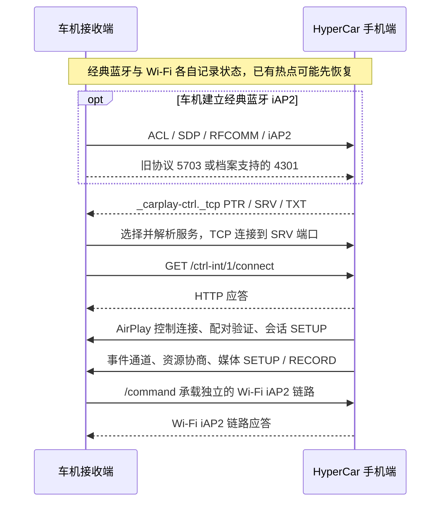

# CarPlay 接收端参考资料与 HyperCar 流程对照

核对日期为 2026-11-22。HyperCar 基线是 `5000b62` 加当时工作区中的 605（10701）改动，包括型号 TXT、手动 mDNS 重发和旧设备点击诊断。本文描述参考实现、当前代码与已有实车证据，供后续日志逐阶段定位。

## 资料与角色

| 本地资料 | 本次核对的范围 |
| --- | --- |
| CarPlay Communication Plug-in R14G17，2017-06-19 | 接收端的 Bonjour 浏览、设备归并、连接邀请、AirPlay 接收、iAP2 隧道与流生命周期。优先引用源代码，集成指南解释车机应用应调用的入口。 |
| R14G Update 1、R12N Update 2 | 两个版本分支都加入接收端的 Wi‑Fi 站点离开通知。代码对照以 R14G 补丁为准。 |
| iAP2 Sample Source R1 | 外设侧 Detect、链路同步、窗口、ACK/EAK、重传与文件传输参考。HyperCar 的手机角色和它的外设角色处在链路两端。 |
| MFIAuthentication 工程、认证流程课件和 USB ATS 接线图 | 外设端的链路与认证教学材料。样例工作流依次进入 Detect、链路协商、认证与识别，I/O 中包含合成的 Detect 应答。该顺序和报文方向只在对应样例的角色与传输上解读。 |

主要资料位于 `D:/devtools/Carplay`。文末列出版本和定位方法。宝马 MGU 的行为以 [iPhone HCI 采集说明](IPHONE-HCI-CAPTURE.md) 和 [盒子实车证据](BMW-BOX-CARPLAY-FLOW.md) 对应的原始样本为准；参考接收端的分支不能替代 BMW 的实际抓包。

## 从设备发现到会话启动

图中的邀请路径对应 MGU 成功样本。HyperCar 同时支持由本轮 `0x4301` 直接给出端点，以及档案允许时按车机网络和端点证据发起 AirPlay。媒体 SETUP 与 RECORD 的先后由档案决定。参见 [会话控制](SESSION-CONTROL.md)、[车型档案](HEADUNIT-PROFILES.md) 和 [HyperCar 会话入口](../app/src/main/java/io/github/hypercar/session/HyperCarRepo.kt#L656)。

经典蓝牙 ACL 到达时，系统可能尚未提供车机名称。已选车机 MAC、已有 CarPlay 记录以及已配对设备的 iAP2 服务声明都能独立识别车机。Wi-Fi 已关联时，App 给 Android 最多 12 秒发布唯一网络句柄和可用地址。该期间若凭据更新就放弃旧等待，若关联消失则恢复常规入网；关联仍在但未就绪时保留关联，避免重复弹出入网确认。此行为覆盖首次发现已关联热点和扫描后再次核验两个入口。

在允许主动 RFCOMM 的档案中，App 接受 Android SDP 回调里的 iAP2 UUID，系统 UUID 缓存稍后更新也能继续连接。未找到服务的结果缓冲 10 秒，之后允许重新查询。热点复用只把系统返回的 `<unknown ssid>` 当作隐藏占位值，按原样比较实际 SSID。盒子以已有蓝牙 Link Key 完成二次进车，随后通过 `0x5703` 取得热点凭据，并在入网后收到新邀请。MGU 来向及无线 iAP2 交接仍按车型现有流程运行。

旧 Wi-Fi 已断开时，恢复流程按 SSID、密码和实际使用的安全类型区分旧请求与新 iAP2 凭据。例如车机从 WPA2 改为 SAE，SSID 和密码相同也能采用新的认证方式入网；重发的旧 WPA2 或等价的过渡模式记录不能抢回请求。安全类型变化由现场凭据提供，本地测试覆盖该分支，现有盒子抓包未观察到这种切换。

盒子二次上车先拿到接口地址，再发布控制服务。Android 本地热点请求返回已关联网络后，App 在原入网总时限内继续等地址，最多 12 秒；系统没有确认关联时，原有已核实网络的补查窗口为 3 秒。已知热点唤醒、服务发布和进程绑网都会核验可用地址。IPv6 链路本地地址可用于车机局域网，IPv4 的 169.254/16 自分配地址不作为该流程的入网完成依据。

iAP2 Sample Source R1 的 ACK 处理会拒绝越过半序号空间的旧累计确认。盒子的 Wi-Fi 成功样本也显示车机逐步确认已写出的业务帧。HyperCar 对已建立且启用发送窗口的蓝牙和 Wi-Fi 链路分别验证累计 ACK，只推进到实际已发送的序号，重传队列只移除本次被确认的帧。处理涵盖 255→0 回绕、双通道迟到确认及窄窗口。盒子对照见 [累计 ACK 样本](BMW-BOX-CARPLAY-FLOW.md#L216)。

| 阶段 | R14G17 接收端参考 | HyperCar 当前路径 |
| --- | --- | --- |
| 经典蓝牙入口 | 集成指南将车机产品层的蓝牙与热点准备交给平台集成；独立 iAP2 样例实现的是已接通传输上的链路状态机。 | `bmw_id85` 默认等待车机连入，保留系统 HFP/A2DP，注册 `…cafe` RFCOMM 服务。HCI 的 Connection Request、SDP 查询、RFCOMM accept 和 iAP2 Detect 都各自可作为阶段证据。 [车型配置](../app/src/main/java/io/github/hypercar/headunit/HeadUnitProfile.kt#L119) · [RFCOMM 注册](../app/src/main/java/io/github/hypercar/iap2/Iap2Bluetooth.kt#L292) |
| iAP2 识别与 Wi‑Fi 凭据 | 样例核对的是 `FF 55` 探测与 `FF 5A` 链路分帧、同步和重传；手机识别与凭据消息的具体时序需要成功报文。 | `Iap2LinkEngine` 处理 Detect、SYN/ACK 及重传。MGU 按识别清单和档案选择问候、凭据请求及 EA 行为；只声明普通 BMW Apps 的已配对来向可以继续等更新识别、凭据或新来向。旧式 `0x5703` 主要提供热点参数，`0x4301` 可携带会话端点。 [链路引擎](../app/src/main/java/io/github/hypercar/iap2/Iap2LinkEngine.kt#L234) · [MGU 来向处理](../app/src/main/java/io/github/hypercar/iap2/Iap2SenderSession.kt#L267) |
| Bonjour 与设备归并 | `CarPlayControlClient` 浏览 `_carplay-ctrl._tcp`，使用标准 `id` TXT。浏览器把 `id` 规范化成 MAC，客户端按设备 ID 合并发现事件，另按接口维护活动服务和缓存的无线服务。 | 在本轮车机 Network 上运行 TCP listener，NSD 注册 `id` 和 `srcvers=770.8.1`。`id` 来自手机身份。控制服务的发布和查询应答由 Android NSD 负责。 [监听与 NSD](../app/src/main/java/io/github/hypercar/net/CarPlayCtrlAdvertiser.kt#L322) |
| 端点选择与邀请 | 优先选活动服务，活动服务中有线优先；找不到活动服务时尝试缓存的无线服务。发送邀请时用该服务解析到的主机、端口和接口，并携带车机自己的 `AirPlay-Receiver-Device-ID`。 | 校验当前监听代次及邀请来源，接受 `GET /ctrl-int/1/connect`，发送 HTTP 应答后发布本轮邀请。MGU 可用邀请来源作为 AirPlay 地址，典型端口 7000；手机发布的 ctrl 端口和车机的 AirPlay 端口用途不同。 [HTTP 邀请处理](../app/src/main/java/io/github/hypercar/net/CarPlayCtrlAdvertiser.kt#L484) · [MGU 端点选择](../app/src/main/java/io/github/hypercar/session/HyperCarRepo.kt#L3273) |
| AirPlay 配对与会话 | 服务端分别处理 `/pair-setup`、`/pair-verify`、`/auth-setup`、`/info`、SETUP 和 RECORD。plist SETUP 分别读 `deviceID`、`macAddress` 和会话标识；配对成功的安全上下文传给会话。 | Rust 在已有接收端配对记录时先尝试 `pair-verify`，失败时按接收端能力走后备路径。会话 SETUP 和会话内 `/info` 获取资源与显示能力。ID8.5 在取得可信站点 MAC 时用它填 `macAddress`，`deviceID` 保持手机身份。iAP2 的 MFi 交换、AirPlay 配对和 `/auth-setup` 各有独立的入口和结果。 [AirPlay 启动](../rust-core/src/airplay.rs#L168) · [会话身份字段](../rust-core/src/airplay.rs#L2577) |
| 媒体、资源与 Wi‑Fi iAP2 | 接收端分别初始化音频和屏幕流；RECORD 启动接收会话。指南要求无线会话启动后在 CarPlay 通道上建立完整的 iAP2 链路，并让接收端保留 Bluetooth iAP2，直到收到 `disableBluetooth`。 | Rust 管理事件通道、保活、`changeModes`/`modesChanged` 与媒体；Kotlin 的 `WifiIap2Bridge` 和 `WifiIap2Protocol` 为本轮 Wi‑Fi 独立同步、识别与认证。MGU 的 `disableBluetooth` 在初始屏幕决定之后发出，ID9、NBT 和 MBUX 使用各自的启动顺序。 [媒体与交接](../rust-core/src/airplay.rs#L529) · [Wi‑Fi iAP2](../app/src/main/java/io/github/hypercar/iap2/WifiIap2Protocol.kt#L121) |
| 收屏、断开与重入 | 有流列表时，旧插件按流释放；没有流或流数为零时结束整个会话。R14G Update 1 添加 AP 站点离开入口，匹配活动服务地址后调用接收端断连流程。 | 优雅关闭有界地发流级 TEARDOWN，再发空请求体的整会话 TEARDOWN。来向分类把带 plist 的空 `streams` 与空请求体分开，只用匹配本轮会话的空请求体触发这一结束判定。Android Network 失效另按本机代次清理。 [主动关闭](../rust-core/src/airplay.rs#L796) · [来向 TEARDOWN 分类](../rust-core/src/rtsp.rs#L245) |

## 与旧设备点击失败直接相关的发现

1. **设备身份和服务端点有各自的状态。** 参考客户端按 TXT `id` 归并设备；服务离开活动列表后，Wi‑Fi 服务仍可能留在缓存。服务从缓存恢复为活动时会重新解析主机和端口。对活动服务发邀请失败，也会触发重新解析及 Bonjour 确认；非活动服务失败时则清理失效条目。由此可以分别检验「旧条目匹配失败」和「匹配成功但用了旧端点」。参考代码见 `CarPlayControlClient.c` 576、609、643、738、1265、1433、1515 行。
2. **iPhone 6s 样本把型号 TXT 与控制服务放在同一个应答包。** 2026-11-11 首连与二次连接的原始 IPv4/IPv6 抓包中，带 `model=N71AP` 的应答都同时携带 `_carplay-ctrl._tcp` 的 PTR、SRV 和 TXT。型号是另一个 DNS 名称下的记录。R14G17 集成指南和 Bonjour 说明未要求此记录，参考控制客户端用 `id` 归并设备，盒子的控制服务注册只写 `id` 和 `srcvers`。HyperCar 按盒子注册控制服务，撤除主动发送型号 TXT 的实验。 [盒子 mDNS 对照](BMW-BOX-CARPLAY-FLOW.md#L385)
3. **旧端点假设可以用目的地址和端口证实。** HyperCar 在同一个 advertiser 内尽量复用 listener 端口，网络更换时尝试复用；停止后该对象的前一端口清零。稳定的 TXT `id` 并不保证跨进程继续使用相同的 SRV 主机名或端口。由车机发出的 `known-answer` 先看记录类型：仅有 PTR 表示车机知道服务实例名，带 SRV 才能看到它声明缓存的主机与端口，实际选用端点还要对照 TCP SYN。 [端口复用路径](../app/src/main/java/io/github/hypercar/net/CarPlayCtrlAdvertiser.kt#L140) · [结束清理](../app/src/main/java/io/github/hypercar/net/CarPlayCtrlAdvertiser.kt#L585)
4. **成功路径证明了阶段顺序。** 11 月 11 日的 iPhone 二次连接先见经典 ACL，再开始发布 ctrl，之后才收到车机的 HTTP 邀请。11 月 22 日 18:04 的 HyperCar 旧样本中，车机的 mDNS 查询已带手机实例 PTR。按用户描述，第一次经典连接和邀请对应「连接新设备」选择手机的阶段；日志没有该车机操作的独立时间戳。这次复用了 Bluetooth Link Key 和 AirPlay 配对。该轮手动重发后来核对为实际跳过，不能用于判断 605 加型号后的结果。相关实车样本位置见下文。

## 下一轮日志的判读顺序

HyperCar 的主动 AirPlay 发现保留 DNS-SD 实例名的原始标签边界。车机名中的句点、反斜线和 UTF-8 字符会作为实例标签的一部分参与 SRV/TXT 查询，DNS 匹配只折叠 ASCII 大小写。盒子与 R14G17 都通过 Bonjour 浏览和解析接口维持实例名与服务类型的边界。此修正覆盖 PTR、SRV 和地址分批到达的车机，不改变手机对车机发布的 ctrl 服务。见 [RFC 6763 §4.3](https://www.rfc-editor.org/rfc/rfc6763.html#section-4.3)。

主动发现收到某个实例的 PTR 下线通告后，暂时停止选择该端点，并保留最多一秒供同名正向通告恢复。若 PTR 到期，随旧通告缓存的 SRV/TXT 会退出该实例的解析，重新发布时重新查证端口。其他实例、共享地址、已分批到达的新记录和仅返回 SRV/地址的接收端沿用既有行为。缓存宽限期见 [RFC 6762 §10.1](https://www.rfc-editor.org/rfc/rfc6762.html#section-10.1)。

手机侧重发只使用当前车机网络上观察到的完整 NSD 通告。按地址族、实例、端口和 TXT 保存最近通告，同一手机的其他 CarPlay 发布不会直接覆盖本轮记录。包内最短 TTL 到期或本机网络地址变化后，旧通告退出重发缓存；发送前再次校验通告和当前注册，并与最近一次同地址族的控制服务通告间隔至少一秒。接收端仍从本轮 Bonjour 记录解析主机和端口。参考 [RFC 6762 §10](https://www.rfc-editor.org/rfc/rfc6762.html#section-10)。

以 `CTRL-CLICK` 的 `epochMs` 对齐手机 HCI。人工打点是即将操作的时间，应保留点按与报错的实际时刻。随后按下表找最早缺失或失败的阶段，保持重发前后分段。完整采集步骤见 [日志采集](CAPTURE.md)。

| 现场证据 | 可以定位到的阶段 |
| --- | --- |
| 已开蓝牙窗口，但 HCI 无目标车机的经典 Connection Request | 这段手机 HCI 未见车机发起经典连接；若 Wi‑Fi 抓包同时有 SYN，应转看 Wi‑Fi 路径。 |
| 车机只有 PTR 查询或 PTR known-answer | 已见发现活动或实例缓存，继续查车机是否查询或缓存 SRV，以及目的地址和端口。 |
| 明确由车机发出的 SYN 指向上一轮确认的手机地址或端口 | 有旧端点选用的直接证据。记录当前公告 SRV 和前一轮 SRV，再比较手动重发后目标是否改变。 |
| SYN 指向当前端口但无 `tcp-accepted` | 已越过端点选择，应检查 SYN/ACK、重传或 RST。应用 accept 日志本身只覆盖握手完成的连接。 |
| 有 `tcp-accepted` 但无 `ctrl-invitation` | 查看 `CTRL-TCP` 的请求头、HTTP 响应、收到邀请时的 Network 和代次。 |
| 有邀请但仍未投屏 | 继续按 `pair-verify`、会话 SETUP、事件通道、资源归属、屏幕 SETUP、RECORD 和 Wi‑Fi iAP2 定位。RTSP 200、iAP2 链路 ACK 和车机显示是不同证据。 |

如果出现空 `streams` TEARDOWN，记录原始请求体、URI、Session 和前后屏幕资源状态；2017 插件与 HyperCar 的分支差异值得结合车机行为核对。当前旧设备点击失败样本还没有证据走到这个阶段。

## 资料定位

- R14G17 位于 `D:/devtools/Carplay/zq6b24bphlAaIw6evlEx-master-cfc63f32276e19514b19f71ab2642e7c43c5aa73/AppleCarPlay_CommunicationPlugin_R14G17_20170619`。外层集成指南 303–358 行覆盖控制客户端和无线 iAP2，Bonjour 指南的 DirectLink 优化主要描述 USB NCM 接口探测。
- 同包内层 `AppleCarPlay_CommunicationPlugin_R14G17/AccessorySDK/Support/BonjourBrowser.c` 1803 行解析标准 TXT `id`。内层 `Sources/CarPlayControlClient.c` 的 SHA-256 为 `07baf2c9cf9483b35426fe639bf45d675663fe43e882f1e356cc6a53c990ce32`。内层 `Sources/AirPlayReceiverServer.c` 2378、3186 行分别是请求分发与 plist SETUP；`Sources/AirPlayReceiverSession.c` 878、1012、1097、5332 行分别是流配置、关闭、启动与 iAP 消息发送。
- 同级 `R14G_Update_1/R14G_Update_1.patch` 258–299 行含 `CarPlayControlClientSTALeft` 的接收端行为。`iAP2 Sample Source R1/iAP2Link/iAP2LinkAccessory.c` 119 行起为外设 Detect 状态；`iOS MFI认证代码及文档/MFIAuthentication/MFIAuthentication/IO/IOImplementation.c` 12 行起包含样例应答。
- 本地实车摘录位于 `D:/devtools/hypercar-diagnostics/20261111-iphone/analysis.md` 73–88、124–130 行，以及 `D:/devtools/hypercar-diagnostics/20261122-evening-entry/analysis-summary.txt` 12–20 行。公开流程对照保留阶段和证据范围，原始设备标识与凭据留在采集目录。
